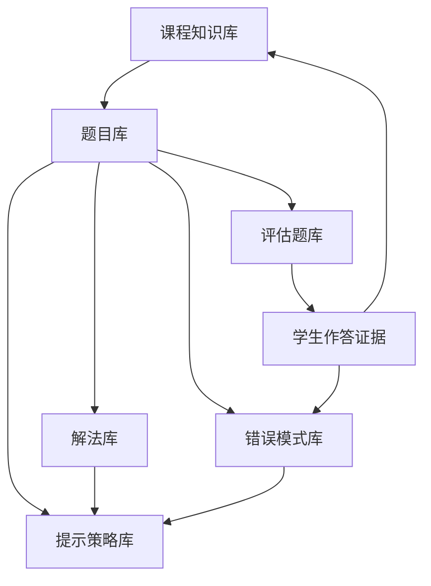

# 数知伙伴需求分析

**状态：** 初稿  
**日期：** 2026-10-02  
**范围：** 数学辅导、教学题库、RAG 与学习评估

## 1. 产品目标

数知伙伴面向需要数学解题帮助的中学生。产品不以快速展示答案为主要目标，而是通过题意确认、卡点诊断、逐级提示、变式练习和学习记录，帮助学生逐步获得独立解决同类问题的能力。

核心教学闭环为：

```text
理解题目 → 分析学生作答 → 识别卡点 → 选择教学动作
    → 给出最小有效提示 → 验证理解 → 更新学习证据
```

系统的核心效果不能只用“回答是否正确”衡量，还要考察：

- 能否识别学生真正的卡点；
- 能否在不过早泄露答案的情况下给出合适提示；
- 学生接受提示后能否完成当前步骤；
- 学生能否独立解决同构题、变式题和迁移题；
- 系统给出的题意、推导、答案和教学依据是否可靠、可追溯。

## 2. 题库存在的意义

本项目中的题库不是只保存题干、答案和解析的内容仓库，而是连接课程知识、题目结构、解题路径、错误模式、提示策略和学习证据的**教学决策系统**。

题库的核心目标是：

> 让系统能够判断学生卡在哪里，选择下一步最合适的教学动作，并验证学生最终是否能够独立解决同类问题。

题库需要支持以下四类业务能力。

### 2.1 诊断学生的具体问题

面对错误答案，系统需要区分不同原因，例如：

- 没有正确理解题意；
- 遗漏显式或隐含条件；
- 不知道应该使用哪个知识点；
- 知道公式，但无法建立变量或图形之间的关系；
- 推导、分类讨论或计算过程中出错；
- 解题方法正确，但出现偶发的书写或计算失误。

题库应为 Agent 提供“题目考查什么、可能卡在哪里、如何识别卡点、对应采用什么教学动作”的结构化依据，避免只根据最终答案进行简单判错。

### 2.2 为模型提供可靠的知识边界

大模型负责理解自然语言、组织对话和适应学生表达；题库负责提供经过审核的事实与教学边界，包括：

- 标准化题意、条件与目标；
- 可用定义、定理、公式及其适用条件；
- 已验证的答案和解题步骤；
- 多种可接受解法及方法差异；
- 典型错误解法和风险点；
- 数学工具的验证范围与尚未验证的内容；
- 教材、题目和题解的来源与版本。

### 2.3 为个性化学习提供统一坐标

系统不生成“数学能力差”“不认真”等固定标签，而应记录可追溯的本轮学习证据，例如：

```text
在一次函数建模题中：
- 能够提取已知量；
- 尚不能独立识别变量关系；
- 在获得“设自变量”的方向提示后建立了方程；
- 独立完成后续计算；
- 尚未通过迁移题验证。
```

题库中的知识点、能力点、解法步骤和错误类型，为这些证据提供统一、可查询的坐标。

### 2.4 支持掌握度验证与后续推荐

完成当前题不等于已经掌握。题库需要帮助系统判断：

- 学生能否再次使用相同方法；
- 条件或题目表述变化后是否仍能完成；
- 是否理解概念边界和反例；
- 是否可以迁移到新的问题情境；
- 应该继续练习、进入后续知识点，还是安排延迟复习。

## 3. 题库的业务边界

### 3.1 题库包含的内容

第一版题库由六类相互连接的数据组成：

1. 课程知识；
2. 题目；
3. 解法与解法步骤；
4. 错误模式；
5. 提示策略；
6. 评估题。

学生作答和学习证据与题库对象建立关联，但属于用户数据，必须与公共教学内容保持权限和存储边界。



### 3.2 题库不承担的职责

- 不直接保存用户认证、家长关系和账户信息；
- 不把未审核的模型生成内容当作标准答案；
- 不用单一难度分数代替具体难点分析；
- 不把向量数据库作为权威业务数据源；
- 不把正式评估集的答案暴露给普通教学检索；
- 不根据少量作答生成稳定的人格、能力或学习习惯标签。

## 4. 六类核心题库

### 4.1 课程知识库

课程知识库回答“学生需要掌握什么”，至少包含：

- 学科、学段、年级和教材版本；
- 章节、知识点和能力要求；
- 定义、定理、公式和适用条件；
- 前置知识和后续知识；
- 知识点之间的依赖关系；
- 常见概念边界、反例和易混淆知识。

示例：

```text
知识点：一元二次方程求根公式
前置知识：一元二次方程定义、配方法、平方根
后续知识：二次函数零点、根与系数关系
```

### 4.2 题目库

题目库回答“用什么情境检查这些知识和能力”。每道题至少需要表达：

- 原始题干与规范化题干；
- 显式条件、隐含条件和求解目标；
- 题型、答案类型和适用学段；
- 主要知识点、前置知识和能力点；
- 难度等级及难度来源；
- 图形、公式和附加材料；
- 母题、同构题、变式题和迁移题关系；
- 来源、许可证、版本和审核状态。

“难度来源”需要单独记录。难点可能来自条件隐藏、知识组合、辅助构造、分类讨论、计算复杂度、证明链长度或反向思考。Agent 应根据难度来源选择教学动作，而不是只读取一个总分。

### 4.3 解法库

解法库回答“这道题有哪些合理的思考路径”。一道题可以拥有多个解法，每个解法应拆成可以引用和验证的步骤：

```text
解法
├── 方法名称与适用条件
├── 关键突破口
├── 步骤 1：目标或条件转换
├── 步骤 2：建立关键关系
├── 步骤 3：应用定义、定理或公式
├── 步骤 4：推导或计算
├── 步骤 5：检查边界条件
└── 结论
```

每个步骤需要关联：

- 使用的条件和知识点；
- 该步骤成立的理由；
- 预期中间结果；
- 是否可以程序化验证；
- 对应的常见错误；
- 可以使用的提示层级。

不同解法可以面向不同学生和教学目标，例如常规解法、直观解法、竞赛解法、几何解法或代数解法。系统不为追求数量而强行生成多解法。

### 4.4 错误模式库

错误模式库回答“学生为什么会卡住”。错误模式应能够跨题目复用，并包含：

- 错误名称和适用知识点；
- 可观察的作答证据；
- 可能原因；
- 需要排除的其他原因；
- 推荐的澄清问题；
- 推荐教学动作；
- 可用于验证理解的后续问题。

示例：

```text
错误模式：忽略二次根式的非负性
识别证据：对算术平方根取负值，或平方后未检查增根
推荐动作：先询问根式取值范围，再要求代回原式检查
```

真实学生作答可以帮助发现新的候选错误模式，但进入公共题库前必须去除个人信息并经过教研审核。

### 4.5 提示策略库
 
提示策略库回答“下一句话应该怎么说”。提示与解法步骤、错误模式和当前学习证据关联，采用四级递进：

1. **方向提示**：指出观察对象或思考方向；
2. **关键关系**：给出一个定义、定理、性质或通用公式；
3. **局部步骤**：展示当前所需的一次操作和中间结果；
4. **完整讲解**：基于已校验解法解释完整过程。

每条提示还应记录：

- 适用解法和步骤；
- 对应错误模式；
- 使用前置条件；
- 答案泄露程度；
- 预期学生回应；
- 提示后的理解检查问题。

提示不是固定播放列表。教学 Agent 应根据学生本轮证据选择最小有效提示，并在收到新作答后重新诊断。

### 4.6 评估题库

评估题库回答“学生是否真正掌握”。至少区分：

| 类型 | 教学目的 |
| --- | --- |
| 同构题 | 检查能否重复使用相同方法 |
| 变式题 | 检查条件变化后的理解 |
| 反例题 | 检查概念边界 |
| 迁移题 | 检查能否用于新情境 |
| 综合题 | 检查多个知识点的组合 |
| 延迟复习题 | 检查是否形成长期掌握 |

正式评估集必须与生产 RAG 隔离。普通教学 Agent 不得检索其完整题解，防止评估泄漏。

## 5. 核心对象关系

```text
知识点
  ↓
题目 ←→ 同构题 / 变式题 / 迁移题
  ↓
解法 → 解法步骤
  ↓        ↓
错误模式 → 提示策略
  ↓
学生作答证据
  ↓
下一教学动作
```

题目是这些对象的连接载体，但知识点、错误模式和提示策略都不应只能依附于单道题。系统需要同时支持题目级配置和跨题复用。

## 6. Agent 对题库的需求

| Agent | 读取的题库内容 | 主要输出 |
| --- | --- | --- |
| `ProblemUnderstandingAgent` | 条件结构、目标、题型、知识点、相似表达 | 规范题意和歧义说明 |
| `SolutionAnalysisAgent` | 多种解法、步骤、关键突破口、易错点 | 候选解法和推荐路线 |
| `SolutionVerificationAgent` | 答案、约束、步骤依据、验证规则 | 校验结果、覆盖范围和置信度 |
| 学情诊断 Agent | 错误模式、学生作答、解法步骤 | 有证据支持的卡点假设 |
| 提示教学 Agent | 提示策略、允许暴露的步骤、提示历史 | 下一条最小有效提示 |
| 学习记录 Agent | 知识点、能力点、错误模式、作答结果 | 本轮学习证据 |
| 推荐 Agent | 题目关系、掌握证据、复习要求 | 下一道题或复习任务 |

若一个题库字段不能帮助任何 Agent 做出教学决策、进行数学验证或满足来源审计，第一阶段不应优先建设。

## 7. 教学使用流程

一次典型的使用过程如下：

1. 学生提交题目，系统读取题目条件、目标、知识点和候选解法；
2. 学生提交尝试，系统将作答证据与解法步骤和错误模式比较；
3. 学情诊断 Agent 生成带证据的卡点假设；
4. 提示教学 Agent 选择当前允许的最小提示；
5. 学生继续作答，系统重新诊断，而不是机械升级提示；
6. 当前题完成后，系统使用同构题或变式题检查理解；
7. 通过后形成具体学习证据，并决定是否进入迁移、后续知识或延迟复习。

示例学习记录：

```text
学生最初混淆相似与全等判定；
在一级提示后能够修正定理选择；
随后独立完成一道同构题；
尚未验证其在不同图形位置下的迁移能力。
```

## 8. 题库、MySQL 与 RAG 的关系

三者职责不同：

- **MySQL** 保存题目、解法、步骤、关系、版本、审核状态和来源等权威数据；
- **RAG 索引** 保存可检索的知识切片和业务对象索引副本；
- **Agent** 根据当前教学阶段、权限和提示等级发起有约束的检索并做出教学决策。

完整 PDF 或整篇题解不能直接无差别进入提示上下文。不同教学阶段应限制可检索内容：

- 题目理解阶段可以读取定义、符号和题型结构；
- 解法分析阶段可以读取经审核的定理、例题和题解；
- 一级至三级提示只读取当前允许暴露的方向、关系或局部步骤；
- 完整讲解只使用已经通过相应校验标准的解法；
- 正式评估内容和答案不进入普通生产检索。

## 9. 内容准入与生成规则

### 9.1 内容来源

题库可以接收以下来源，但都必须记录来源、许可、版本和审核状态：

- 自研教研内容；
- 明确授权的出版社、学校或教师内容；
- 许可证允许使用和改编的开放教育资源；
- 经过权属确认和审核的教师投稿；
- 基于已审核母题生成并重新验证的变式题。

来源不明、权利边界不清、无法定位原文或未经审核的抓取内容不能进入生产题库。

### 9.2 AI 生成内容

比较可靠的企业内容准入流程通常是：

1. 从人工审核过的母题生成变式；
2. 检查条件是否完整、是否存在唯一答案；
3. 使用 SymPy、数值代入或规则程序验证答案；
4. 检测是否与已有题目过度重复；
5. 由教研人员抽检或审核；
6. 审核通过后进入正式题库；
7. 未审核内容只标记为候选内容，不能作为标准答案依据。

AI 生成的题目、题解和提示默认都是候选内容。无论生成文本看起来多完整，都不能在一次模型调用后直接写入正式题库。

### 9.3 独立开发阶段的 AI 自动准入方案

当前项目由独立开发者建设，第一阶段没有专职教研团队。系统使用职责分离的 AI Agent 和确定性数学工具完成日常生成、审核与准入，并保留以后接入人工抽检的接口。

```text
可信母题
  → 变式生成 Agent
  → 题意与条件检查 Agent
  → 独立解题 Agent
  → 数学工具验证
  → 重复与泄漏检测
  → AI 复核 Agent
  → 自动准入门
      ├── 通过：正式题库
      ├── 可修订：候选区重新生成
      └── 不可验证：隔离区
```

各环节使用结构化输入输出，并承担单一职责：

| 环节 | 主要职责 | 不允许做的事 |
| --- | --- | --- |
| 变式生成 Agent | 根据可信母题改变参数、条件、问法或情境 | 自己宣布题目正确 |
| 条件检查 Agent | 检查条件完整性、歧义、定义域、答案数量和学段适配 | 复用生成 Agent 的结论 |
| 独立解题 Agent | 在不读取生成答案的情况下重新解题 | 直接复制候选题解 |
| 数学验证工具 | 使用 SymPy、数值代入、穷举或规则验证答案与约束 | 对未覆盖的证明给出“已验证”结论 |
| 重复检测器 | 检查文本、公式结构、条件结构和解法结构相似度 | 只依赖向量距离作最终判断 |
| AI 复核 Agent | 比较候选答案、独立答案、工具证据和教学标签 | 绕过确定性校验失败 |
| 准入门 | 根据可配置规则决定正式、修订或隔离 | 因模型高置信度降低准入标准 |

为降低同一个模型自我确认错误的风险，生成与复核必须使用不同提示词和隔离上下文；条件允许时使用不同模型。复核 Agent 只能读取候选结果和外部验证证据，不能读取生成 Agent 的隐藏推理过程。

#### 9.3.1 内容状态

AI 内容至少经过以下状态：

```text
candidate
  → validating
  → revision_required / quarantined / approved
  → indexed
  → retired
```

- `candidate`：刚生成，仅可用于内部验证；
- `validating`：正在执行独立解题、数学验证和去重；
- `revision_required`：存在可以明确修复的问题，允许有限次数重新生成；
- `quarantined`：存在冲突、验证覆盖不足或无法确定的问题，不进入生产检索；
- `approved`：满足当前题型的自动准入规则，可进入正式题库；
- `indexed`：已同步到检索索引；
- `retired`：发现错误、来源变化或规则升级后退出生产。

#### 9.3.2 自动准入规则

一道 AI 题目只有同时满足以下条件才能自动进入正式题库：

1. 母题已在可信来源中登记，且允许改编或属于项目自有内容；
2. 题干、条件、目标、答案类型和知识点均通过 Schema 校验；
3. 条件检查没有阻断歧义，并确认解的数量符合题目要求；
4. 独立解题结果与候选答案一致；
5. 当前题型的确定性验证器完整覆盖最终答案和关键约束；
6. 不存在未解决的校验冲突；
7. 与训练母题、现有题库和隔离评估集均未过度重复；
8. 难度、知识点、适用学段和提示内容通过独立复核；
9. 生成模型、提示版本、验证器版本、证据和时间均已留档。

代数方程、数值计算、有限集合枚举等可被程序完整验证的题型，可以在满足上述条件后自动准入。几何证明、开放证明和依赖复杂语言理解的题目，如果只有模型互审而没有完整的确定性验证，其验证状态最高为 `partial`，内容状态必须保持 `quarantined`，不能作为权威标准答案。以后具备人工审核条件后，再把这类内容提升为正式题目。

#### 9.3.3 修订和回滚

- 一个候选题最多自动修订两次；
- 每次修订必须针对明确的失败证据，不能只要求模型“再检查一次”；
- 确定性验证失败时不能由 AI 复核意见覆盖；
- 达到最大重试次数后进入隔离区；
- 已准入题目在后续教学中出现答案冲突或高频投诉时，立即停止检索并重新验证；
- 验证规则或工具版本升级时，可以批量重新验证相关题目。

这套机制把“没有教研团队”转化为可管理的产品边界：第一版优先生产能够被程序完整验证的题型，把无法可靠自动验证的内容留在候选区，而不是让 AI 同时担任出题者和最终裁判。

## 10. 第一阶段范围

第一阶段不追求题目总量，先选择一个边界清楚的专题建立完整教学闭环。建议从“初中一元二次方程”开始，目标规模为：

- 20～30 个知识点和能力点；
- 约 100 道来源清楚、答案可程序验证的可信母题；
- 每题 1～2 种结构化解法；
- 解法拆分为可引用、可验证的步骤；
- 20～40 种跨题复用的典型错误模式；
- 关键步骤配置四级提示；
- 每道母题配置 2～3 道同构题或变式题；
- 建立独立且不可被生产 RAG 检索的评估题集；
- 所有公共内容记录来源、许可、版本和审核状态。

## 11. 第一阶段验收标准

第一阶段是否成功，不以题目数量为主要标准，而以以下能力验收：

1. **题意结构化**：系统能够稳定提取题目条件、目标、题型和歧义；
2. **卡点诊断**：诊断结论能够引用学生本轮原文证据，并区分主要错误原因；
3. **提示选择**：提示与当前卡点和解法步骤匹配，不在早期泄露完整答案；
4. **数学正确性**：标准答案和关键步骤达到既定程序化或人工验证标准；
5. **理解验证**：完成当前题后，系统能够使用同构题或变式题验证独立完成能力；
6. **学习证据**：系统记录具体行为和表现，不生成无依据的固定能力标签；
7. **来源追溯**：任何进入生产教学的公共内容都能定位来源、版本和审核记录；
8. **评估隔离**：正式评估题及答案不能被普通教学检索访问。

第一阶段需要重点回答三个产品问题：

- 系统能否识别学生真正的卡点？
- 系统能否选择合适的提示层级？
- 学生接受提示后，能否独立完成变式题？

只有完成这一闭环，扩大题目数量和接入更多来源才有明确价值。

## 12. 暂不纳入第一阶段

- 全学段、全教材和全题型覆盖；
- 未审核内容自动进入生产索引；
- 仅依赖向量相似度自动选择教学内容；
- 依据单次作答生成长期能力结论；
- 自动采购或抓取版权边界不明确的商业题库；
- 用生成题替代独立、固定的系统评估集。
