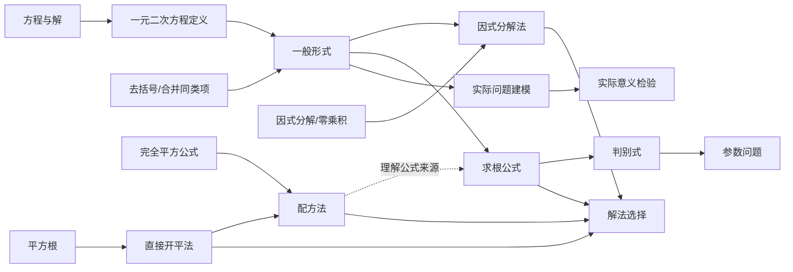

# 一元二次方程知识与能力目录

## 1. 目标与范围

第一版目录限定为初中数学“一元二次方程”，用于统一以下业务的稳定编码和依赖关系：

- 题目、题解和教材切片的知识点标注；
- 学生本轮作答证据的能力定位；
- 生成变式题时的范围和先修约束；
- 教学 Agent 的卡点诊断和提示选择；
- 相似题、迁移题和复习题推荐；
- RAG 的元数据过滤与重排。

目录源文件为：

```text
app/catalogs/data/middle_school_quadratic_equations.v1.json
```

目录使用语义版本 `1.0.0`，稳定编码以 `MS.QE` 开头。修改名称或说明可以升级补丁版本；改变关系或能力含义升级次版本；删除或重新定义已有编码升级主版本。

## 2. 目录组成

第一版包含：

- 24 个知识节点，包括单元根节点、9 个基础知识和 14 个单元知识；
- 20 个能力节点，包括能力根节点和 19 个可观察能力；
- 知识点之间的有向无环先修关系；
- 能力点之间的有向无环先修关系；
- 能力点与所需知识点之间的关联。

父子关系用于展示目录层级，先修关系用于决定学习顺序。二者不能互相替代。例如“求根公式”属于“一元二次方程”单元，但它的先修知识包括“一般形式”和“平方根”。

## 3. 知识点目录

### 3.1 基础知识

| 编码 | 名称 | 在本单元中的作用 |
| --- | --- | --- |
| `MS.ALG.EXPR.LIKE_TERMS` | 合并同类项 | 整理方程 |
| `MS.ALG.EXPR.DISTRIBUTIVE` | 分配律与去括号 | 展开题目中的括号 |
| `MS.ALG.POLY.MULTIPLICATION` | 多项式乘法 | 识别次数和展开乘积 |
| `MS.ALG.FACTOR.COMMON` | 提公因式法因式分解 | 因式分解求根 |
| `MS.ALG.FACTOR.IDENTITIES` | 公式法因式分解 | 因式分解与配方 |
| `MS.ALG.ZERO_PRODUCT` | 零乘积性质 | 从因式乘积得到各个根 |
| `MS.EQ.CONCEPT.SOLUTION` | 方程与方程的解 | 理解根和解集 |
| `MS.EQ.TRANSFORM.EQUIVALENT` | 方程同解变形 | 保证整理过程不改变解集 |
| `MS.NUM.REAL.SQUARE_ROOT` | 平方根与算术平方根 | 直接开平和公式法 |

### 3.2 单元知识

| 编码 | 名称 | 分类 |
| --- | --- | --- |
| `MS.QE.DEFINITION` | 一元二次方程的定义 | 核心 |
| `MS.QE.STANDARD_FORM` | 一元二次方程的一般形式 | 核心 |
| `MS.QE.ROOT` | 一元二次方程的根 | 核心 |
| `MS.QE.DIRECT_SQRT` | 直接开平方法 | 核心 |
| `MS.QE.FACTORING` | 因式分解法解方程 | 核心 |
| `MS.QE.COMPLETING_SQUARE` | 配方法解方程 | 核心 |
| `MS.QE.QUADRATIC_FORMULA` | 公式法解方程 | 核心 |
| `MS.QE.DISCRIMINANT` | 根的判别式 | 核心 |
| `MS.QE.ROOTS_COEFFICIENTS` | 根与系数的关系 | 核心 |
| `MS.QE.METHOD_SELECTION` | 解法选择原则 | 核心 |
| `MS.QE.PARAMETER` | 含参数一元二次方程 | 拓展 |
| `MS.QE.MODELING` | 一元二次方程建模 | 核心 |
| `MS.QE.CONTEXT_VALIDATION` | 实际问题解的检验与取舍 | 核心 |
| `MS.QE.REDUCIBLE` | 可化为一元二次方程的方程 | 拓展 |

## 4. 能力点目录

能力点表达学生可观察的行为，不能只根据一次正确或错误建立长期标签。

| 编码 | 能力 |
| --- | --- |
| `MS.QE.CAP.IDENTIFY` | 识别一元二次方程 |
| `MS.QE.CAP.NORMALIZE` | 整理为一般形式 |
| `MS.QE.CAP.EXTRACT_COEFFICIENTS` | 提取 `a`、`b`、`c` |
| `MS.QE.CAP.CHECK_QUADRATIC_CONDITION` | 检查二次项系数条件 |
| `MS.QE.CAP.SOLVE_DIRECT_SQRT` | 使用直接开平法求解 |
| `MS.QE.CAP.SOLVE_FACTORING` | 使用因式分解法求解 |
| `MS.QE.CAP.SOLVE_COMPLETING_SQUARE` | 使用配方法求解 |
| `MS.QE.CAP.SOLVE_FORMULA` | 使用求根公式求解 |
| `MS.QE.CAP.CALCULATE_DISCRIMINANT` | 计算判别式 |
| `MS.QE.CAP.DETERMINE_ROOT_COUNT` | 判断实数根个数 |
| `MS.QE.CAP.VERIFY_ROOTS` | 验证根与解集完整性 |
| `MS.QE.CAP.SELECT_METHOD` | 选择合适解法 |
| `MS.QE.CAP.EXPLAIN_STEPS` | 解释解题步骤依据 |
| `MS.QE.CAP.ANALYZE_PARAMETER` | 分析参数条件 |
| `MS.QE.CAP.MODEL_CONTEXT` | 建立实际问题方程 |
| `MS.QE.CAP.VALIDATE_CONTEXT` | 检验实际意义 |
| `MS.QE.CAP.CONSTRUCT_FROM_ROOTS` | 根据根构造方程 |
| `MS.QE.CAP.DIAGNOSE_ERRORS` | 识别并修正常见错误 |
| `MS.QE.CAP.TRANSFER` | 迁移到新结构 |

## 5. 主要先修路径



完整关系及每条关系的要求程度、掌握水平和理由以版本化 JSON 为准。

## 6. 数据结构

MySQL 使用以下结构：

- `knowledge_points`：知识点及展示层级；
- `knowledge_point_prerequisites`：知识点先修关系；
- `capability_points`：能力点及展示层级；
- `capability_point_prerequisites`：能力点先修关系；
- `capability_knowledge_requirements`：能力所依赖的知识点。

先修强度为 `required` 或 `recommended`。知识掌握要求为：

- `introduced`：接触过并能识别；
- `familiar`：能在提示下使用；
- `proficient`：能够独立、稳定使用。

能力与知识的关系角色为 `core`、`prerequisite` 或 `supporting`。

## 7. 导入方式

先执行数据库迁移：

```bash
alembic upgrade 20261002_0005
```

只校验目录文件，不连接数据库：

```bash
math-tutor-catalog --validate-only
```

幂等同步到 MySQL：

```bash
math-tutor-catalog
```

导入器按稳定编码更新名称、说明、分类、顺序和关系。再次导入同一版本不会重复创建节点；目录内当前节点的关系会以文件内容为准重新同步。

## 8. 使用约束

- 题目和题解保存稳定编码，不保存数据库自增 ID 的外部副本；
- Agent 的能力判断必须附带学生本轮作答证据；
- 先修关系用于诊断候选和推荐排序，不能单独证明学生未掌握某项能力；
- RAG 只能使用 `active=true` 的节点作为过滤标签；
- 更新关系前必须通过目录 Schema 的引用完整性和无环检查；
- 正式评估集与生产题库共用编码，但评估题正文和答案保持隔离。
