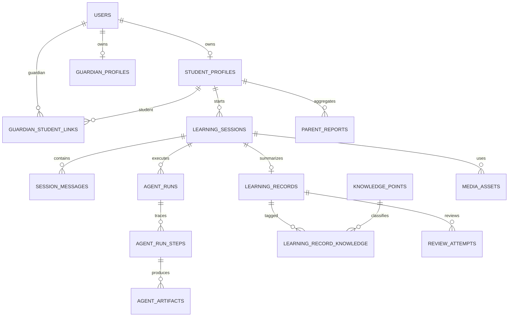

# 数学辅导 Agent 数据对象与 MySQL 模型设计

## 1. 文档范围

本文定义数学辅导产品的数据对象、对象之间的关系，以及在 MySQL 8.0 中的持久化模型。设计覆盖学生辅导会话、多 Agent Harness 运行记录、错题复习、知识点和家长报告。RAG 的来源引用、教材版本、知识文档、切片、题目和题解模型见 `docs/RAG_DATA_MODEL.md`。

当前代码已经实现 MySQL `SessionRepository`，并通过 Harness 的 `SessionRepository` 接口读写会话聚合。会话、消息、Agent run、step、artifact 与学习记录写入规范化表。Alembic 初始迁移位于 `migrations/versions/20260928_0001_initial_mysql_schema.py`，部署流程见 `docs/MIGRATIONS.md`。Redis 只保存带 TTL 的会话缓存、幂等结果和锁，不改变下述 MySQL 数据模型；详细边界见 `docs/REDIS_DESIGN.md`。

## 2. 数据分层

系统中的数据对象分为四层：

| 层次 | 作用 | 示例 |
| --- | --- | --- |
| API DTO | 接收客户端请求、返回稳定响应 | `CreateSessionRequest`、`TurnResponse` |
| 领域对象 | 表达教学业务和状态规则 | `TutoringSession`、`LearnerState`、`LearningRecord` |
| Harness 对象 | 表达一次 Agent 运行及其治理信息 | `HarnessRunResult`、`HarnessTraceStep` |
| 持久化实体 | 负责 MySQL 查询、约束和数据生命周期 | `learning_sessions`、`agent_runs`、`learning_records` |

API DTO 不等同于数据库实体。客户端不能直接提交 Agent 置信度、会话状态、错因和掌握状态等服务端字段。

## 3. 核心关系



## 4. API DTO

### 4.1 CreateSessionRequest

创建学习会话。

| 字段 | 类型 | 必填 | 说明 |
| --- | --- | --- | --- |
| `question` | string | 是 | 文字题目，1—5000 字符 |
| `subject` | enum | 否 | 首版固定为 `math` |
| `grade_band` | enum | 是 | `primary_lower`、`primary_upper`、`middle`、`high` |
| `input_type` | enum | 否 | `text`；后续扩展 `image`、`audio` |
| `media_asset_id` | UUID | 否 | 图片或音频输入对应的附件 |

学生身份从认证上下文读取，不允许客户端通过请求体指定其他学生。

### 4.2 TurnRequest

提交学生本轮表达。

| 字段 | 类型 | 必填 | 说明 |
| --- | --- | --- | --- |
| `message` | string | 是 | 学生的作答、问题或状态描述 |
| `intent` | enum | 否 | `answer`、`ask_hint`、`ask_solution`、`practice`、`complete` |
| `client_turn_id` | string | 是 | 客户端幂等键，避免重复提交 |

### 4.3 TutorResponse

| 字段 | 类型 | 说明 |
| --- | --- | --- |
| `session_id` | UUID | 学习会话标识 |
| `run_id` | UUID | 本轮 Harness 运行标识 |
| `status` | enum | 当前教学状态 |
| `reply` | `TutorReply` | 面向学生的内容 |
| `duration_ms` | integer | Harness 本轮总耗时 |
| `degraded` | boolean | 是否发生降级 |
| `degradation_reason` | string/null | 可解释的降级原因 |

客户端默认不接收完整 `SolutionPlan`、内部 artifact 或模型原始输出。管理员调试接口只能返回清洗后的 trace 元数据。

## 5. 领域对象

### 5.1 TutoringSession

辅导会话聚合根，控制教学状态转换。

| 字段 | 类型 | 说明 |
| --- | --- | --- |
| `id` | UUID | 会话标识 |
| `student_id` | UUID | 所属学生 |
| `subject` | enum | 学科 |
| `grade_band` | enum | 学段快照 |
| `question_text` | text | 本次题目原文 |
| `normalized_question` | text/null | 题目理解 Agent 确认后的题目 |
| `status` | enum | 教学状态 |
| `hint_level` | tinyint | 0—4 |
| `attempt_count` | integer | 学生有效尝试次数 |
| `started_at` | datetime | 开始时间 |
| `completed_at` | datetime/null | 完成时间 |
| `version` | integer | 乐观锁版本 |

状态枚举：`collecting`、`clarifying`、`diagnosing`、`hinting`、`checking_attempt`、`explaining`、`completed`、`abandoned`。

### 5.2 ProblemSpec

题目理解 Agent 的结构化产物，当前 schema version 为 `2.0`：

- `normalized_question`
- `subject`
- `grade_band`
- `question_type`：主题型代码
- `question_type_candidates[]`：候选题型、置信度和原文证据
- `known_conditions[]`：条件表达、条件类别、`explicit/inferred` 来源和置信度
- `target`：动作、目标对象、期望答案类型和来源；无法识别时为 `null`
- `ambiguities[]`：歧义类别、`blocking/warning` 级别、说明和澄清问题
- `needs_clarification`
- `clarification_questions[]`
- `confidence`

完整字段、题型代码和澄清流程见 `docs/PROBLEM_UNDERSTANDING.md`。

### 5.3 SolutionPlan

解题分析 Agent 的内部产物，当前 schema version 为 `2.1`：

- `methods[]`：每种方法包含策略、适用性、带依据的步骤、答案、优点、局限和置信度
- `recommended_method_id`
- `recommendation_reason`
- `answer_consistency`：`consistent`、`unconfirmed` 或 `conflict`
- `key_breakthroughs[]`：关键结构、作用、引导问题和关联方法
- `verification_targets[]`
- `assumptions[]`
- `knowledge_points[]`
- `common_misconceptions[]`
- `difficulty`
- `confidence`
- `revision_attempt`：初始方案为 0，自动修订后递增
- `revision_reason`：触发本次修订的校验问题摘要
- `steps[]`、`answer`、`alternative_methods[]`：从推荐方法生成的兼容字段

该对象默认不直接返回客户端。只有校验通过并符合教学策略时，`HintTeachingAgent` 才能引用其中内容。
完整合约和多解法判定规则见 `docs/SOLUTION_ANALYSIS.md`。

### 5.4 VerificationReport

- `passed`
- `coverage`：`full`、`partial`、`none`
- `checks[]`：检查类别、工具、状态、关联方法/步骤及证据
- `evidence`
- `issues[]`
- `limitations[]`
- `confidence`
- `verifier_type`：`cas`、`model`、`hybrid`、`unverified`
- `proof_review`：证明题的六维审查、硬性阻断项、未验证主张、原始置信度和单模型置信度上限；其他题型为 `null`
- `revision_context`：当前修订次数、最大次数、是否继续、是否耗尽及终止原因

`passed=false` 时不得把候选答案描述为可靠答案。
确定性工具失败时模型不得覆盖；完整流程和 SymPy 覆盖边界见 `docs/SOLUTION_VERIFICATION.md`。
不能程序化验证的证明题只能产生 `partial` 覆盖；暂时通过门槛、置信度封顶和拒绝规则见 `docs/PROOF_VERIFICATION.md`。

### 5.5 LearnerState

- `evidence_scope`：固定为 `current_turn`
- `observed_work`
- `attempt_kind`
- `has_meaningful_attempt`
- `evidence[]`：本轮原文、直接观察和支持类型
- `mastered_points[]`：描述及其 `evidence_ids`
- `misconception_hypotheses[]`：具体误区假设、证据 ID 和置信度
- `uncertainties[]`
- `possible_misconception`：兼容字段，没有证据时为“需要追问”
- `next_hint_level`
- `follow_up_question`
- `confidence`

它只表达本轮消息中的可观察状态，不是学生的固定能力标签。证据校验、标签过滤和有效尝试规则见 `docs/LEARNER_STATE.md`。

### 5.6 TutorReply

- `action`
- `text`
- `hint_level`
- `hint_stage`：`direction`、`key_relation`、`local_step` 或 `full_explanation`
- `can_show_full_solution`：服务端策略是否允许展示完整讲解
- `understanding_check`
- `solution_steps[]`
- `confidence`

`solution_steps` 只在已允许展示完整讲解且校验通过时返回。
提示等级、上下文裁剪和第四级门槛见 `docs/HINT_STRATEGY.md`。
题库中的题目、稳定解法步骤、可观察错误模式和提示蓝图使用独立的关系表持久化，见 `docs/TEACHING_CONTENT_LINKS.md`。这些内容为本轮诊断提供候选依据，不会直接写成学生的固定标签。

### 5.7 LearningRecord

- `question_snapshot`
- `learner_answer`
- `error_category`
- `error_reason`
- `correct_approach`
- `knowledge_points[]`
- `difficulty`
- `mastery_status`
- `next_review_at`
- `review_count`

一场会话最多生成一个主学习记录。之后的复习通过 `ReviewAttempt` 累积，不覆盖原始错误证据。

## 6. Harness 运行对象

### 6.1 HarnessRunResult

| 字段 | 说明 |
| --- | --- |
| `run_id` | 一次 Harness 调用的唯一标识 |
| `session` | 持久化后的会话快照 |
| `reply` | 本轮最终学生回复 |
| `trace[]` | 本轮 Agent 步骤摘要 |
| `duration_ms` | Harness 总耗时 |
| `degraded` | 是否降级 |
| `degradation_reason` | 降级原因 |

### 6.2 HarnessTraceStep

- `run_id`
- `step_no`
- `agent_name`
- `artifact_kind`
- `status`
- `confidence`
- `duration_ms`
- `model_name`
- `token_input` / `token_output`
- `error_code` / `error_message_safe`

不保存模型隐藏推理文本。错误信息必须清除密钥、请求头和学生隐私数据。

## 7. MySQL 持久化实体

### 7.1 users

| 字段 | MySQL 类型 | 约束/说明 |
| --- | --- | --- |
| `id` | CHAR(36) | PK，UUID |
| `email` | VARCHAR(254) | 唯一，登录前进行大小写归一化 |
| `password_hash` | VARCHAR(255) | Argon2 密码哈希，不保存明文 |
| `role` | VARCHAR(20) | `student`、`guardian`、`admin` |
| `account_status` | VARCHAR(20) | `active`、`disabled`、`deleted` |
| `token_version` | INT UNSIGNED | 撤销旧 JWT，默认 1 |
| `last_login_at` | DATETIME(6) NULL | 最近成功登录时间 |
| `email_verified_at` | DATETIME(6) NULL | 邮箱验证完成时间 |
| `created_at` | DATETIME(6) | UTC |
| `updated_at` | DATETIME(6) | UTC |
| `deleted_at` | DATETIME(6) NULL | 账号软删除时间 |

密码哈希保存在用户表；一次性账号操作令牌和 Refresh Session 使用下述专用认证表，不放入教学业务表。

#### 7.1.1 account_action_tokens

| 字段 | 类型 | 说明 |
| --- | --- | --- |
| `id` | CHAR(36) | 主键 |
| `user_id` | CHAR(36) | FK → `users.id` |
| `purpose` | VARCHAR(32) | `email_verification` 或 `password_reset` |
| `token_hash` | VARCHAR(64) | 一次性令牌 SHA-256 摘要，唯一 |
| `expires_at` | DATETIME(6) | 过期时间 |
| `used_at` | DATETIME(6) NULL | 消费或失效时间 |
| `created_at` | DATETIME(6) | 创建时间 |

#### 7.1.2 refresh_sessions

| 字段 | 类型 | 说明 |
| --- | --- | --- |
| `id` | CHAR(36) | 主键 |
| `user_id` | CHAR(36) | FK → `users.id` |
| `family_id` | CHAR(36) | 一次登录产生的令牌家族 |
| `token_hash` | VARCHAR(64) | Refresh Token SHA-256 摘要，唯一 |
| `expires_at` | DATETIME(6) | 过期时间 |
| `used_at` | DATETIME(6) NULL | 被轮换消费的时间 |
| `revoked_at` | DATETIME(6) NULL | 撤销时间 |
| `replaced_by_id` | CHAR(36) NULL | FK → 下一枚 Refresh Session |
| `created_at` | DATETIME(6) | 创建时间 |

旧 Refresh Token 重放时，服务端按 `family_id` 撤销整条轮换链，同时提升用户的 `token_version`。

### 7.2 student_profiles

| 字段 | MySQL 类型 | 约束/说明 |
| --- | --- | --- |
| `user_id` | CHAR(36) | PK、FK → `users.id` |
| `display_name` | VARCHAR(40) | 昵称，不要求真实姓名 |
| `grade_band` | VARCHAR(24) | 当前学段 |
| `current_grade` | TINYINT UNSIGNED NULL | 1—12 |
| `preferred_explanation_style` | VARCHAR(24) | `concrete`、`balanced`、`formal` |
| `created_at` | DATETIME(6) | UTC |
| `updated_at` | DATETIME(6) | UTC |

### 7.3 guardian_profiles

| 字段 | MySQL 类型 | 说明 |
| --- | --- | --- |
| `user_id` | CHAR(36) | PK、FK → `users.id` |
| `display_name` | VARCHAR(40) | 展示名称 |
| `report_frequency` | VARCHAR(16) | `off`、`weekly`、`monthly` |
| `created_at` | DATETIME(6) | UTC |
| `updated_at` | DATETIME(6) | UTC |

### 7.4 guardian_student_links

| 字段 | MySQL 类型 | 说明 |
| --- | --- | --- |
| `id` | CHAR(36) | PK |
| `guardian_user_id` | CHAR(36) | FK → `users.id` |
| `student_user_id` | CHAR(36) | FK → `student_profiles.user_id` |
| `relationship` | VARCHAR(20) | 家长关系类型 |
| `status` | VARCHAR(20) | `pending`、`active`、`revoked` |
| `consented_at` | DATETIME(6) NULL | 授权时间 |
| `created_at` | DATETIME(6) | UTC |

唯一键：`(guardian_user_id, student_user_id)`。

### 7.5 learning_sessions

| 字段 | MySQL 类型 | 说明 |
| --- | --- | --- |
| `id` | CHAR(36) | PK |
| `student_user_id` | CHAR(36) | FK → `student_profiles.user_id` |
| `subject` | VARCHAR(24) | 首版 `math` |
| `grade_band` | VARCHAR(24) | 会话开始时的学段快照 |
| `question_text` | TEXT | 题目原文 |
| `normalized_question` | TEXT NULL | 确认后的题目 |
| `status` | VARCHAR(24) | 教学状态 |
| `hint_level` | TINYINT UNSIGNED | 0—4 |
| `attempt_count` | SMALLINT UNSIGNED | 默认 0 |
| `version` | INT UNSIGNED | 乐观锁，默认 1 |
| `started_at` | DATETIME(6) | UTC |
| `completed_at` | DATETIME(6) NULL | 完成时间 |
| `updated_at` | DATETIME(6) | UTC |

索引：

- `INDEX idx_sessions_student_updated (student_user_id, updated_at DESC)`
- `INDEX idx_sessions_student_status (student_user_id, status)`

### 7.6 session_messages

| 字段 | MySQL 类型 | 说明 |
| --- | --- | --- |
| `id` | CHAR(36) | PK |
| `session_id` | CHAR(36) | FK → `learning_sessions.id` |
| `sequence_no` | INT UNSIGNED | 会话内顺序号 |
| `role` | VARCHAR(16) | `student`、`assistant`、`system` |
| `content` | TEXT | 学生可见消息 |
| `intent` | VARCHAR(24) NULL | 学生消息意图 |
| `client_turn_id` | VARCHAR(64) NULL | 客户端幂等键 |
| `created_at` | DATETIME(6) | UTC |

唯一键：`(session_id, sequence_no)`；学生消息增加唯一键 `(session_id, client_turn_id)`。

### 7.7 agent_runs

一条记录对应一次 Harness 调用。

| 字段 | MySQL 类型 | 说明 |
| --- | --- | --- |
| `id` | CHAR(36) | PK，即 `run_id` |
| `session_id` | CHAR(36) | FK → `learning_sessions.id` |
| `trigger_type` | VARCHAR(24) | `start_session`、`student_turn`、`complete`、`review` |
| `status` | VARCHAR(20) | `running`、`completed`、`degraded`、`failed` |
| `max_agent_calls` | SMALLINT UNSIGNED | 本轮调用预算 |
| `agent_call_count` | SMALLINT UNSIGNED | 实际调用数 |
| `duration_ms` | INT UNSIGNED | 总耗时 |
| `degraded` | BOOLEAN | 是否降级 |
| `degradation_reason` | VARCHAR(255) NULL | 安全可展示原因 |
| `started_at` | DATETIME(6) | UTC |
| `finished_at` | DATETIME(6) NULL | 结束时间 |

索引：`INDEX idx_runs_session_started (session_id, started_at DESC)`。

### 7.8 agent_run_steps

| 字段 | MySQL 类型 | 说明 |
| --- | --- | --- |
| `id` | BIGINT UNSIGNED | PK，自增 |
| `run_id` | CHAR(36) | FK → `agent_runs.id` |
| `step_no` | SMALLINT UNSIGNED | 运行内顺序 |
| `agent_name` | VARCHAR(64) | Agent 稳定名称 |
| `status` | VARCHAR(20) | `started`、`completed`、`failed`、`skipped` |
| `artifact_kind` | VARCHAR(64) NULL | 产物类型 |
| `confidence` | DECIMAL(5,4) NULL | 0—1 |
| `duration_ms` | INT UNSIGNED | 耗时 |
| `model_provider` | VARCHAR(40) NULL | Provider 名称 |
| `model_name` | VARCHAR(100) NULL | 模型名称 |
| `token_input` | INT UNSIGNED NULL | 输入 token |
| `token_output` | INT UNSIGNED NULL | 输出 token |
| `error_code` | VARCHAR(64) NULL | 稳定错误码 |
| `error_message_safe` | VARCHAR(500) NULL | 清洗后的错误摘要 |
| `created_at` | DATETIME(6) | UTC |

唯一键：`(run_id, step_no)`。

### 7.9 agent_artifacts

| 字段 | MySQL 类型 | 说明 |
| --- | --- | --- |
| `id` | BIGINT UNSIGNED | PK，自增 |
| `run_step_id` | BIGINT UNSIGNED | FK → `agent_run_steps.id` |
| `session_id` | CHAR(36) | 冗余 FK，方便按会话查询 |
| `kind` | VARCHAR(64) | `problem_spec`、`solution_plan` 等 |
| `schema_version` | VARCHAR(16) | 如 `1.0` |
| `payload_json` | JSON | 结构化 Agent 产物 |
| `created_at` | DATETIME(6) | UTC |

索引：

- `INDEX idx_artifacts_session_kind (session_id, kind, created_at)`
- `INDEX idx_artifacts_step (run_step_id)`

只有结构稳定且需要频繁过滤的数据才提升为普通列。不要为每个 Agent 产物建立完全不同的宽表。

### 7.10 learning_records

| 字段 | MySQL 类型 | 说明 |
| --- | --- | --- |
| `id` | CHAR(36) | PK |
| `session_id` | CHAR(36) | UNIQUE、FK → `learning_sessions.id` |
| `student_user_id` | CHAR(36) | FK → `student_profiles.user_id` |
| `question_snapshot` | TEXT | 完成时题目快照 |
| `learner_answer` | TEXT NULL | 学生代表性错误/作答 |
| `error_category` | VARCHAR(40) NULL | 规范化错因 |
| `error_reason` | VARCHAR(500) NULL | 有证据的具体描述 |
| `correct_approach` | TEXT | 经校验的正确思路 |
| `difficulty` | TINYINT UNSIGNED | 1—3 |
| `mastery_status` | VARCHAR(20) | `to_review`、`reviewing`、`mastered` |
| `review_count` | SMALLINT UNSIGNED | 默认 0 |
| `next_review_at` | DATETIME(6) NULL | 下次复习时间 |
| `created_at` | DATETIME(6) | UTC |
| `updated_at` | DATETIME(6) | UTC |

索引：`INDEX idx_records_review_queue (student_user_id, mastery_status, next_review_at)`。

### 7.11 knowledge_points

| 字段 | MySQL 类型 | 说明 |
| --- | --- | --- |
| `id` | BIGINT UNSIGNED | PK |
| `subject` | VARCHAR(24) | 学科 |
| `grade_band` | VARCHAR(24) | 学段 |
| `code` | VARCHAR(80) | 稳定编码，唯一 |
| `name` | VARCHAR(100) | 展示名称 |
| `description` | VARCHAR(1000) | 知识点边界和含义 |
| `category` | VARCHAR(24) | `foundation`、`core`、`extension` |
| `sort_order` | INT UNSIGNED | 同一目录中的稳定展示顺序 |
| `parent_id` | BIGINT UNSIGNED NULL | 自关联父知识点 |
| `active` | BOOLEAN | 是否启用 |

知识点父子关系表达目录层级。跨分支的学习顺序由 `knowledge_point_prerequisites` 表达，不能用 `parent_id` 代替。

#### 7.11.1 knowledge_point_prerequisites

| 字段 | MySQL 类型 | 说明 |
| --- | --- | --- |
| `knowledge_point_id` | BIGINT UNSIGNED | 当前知识点 |
| `prerequisite_id` | BIGINT UNSIGNED | 先修知识点 |
| `strength` | VARCHAR(16) | `required` 或 `recommended` |
| `required_level` | VARCHAR(16) | `introduced`、`familiar`、`proficient` |
| `rationale` | VARCHAR(500) | 建立先修关系的教学理由 |

联合主键为 `(knowledge_point_id, prerequisite_id)`，并禁止自引用。应用层目录校验还负责阻止循环依赖。

#### 7.11.2 capability_points

| 字段 | MySQL 类型 | 说明 |
| --- | --- | --- |
| `id` | BIGINT UNSIGNED | PK |
| `subject` / `grade_band` | VARCHAR(24) | 学科与学段 |
| `code` | VARCHAR(80) | 稳定编码，唯一 |
| `name` | VARCHAR(100) | 能力名称 |
| `description` | VARCHAR(1000) | 可观察的能力表现 |
| `category` | VARCHAR(24) | 识别、运算、推理、建模、验证、迁移等 |
| `sort_order` | INT UNSIGNED | 展示顺序 |
| `parent_id` | BIGINT UNSIGNED NULL | 能力目录父节点 |
| `active` | BOOLEAN | 是否启用 |

`capability_point_prerequisites` 表达能力之间的先修关系；`capability_knowledge_requirements` 将能力连接到核心、先修或辅助知识，并记录要求的掌握水平。第一批目录及编码见 `docs/CURRICULUM_CATALOG.md`。

### 7.12 learning_record_knowledge

| 字段 | MySQL 类型 | 说明 |
| --- | --- | --- |
| `learning_record_id` | CHAR(36) | FK |
| `knowledge_point_id` | BIGINT UNSIGNED | FK |
| `relation_type` | VARCHAR(20) | `primary`、`supporting`、`misconception` |
| `evidence` | VARCHAR(500) NULL | 关联依据 |

联合主键：`(learning_record_id, knowledge_point_id, relation_type)`。

### 7.13 review_attempts

| 字段 | MySQL 类型 | 说明 |
| --- | --- | --- |
| `id` | CHAR(36) | PK |
| `learning_record_id` | CHAR(36) | FK |
| `session_id` | CHAR(36) NULL | 对应复习会话 |
| `answer_text` | TEXT | 本次作答 |
| `result` | VARCHAR(20) | `correct`、`partial`、`incorrect` |
| `hint_level` | TINYINT UNSIGNED | 使用的最高提示等级 |
| `mastery_after` | VARCHAR(20) | 复习后的状态 |
| `reviewed_at` | DATETIME(6) | UTC |

### 7.14 parent_reports

| 字段 | MySQL 类型 | 说明 |
| --- | --- | --- |
| `id` | CHAR(36) | PK |
| `student_user_id` | CHAR(36) | FK |
| `period_type` | VARCHAR(16) | `session`、`weekly`、`monthly` |
| `period_start` | DATE | 报告周期开始 |
| `period_end` | DATE | 报告周期结束 |
| `metrics_json` | JSON | 题目数、错题数等真实统计快照 |
| `content_markdown` | MEDIUMTEXT | 已生成报告正文 |
| `status` | VARCHAR(20) | `draft`、`ready`、`delivered` |
| `generated_at` | DATETIME(6) | 生成时间 |

唯一键：`(student_user_id, period_type, period_start, period_end)`。

### 7.15 media_assets

为后续 OCR、ASR、TTS 预留，不在数据库保存二进制文件。

| 字段 | MySQL 类型 | 说明 |
| --- | --- | --- |
| `id` | CHAR(36) | PK |
| `session_id` | CHAR(36) | FK |
| `owner_user_id` | CHAR(36) | FK |
| `media_type` | VARCHAR(16) | `image`、`audio`、`tts` |
| `storage_key` | VARCHAR(500) | 对象存储键，不是公开 URL |
| `mime_type` | VARCHAR(100) | MIME 类型 |
| `size_bytes` | BIGINT UNSIGNED | 文件大小 |
| `processing_status` | VARCHAR(20) | `pending`、`ready`、`failed` |
| `expires_at` | DATETIME(6) NULL | 原始附件清理时间 |
| `created_at` | DATETIME(6) | UTC |

## 8. MySQL 约定

- MySQL 8.0、InnoDB、`utf8mb4`。
- 默认排序规则使用 `utf8mb4_0900_ai_ci`；知识点 `code`、幂等键等需要精确匹配的列可使用二进制排序规则。
- 所有时间以 UTC 写入 `DATETIME(6)`，展示时由客户端转换时区。
- UUID 首版使用 `CHAR(36)` 提高可读性；数据量明显增大后可评估 `BINARY(16)`。
- 金额不在当前模型中；置信度使用 `DECIMAL(5,4)`，不使用浮点作为持久化比较依据。
- JSON 用于结构可演进的 Agent artifact 和报告快照；需要排序、关联或高频筛选的字段必须使用普通列。
- 所有写操作在同一业务动作内使用事务。会话消息、Agent run、steps、artifacts 与会话状态更新应一起提交。

## 9. 删除与保留策略

- 学生删除账号后，立即撤销访问令牌并停止生成报告。
- 用户表可先软删除；学习内容按产品隐私规则进入异步物理删除流程。
- 会话消息、Agent artifact、图片和音频应分别配置保留周期，原始媒体通常短于结构化学习记录。
- 家长解除关联后不得继续读取学生的新报告。
- 不将孩子真实姓名、学校、住址或电话写入 Agent artifact、trace 或日志。
- 数据库备份和只读副本必须采用与主库相同的访问控制和删除策略。

## 10. 一致性与并发

- `learning_sessions.version` 用于乐观锁，避免同一会话多端同时提交导致提示顺序错乱。
- 新会话领域版本为 `0`，首次插入后变为 `1`；更新使用 `WHERE id = :id AND version = :expected_version`，成功时在同一语句中执行 `version = version + 1`。
- 条件更新影响行数不是 1 时，Repository 抛出版本冲突；包含消息、Agent run、artifact 和学习记录的整个事务回滚。
- Harness 收到版本冲突后删除 Redis 中的旧会话快照，API 返回 HTTP 409，客户端重新读取会话后再提交新的操作。
- `client_turn_id` 保证客户端重试不会重复创建消息和 Agent run。
- 创建学习记录时，以 `session_id` 唯一约束保证幂等。
- 周报以学生、周期类型和日期范围唯一，重新生成时更新现有草稿。
- Harness 开始时写入 `agent_runs.running`；成功后在同一事务写入最终状态。超时回收任务可将长期 `running` 标记为 `failed`。

## 11. Repository 边界

建议将当前单一 `SessionRepository` 拆为以下接口：

```text
SessionRepository
MessageRepository
AgentRunRepository
LearningRecordRepository
ReportRepository
MediaAssetRepository
```

Harness 通过 Unit of Work 使用这些接口，保证一次运行的数据原子提交。Agent 不得直接持有数据库连接；模型 Provider 也不得读写业务表。

## 12. 迁移顺序

1. 引入 MySQL 连接配置与 Alembic 初始迁移，建立完整业务表。（已完成）
2. 使用 MySQL Repository 将会话聚合写入 `learning_sessions`、`session_messages`、`agent_runs`、`agent_run_steps` 和 `agent_artifacts`。（已完成）
3. 在 Harness 工厂中装配 MySQL Repository 和事务边界。（已完成）
4. 迁移错题记录、知识点关联和复习记录。
5. 接入家长关联、报告快照与数据授权。
6. 最后处理媒体对象、清理任务和多副本并发控制。

默认配置已切换为 `mysql+pymysql` URL。当前 Repository 会在单个事务中保存完整会话聚合，但不会在应用启动时自动建表；表结构由后续 Alembic 初始迁移管理。

## 13. ORM 文件映射

| 文件 | 持久化实体 |
| --- | --- |
| `app/models/base.py` | SQLAlchemy Base、UUID 与时间混入 |
| `app/models/enums.py` | 数据库存储使用的稳定枚举值 |
| `app/models/identity.py` | `users`、一次性账号令牌、Refresh Session、学生/家长资料、家长学生关联 |
| `app/models/session.py` | 学习会话与会话消息 |
| `app/models/agent.py` | Harness runs、steps 与 artifacts |
| `app/models/learning.py` | 错题记录、知识点关联与复习记录 |
| `app/models/reporting.py` | 家长报告 |
| `app/models/media.py` | 图片、音频与语音输出附件元数据 |

数据库连接位于 `app/core/database.py`，Repository 位于 `app/repositories/mysql_sessions.py`。Repository 使用 SQLAlchemy Session 事务保存聚合；Alembic 环境和版本化迁移位于 `migrations/`。
