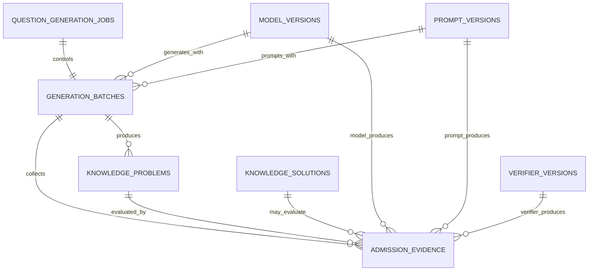

# AI 题库生成版本与准入证据设计

## 1. 目标

AI 生成题目不能只保存最终题干。系统必须能够回答：

- 题目属于哪一次生成批次；
- 使用了哪个模型和具体版本；
- 使用了哪一版提示词及输出 Schema；
- 使用了哪个验证器和规则集；
- 每项准入检查的结果与证据是什么；
- 哪项失败阻止了题目进入正式题库。

因此系统建立 `QuestionGenerationJob`、`GenerationBatch`、`ModelVersion`、`PromptVersion`、`VerifierVersion`、`AdmissionEvidence` 和 `ProblemStatusTransition`。它们是生成与准入流水线的审计基础，不负责直接执行 Agent。

## 2. 对象关系

## 3. GenerationBatch

生成批次聚合一组使用相同生成配置执行的任务。

| 字段 | 说明 |
| --- | --- |
| `batch_key` | 调用方提供的唯一幂等键 |
| `purpose` | 变式生成、内容导入、重新验证等目的 |
| `subject` / `grade_band` / `topic_code` | 内容范围 |
| `requested_count` | 请求生成数量 |
| `generated_count` | 已生成候选数量 |
| `approved_count` | 已通过准入的数量 |
| `quarantined_count` | 进入隔离区的数量 |
| `failed_count` | 生成或处理失败数量 |
| `status` | `pending`、`running`、`paused`、`completed`、`partial_failed`、`failed`、`cancelled` |
| `model_version_id` / `prompt_version_id` | 批次默认使用的生成模型和提示版本 |
| `config` | 温度、变式类型、难度目标等批次配置 |
| `started_at` / `finished_at` | 执行时间范围 |

模型和提示版本必须同时存在或同时为空。内容导入批次可以为空；AI 生成批次必须在服务层指定两者。终态批次必须记录 `finished_at`。

`knowledge_problems.generation_batch_id` 保存题目的原始生成批次。后续重新验证不会覆盖该字段，而是创建新的证据记录。

生成 Job 的完整输入、输出、预算、幂等和状态转换规则见 [QuestionGenerationJob 合约](./QUESTION_GENERATION_JOB.md)。

## 4. ModelVersion

模型版本对象记录可复现的模型身份：

- Provider；
- 模型名称；
- Provider 给出的版本或快照标签；
- API 家族；
- 不含密钥的模型配置指纹；
- 能力标签和扩展元数据。

`provider + model_name + version_label` 唯一。API 密钥、访问令牌和完整请求头不能写入配置或元数据。模型别名指向的实际版本发生变化时必须创建新记录。

## 5. PromptVersion

提示版本对象记录：

- 稳定用途编码 `prompt_key`；
- 语义化版本；
- 使用目的；
- 完整提示模板；
- 模板 SHA-256；
- 预期输出 Schema 版本。

同一个 `prompt_key` 下，版本和模板哈希都不能重复。提示发布后不原地修改；修改文本或输出格式时创建新版本。

## 6. VerifierVersion

验证器版本用于标识 SymPy 适配器、数值验证器、规则验证器和重复检测器等确定性组件：

- 稳定验证器编码；
- 版本号；
- 实现代码指纹；
- 可选规则集指纹；
- 支持的题型；
- 不含密钥的验证配置。

实现代码或规则发生影响结果的变化时必须创建新版本。重新验证可以据此筛选受影响的题目。

## 7. AdmissionEvidence

每次条件检查、独立解题、数学验证、去重和最终决策都生成独立证据记录。

建议的 `evidence_type`：

- `candidate_generation`；
- `condition_completeness`；
- `solution_independence`；
- `symbolic_verification`；
- `numeric_verification`；
- `constraint_verification`；
- `duplicate_detection`；
- `evaluation_leakage_detection`；
- `pedagogical_review`；
- `source_rights_clearance`；
- `revision_generation`；
- `admission_decision`；
- `index_sync`；
- `index_removal`。

证据包含：

| 字段 | 说明 |
| --- | --- |
| `generation_batch_id` | 本次生成或重新验证批次 |
| `problem_id` / `solution_id` | 被检查的题目及可选题解 |
| `evidence_type` | 检查类型 |
| `producer_type` | `model`、`verifier`、`hybrid` 或 `system` |
| `status` | `passed`、`failed`、`not_run` 或 `inconclusive` |
| 版本引用 | 模型、提示和验证器版本 |
| `is_blocking` | 失败是否阻止准入 |
| `summary` | 可读的结果摘要 |
| `payload` | 结构化残差、解集、相似度或检查明细 |
| `evidence_hash` | 规范化证据内容 SHA-256 |

版本引用必须与生产者类型一致：

- `model`：必须有模型版本和提示版本；
- `verifier`：必须有验证器版本；
- `hybrid`：三种版本都必须存在；
- `system`：不引用模型、提示或验证器，用于规则化最终决策。

若 `solution_id` 存在，该题解必须属于同一个 `problem_id`，该规则由 Repository 在写入时校验。证据是审计记录，不允许因题目、题解、批次或版本清理而被级联删除。

## 8. 准入使用规则

1. 生成批次开始前登记模型和提示版本；
2. 每个候选题保存 `generation_batch_id`；
3. 每个检查环节追加证据，不覆盖之前的证据；
4. 任一阻断证据为 `failed` 或 `inconclusive` 时不得批准；
5. 自动修订写入绑定失败证据、旧新内容哈希、模型和提示版本的 `revision_generation`；
6. 最终准入门写入 `producer_type=system` 的 `admission_decision`；
7. 题目退役后保留批次和全部证据；
8. 验证器升级时创建重新验证批次，保留新旧证据以便比较。

状态流转、自动批准门槛、修订上限和索引一致性规则见 `docs/PROBLEM_LIFECYCLE.md`。

## 9. 完整审计时间线

审计时间线不另建一份可变副本，而是按时间合并两类不可变事实：

- `AdmissionEvidence`：生成、条件检查、独立解题、工具验证、独立复核、修订、准入和索引结果；
- `ProblemStatusTransition`：每次真实状态变化、状态版本、执行者、原因和已检查规则。

初次变式题保存时同步写入 `candidate_generation`，内容包括 Job、请求哈希、候选序号、母题、题目内容哈希、模型版本、提示版本和输出 Schema。幂等重放复用同一条记录。

管理员题目详情返回 `audit_timeline`，每项具有：

- 阶段和事件类型；
- 来源记录类型与不可变 ID；
- 结果和公开摘要；
- 题目、题解内容哈希与状态版本；
- 模型、提示或验证器版本；
- 状态执行者；
- 复现所需的结构化公开载荷。

时间线按创建时间正序排列。原始 `evidence` 和 `transitions` 仍分别返回，便于按证据或状态查询。

## 10. 数据保留边界

- 保存公开的结构化检查证据，不保存模型隐藏推理；
- 不保存 API 密钥、Authorization Header 或 Provider 内部请求 ID 中的敏感部分；
- `payload` 只保存复现结果所需的数据；
- 版本对象发布后只允许切换 `active`，身份字段和哈希不原地修改；
- 业务上使用退役和停用，不通过物理删除清理审计链。

批次级暂停、恢复、取消、重试和批准内容撤回另写入 `generation_batch_management_events`。批次事件保存管理员、原因、操作前后状态和关联重试批次；撤回内容仍会为每道题写入 `ProblemStatusTransition`。详见 [生成批次管理](./GENERATION_BATCH_MANAGEMENT.md)。
