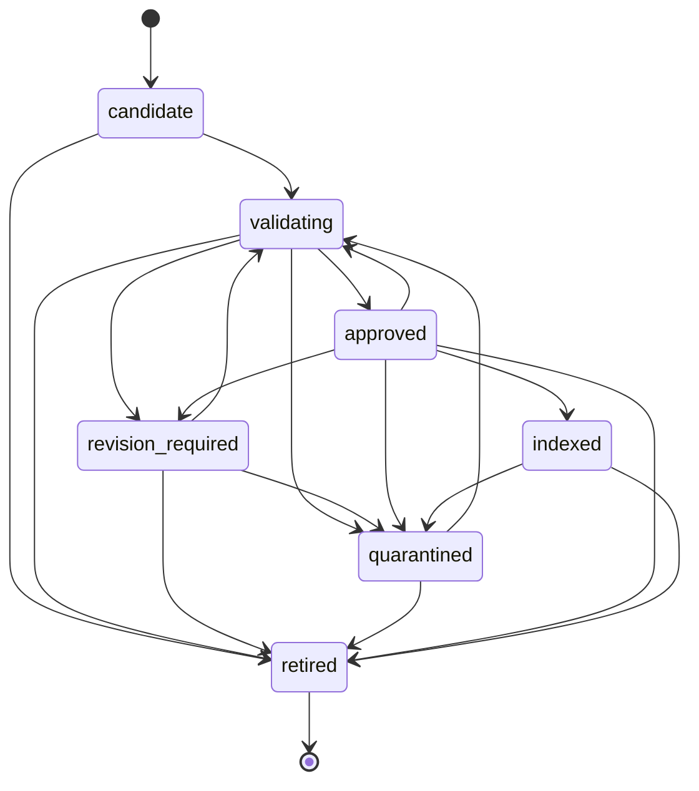

# 题库内容状态机

## 1. 目标

状态机控制 AI 题目从候选内容到生产检索的完整生命周期。任何代码都不能直接把状态字符串从 `candidate` 改成 `approved` 或 `indexed`；Repository 后续必须先调用 `ProblemContentStateMachine`，再在同一事务中保存结果和审计证据。

核心代码：

```text
app/domain/problem_lifecycle.py
```

## 2. 状态定义

| 状态 | 含义 | 是否允许生产检索 |
| --- | --- | --- |
| `candidate` | 新导入或新生成，尚未开始检查 | 否 |
| `validating` | 正在执行条件、解答、验证和去重检查 | 否 |
| `revision_required` | 存在明确且可修复的问题 | 否 |
| `quarantined` | 证据冲突、验证不足或超过修订上限 | 否 |
| `approved` | 已通过自动准入门，等待索引同步 | 否 |
| `indexed` | 已确认进入生产索引 | 是 |
| `retired` | 已永久退出当前内容版本 | 否 |

`retired` 是终态。如果需要重新使用退役题目的内容，应创建新版本或新题目记录，不能原地复活旧记录。

## 3. 允许的状态流转



重复请求相同状态按幂等空操作返回，不产生新的状态变化。

## 4. 自动批准门槛

只有 `validating → approved` 可以产生批准状态，并且必须同时满足：

1. 题目结构化字段完整；
2. 来源权利已经确认；
3. 至少存在一个完整验证的结构化题解；
4. 生产索引中不存在当前题目的活动记录；
5. 最新阻断证据全部通过；
6. 以下最新证据全部为 `passed`：
   - `condition_completeness`；
   - `solution_independence`；
   - `symbolic_verification`；
   - `numeric_verification`；
   - `constraint_verification`；
   - `duplicate_detection`；
   - `evaluation_leakage_detection`；
   - `pedagogical_review`；
   - `source_rights_clearance`。

同一证据类型可能经过多次检查，状态机采用创建时间最新的一条。旧证据继续保留用于审计。

`evaluation_leakage_detection` 必须来自带版本号的 Verifier；`pedagogical_review` 必须来自同时带模型版本和提示版本的独立 AI 复核 Agent。导入程序或普通系统任务写入的同名 `passed` 记录不能满足自动批准门槛。

自动准入不得由调用方直接指定 `approved`。`RuleBasedAdmissionGate` 根据同一题解的最新有效证据选择批准、修订、隔离或等待，再由状态机复核并执行转换。确定性证据失败的优先级高于 `pedagogical_review`，完整规则见 [规则化自动准入门](./AUTOMATIC_ADMISSION_GATE.md)。

证明题和开放题还必须具有权威完整验证覆盖。缺少形式化证明、穷尽式评分验证或可追溯合格人工复核时，状态机以 `verification_coverage_insufficient` 拒绝批准并建议 `quarantined`，详见 [验证覆盖限制](./VERIFICATION_SCOPE_POLICY.md)。

## 5. 有限修订

进入 `revision_required` 时修订次数增加 1。默认最多两次：

```text
validating → revision_required（第 1 次）
revision_required → validating
validating → revision_required（第 2 次）
revision_required → validating
再次失败 → quarantined
```

管理状态机保留 `revision_required → validating` 供人工重新验证使用。自动候选题修订不会覆盖原题，而是从 `revision_required` 版本创建新的 `candidate` 行；新行继承累计修订次数并重新执行全部校验，旧行和旧证据继续保留。详细规则见 [候选题有限自动修订](./CANDIDATE_REVISION.md)。

超过上限时状态机拒绝进入 `revision_required`，错误代码为 `revision_limit_exhausted`，并建议转为 `quarantined`。修订、隔离和退役都必须提供具体原因。

## 6. 索引门槛

### approved → indexed

必须满足：

- 最新 `index_sync` 证据为 `passed`；
- 索引适配器确认生产索引记录处于活动状态。

### indexed → quarantined / retired

必须先完成索引移除：

- 最新 `index_removal` 证据为 `passed`；
- 索引适配器确认记录已不可检索。

这样可以避免数据库已经显示“隔离”，但向量索引仍在召回旧题目的不一致状态。

实际删除由持久化 `search_index_maintenance_jobs` 执行。只有 Qdrant Point 删除成功后，任务才写入 `index_removal` 证据并调用本状态机；重新验证和版本替换会等待新内容重新达到 `approved` 后再建索引。详见 [生产索引删除与重建流程](./INDEX_LIFECYCLE.md)。

## 7. 错误代码

| 错误代码 | 含义 |
| --- | --- |
| `transition_not_allowed` | 当前状态不允许进入目标状态 |
| `status_reason_required` | 修订、隔离或退役缺少原因 |
| `revision_limit_exhausted` | 已达到最大自动修订次数 |
| `approval_gate_failed` | 自动准入条件不完整 |
| `verification_coverage_insufficient` | 证明题或开放题缺少权威完整覆盖 |
| `required_evidence_missing` | 索引同步或移除证据缺失 |
| `index_not_active` | 声称已索引，但索引尚未激活 |
| `index_still_active` | 退出生产前索引仍可检索 |
| `unexpected_active_index` | 非 `indexed` 状态存在活动索引 |

错误对象会携带缺失条件和可选建议状态，供 Orchestrator 决定修订、隔离或重试。

## 8. 持久化边界

状态机保持为纯领域逻辑，不自行提交数据库或调用向量存储。`KnowledgeRepository` 已实现以下事务边界：

1. 使用行锁或乐观锁读取题目当前状态；
2. 读取该题目的准入证据和题解验证覆盖；
3. 获取索引适配器确认结果；
4. 调用状态机；
5. 在事务中更新状态、原因和修订次数；
6. 追加不可变的 `problem_status_transitions` 状态变化记录；
7. 处理并发冲突，不覆盖其他任务刚完成的状态变化。

管理查询、接口和并发约定见 [题库管理查询与状态持久化](./KNOWLEDGE_ADMIN.md)。
