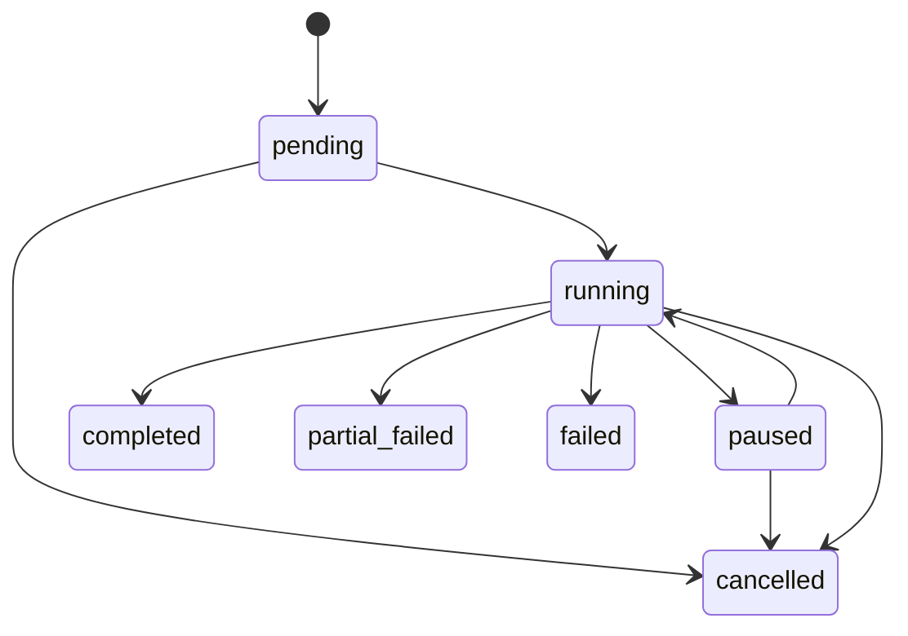

# QuestionGenerationJob 合约

## 1. 职责边界

`QuestionGenerationJob` 表示一次可重放、受预算约束的候选题生成请求。它不负责批准内容，也不能把模型生成的答案当作标准答案。

对象分工如下：

- `QuestionGenerationJobInput`：生成范围、母题、变式类型、模型与提示版本、验证配置和预算；
- `GenerationBatch`：批次状态、请求数量和结果计数；
- `QuestionGenerationJob`：规范输入、幂等身份、预算消耗和输出摘要；
- `QuestionGenerationJobOutput`：每个请求位置的候选结果、停止原因和最终资源消耗；
- `KnowledgeProblem`：成功生成后持久化的候选题，初始状态只能是 `candidate`。

生成草稿不包含可信标准答案。答案必须由后续隔离上下文的独立解题 Agent 产生，再由数学工具验证。

## 2. 输入

必填范围：

| 字段 | 规则 |
| --- | --- |
| `idempotency_scope` | 调用方定义的稳定作用域，例如租户、管理任务或数据集 |
| `idempotency_key` | 8–128 字符的调用方随机键，只在请求内存在；禁止首尾空白和控制字符 |
| `mother_problem_ids` | 1–100 个去重母题 ID |
| `requested_count` | 1–1000，且不能超过预算中的 `max_candidates` |
| `subject` / `grade_band` / `topic_code` | 生成内容范围 |
| `problem_type` | 目标题型 |
| `knowledge_point_codes` | 必须覆盖的知识点 |
| `capability_point_codes` | 可选能力点 |
| `allowed_derivation_types` | 允许的参数、条件、表述、情境、方法、同构或难度变化 |
| `difficulty` | 1–5 的目标难度区间 |
| `model_version_id` | 已登记且启用的模型版本 |
| `prompt_version_id` | 已登记且启用的提示版本 |
| `verifier_profile` | 后续验证流水线的稳定配置名 |
| `random_seed` | 可选随机种子；Provider 支持时用于复现 |
| `constraints` | 定义域、答案类型、解数量、唯一答案、知识点扩展等限制 |
| `budget` | 本 Job 的硬资源上限 |

首版变式类型直接复用 `ProblemDerivationType`。输入列表必须去重。模型版本和提示版本发布后不可原地修改，因此请求哈希可以稳定指向实际生成配置。

任务登记时，Repository 还会确认母题存在、标记为可信母题、状态为 `approved` 或 `indexed`，并且学科、学段和题型与请求一致。知识点和能力点必须存在；当前实现要求请求知识点来自所选母题，并且至少一条母题能够独立覆盖全部请求知识点。

提示版本的 `purpose` 必须是 `question_generation`，其 `output_schema_version` 必须与请求一致。

## 3. 输出

每个请求位置产生一个 `QuestionGenerationCandidateResult`：

- `candidate_created`：包含结构化草稿和持久化 `problem_id`，题目状态必须为 `candidate`；
- `generation_failed`：包含稳定错误编码和可读摘要；
- `skipped`：因取消、预算或前置条件不满足而未尝试。

候选草稿包含题干、显式/隐含条件、求解目标、难度来源、答案类型、知识点、母题变化类型和变化说明。它不包含可直接进入题库的标准答案。

`candidate_key` 由幂等键哈希和序号确定。同一请求重放时，候选位置身份保持一致。输出同时包含：

- Job 与批次 ID；
- 批次终态；
- 停止原因；
- 候选结果列表；
- 最终预算消耗；
- 开始与结束时间；
- 有界错误摘要。

## 4. 预算

`QuestionGenerationBudget` 包含：

| 预算 | 含义 |
| --- | --- |
| `max_execution_attempts` | Job 从待执行或暂停状态进入运行态的累计次数上限 |
| `max_model_calls` | 全部生成与修订模型调用上限 |
| `max_revision_rounds` | 每条候选版本链允许使用的修订轮次上限，范围 0–2 |
| `max_input_tokens` / `max_output_tokens` | 分方向 token 上限 |
| `max_total_tokens` | 输入与输出 token 总上限 |
| `max_cost_minor_units` / `currency` | 费用上限，以货币最小单位记录 |
| `max_duration_seconds` | Job 墙钟时间上限 |
| `max_candidates` | 最多尝试的候选位置数 |

执行器必须在每次模型调用、修订或候选生成前调用 `usage.can_reserve(...)`，使用该次操作的最大预计消耗做预留判断。操作完成后以 Provider 返回的真实 usage 更新累计值。无法取得 token 或费用信息时不能填零冒充真实值，后续执行器应停止或按明确配置使用保守估算。

达到预算后不再开始新操作：已有候选则批次进入 `partial_failed`，没有候选则进入 `failed`；停止原因使用 `budget_exhausted`。恰好在最后一个成功候选后达到上限，且请求已经完整完成时，可以正常进入 `completed`。

每次执行器成功取得 Job 并把批次从 `pending` 或 `paused` 切换到 `running` 时，原子增加 `attempt_count`。达到 `max_execution_attempts` 后不能再次恢复，应根据已有候选进入 `partial_failed` 或 `failed`。一次运行内部的模型重试仍计入 `max_model_calls`，不能借 Job 重启绕过 token、费用或调用预算。

## 5. 幂等规则

系统计算两个 SHA-256：

1. `idempotency_key_hash`：规范化 `{scope, key}`；
2. `request_hash`：除 scope 和原始 key 外的完整语义请求。

数据库只保存幂等键哈希，不保存原始 key。

- 同一幂等键哈希和相同请求哈希：返回原 Job 与批次，不重复生成；
- 同一幂等键哈希但请求哈希不同：抛出 `QuestionGenerationIdempotencyConflict`；
- 需要重新生成时：调用方必须提供新 key；
- MySQL 记录永久承担审计幂等，Redis 只能作为快速查询或分布式锁，不能成为唯一依据。

`batch_key` 固定为 `qgen-{idempotency_key_hash}`，单个候选键固定为 `qgc-{sha256(idempotency_hash:ordinal)}`。

## 6. 批次状态机



| 状态 | 含义 | 终态 |
| --- | --- | --- |
| `pending` | 已登记，尚未占用执行资源 | 否 |
| `running` | 正在生成或持久化候选 | 否 |
| `paused` | 主动暂停，可从已保存 usage 和序号恢复 | 否 |
| `completed` | 所有请求位置成功产生候选 | 是 |
| `partial_failed` | 至少有一个候选成功，另有失败或跳过 | 是 |
| `failed` | 没有产生可持久化候选 | 是 |
| `cancelled` | 收到取消请求，不再开始新操作 | 是 |

终态必须写入 `finished_at` 和停止原因。终态不可恢复；重试使用新幂等键和新批次。暂停不会释放审计记录，恢复时继续累计原 usage。

管理员暂停、恢复、取消、失败位置重试和批准内容撤回的接口及事务规则见 [生成批次管理](./GENERATION_BATCH_MANAGEMENT.md)。

## 7. 数量语义

- `requested_count`：请求位置总数；
- `generated_count`：已经持久化为 `candidate` 的题目数；
- `failed_count`：未产生候选的失败或跳过位置数；
- `approved_count` / `quarantined_count`：后续准入流程对已生成候选的分类。

数据库保证：

```text
generated_count + failed_count <= requested_count
approved_count + quarantined_count <= generated_count
```

运行中的批次可以小于请求总数。终态结果中的候选序号和候选键必须唯一。

`usage.candidates_attempted` 必须等于输出中非 `skipped` 的位置数；模型调用重试不重复增加候选位置数，但仍累计模型调用、token、费用和耗时。

## 8. 持久化

`question_generation_jobs` 与 `generation_batches` 一对一。Job 表保存：

- 幂等作用域、幂等键哈希和请求哈希；
- 输入和输出 Schema 版本；
- 去除原始幂等键后的规范输入；
- 预算、累计 usage 和输出摘要；
- 尝试次数、状态原因及最近错误码。

`QuestionGenerationJobRepository.register()` 必须在调用方事务内使用。它先执行幂等检查，再确认模型和提示版本处于启用状态，最后原子创建批次与 Job。

变式生成 Agent、可信母题的二次校验、禁止答案字段和候选持久化边界见 `docs/QUESTION_VARIATION_AGENT.md`。
