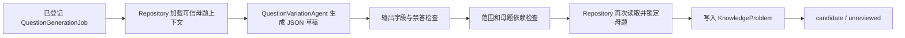

# 变式生成 Agent

## 1. 目标与边界

`QuestionVariationAgent` 从一条经过 Repository 再次确认的可信母题生成一道结构化候选题。它只负责生成，不解题、不验证、不审核，也不执行内容状态迁移。

本 Agent 的成功输出仍然是不可信内容：

- 数据状态固定为 `candidate`；
- 审核状态固定为 `unreviewed`；
- 不创建 `KnowledgeSolution`；
- 不创建“验证通过”或“准入通过”的证据；
- 不能写入 `approved` 或 `indexed`；
- 必须由后续题意检查、独立解题、数学工具验证、重复检测和独立复核流程处理。

即使模型在文字中声称题目已经验证，系统也不会把该声明当作证据。

## 2. 可信母题入口

Agent 不接受任意题目文本作为母题。调用方必须通过 `QuestionGenerationJobRepository.load_agent_context()` 取得 `TrustedMotherProblemContext`。

Repository 会确认：

1. 母题 ID 已登记在当前 `QuestionGenerationJob`；
2. `metadata_json.trusted_mother=true`；
3. 当前状态仍为 `approved` 或 `indexed`；
4. 学科、学段和题型与 Job 一致；
5. 母题包含结构化求解目标；
6. 模型与提示版本仍启用，且提示用途和输出 Schema 匹配。

上下文只包含题干、显式/隐含条件、求解目标、难度来源、答案类型和知识点，不读取母题题解、最终答案或推理过程。这样可以避免生成 Agent 把母题答案直接改写为“新题答案”，并为后续隔离解题保留独立性。

## 3. 单题生成流程



一次调用只生成一个候选位置。`candidate_key` 由 Job 的幂等键哈希和序号确定。执行器应在调用前确认预算，并选择能够覆盖本 Job 全部必需知识点的母题。

主要调用关系：

```python
context = repository.load_agent_context(session, job_id)
mother = context.mothers[0]
draft = agent.run(
    mother=mother,
    generation_input=context.generation_input,
    candidate_key=candidate_key(context.idempotency_key_hash, ordinal),
    ordinal=ordinal,
    expected_model_name=context.model_name,
    versioned_prompt=context.versioned_prompt,
)
result = repository.persist_candidate(
    session,
    job_id=context.job_id,
    ordinal=ordinal,
    mother_problem_id=mother.id,
    draft=draft,
)
```

`persist_candidate()` 只接受处于 `running` 的批次。批次领取、预算预留、终态汇总与失败计数由后续 Job 执行器负责。

## 4. 生成约束

Agent 在模型调用前验证母题范围，在模型调用后验证草稿：

- 题目必须发生真实变化，不能与母题规范文本相同；
- `derivation_type` 必须属于 Job 允许列表；
- 难度必须位于请求区间；
- 当要求保持答案类型时，候选题答案类型必须与母题一致；
- 候选题必须覆盖 Job 的全部必需知识点；
- 候选题的知识点只能来自当前母题；
- 候选题必须具有显式条件和结构化求解目标；
- 题干不能包含 Job 配置的禁用词。

虽然 Job 合约保留 `allow_new_knowledge_points` 供以后扩展，当前 Agent 仍禁止引入母题之外的知识点。这是“只基于可信母题”的硬边界，不受版本化提示覆盖。

## 5. 禁止答案泄漏

`GeneratedQuestionDraft` 使用 `extra="forbid"`，模型无法通过额外顶层字段夹带内容。Agent 还会递归拒绝以下字段名：

```text
answer, answers, correct_answer, final_answer,
solution, solutions, steps, proof, analysis, reasoning
```

Agent 的系统提示明确禁止答案、解题步骤、证明和推理。版本化提示只能补充生成风格和具体要求，不能覆盖这组安全规则。

## 6. 持久化与幂等

Repository 写入前会重新锁定 Job、批次和母题，防止母题在模型调用期间被撤回后仍生成内容。

持久化规则：

- `mother_problem_id` 必填；
- `generation_batch_id` 指向当前 Job 的批次；
- `source_reference_id` 指向按原始来源建立的本地 AI 衍生来源，保留原来源许可和归属说明，避免把生成题误写成原出版物原题；
- `external_id` 使用稳定 `candidate_key`；
- `content_status="candidate"`；
- `review_status="unreviewed"`；
- `status_version=1`、`revision_attempts=0`；
- 元数据记录 Job、母题、模型版本、提示版本和输出 Schema；
- 元数据明确记录 `approval_forbidden_at_generation=true`；
- 生成题不会继承 `trusted_mother=true`。

相同候选键、相同母题和相同内容的重放返回已有候选。身份相同但内容或母题不同会报冲突。与已有题目内容哈希完全相同也会拒绝写入；更完整的文本、公式 AST、条件和解法结构重复检测仍由后续独立流程完成。

## 7. 稳定错误码

Agent 使用 `QuestionVariationError.code` 区分主要失败原因，包括：

- `provider_unavailable`：LLM Provider 未配置；
- `model_version_mismatch`：实际 Provider 模型与 Job 登记的模型版本不一致；
- `provider_invalid_response`：Provider 未返回有效 JSON；
- `answer_material_forbidden`：输出包含答案或推理字段；
- `output_schema_invalid`：输出不符合结构化草稿 Schema；
- `mother_not_declared` / `mother_scope_mismatch`：母题不属于 Job；
- `mother_knowledge_scope_insufficient`：母题不能覆盖请求知识点；
- `mother_copy_forbidden`：候选题与母题相同；
- `derivation_type_forbidden`：使用了未允许的变式类型；
- `difficulty_out_of_range`：难度越界；
- `answer_type_changed`：破坏了答案类型保持约束；
- `required_knowledge_missing` / `new_knowledge_forbidden`：知识点不合规；
- `explicit_conditions_missing`：没有可检查的显式条件；
- `prohibited_term_present`：题干包含禁用词。

这些错误只能形成生成失败记录，不能转换为批准证据。
