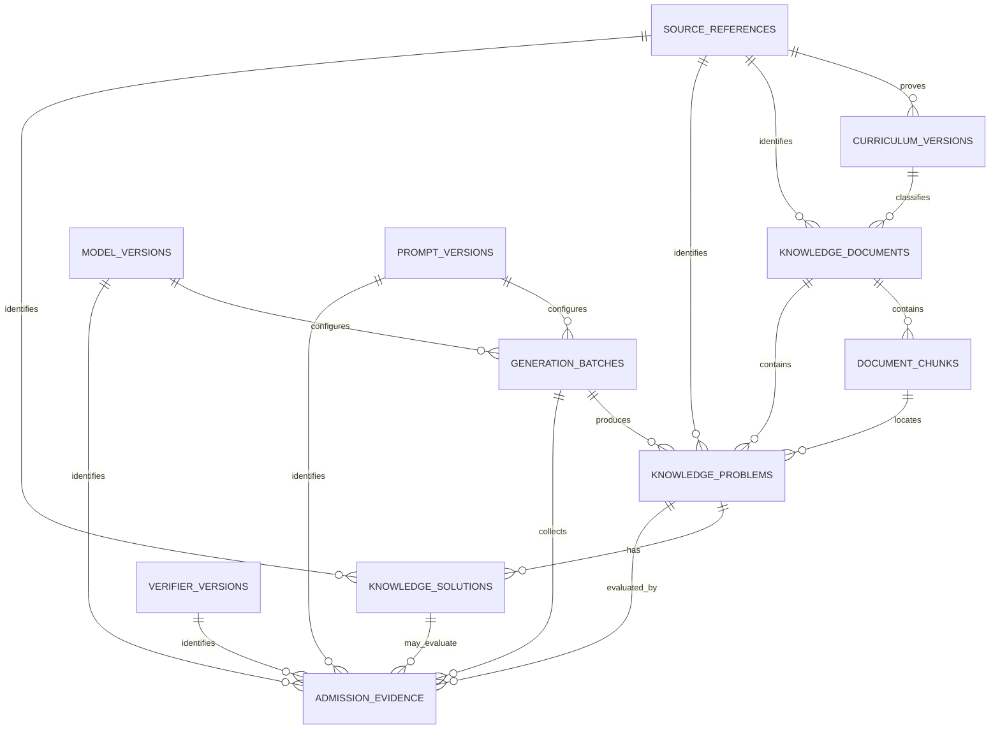

# RAG 知识数据对象与 MySQL 映射

## 1. 范围

本文定义 RAG 知识库第一版的领域对象和 MySQL 映射，覆盖：

- 来源引用 `SourceReference`；
- 教材或课程标准版本 `CurriculumVersion`；
- 知识文档 `KnowledgeDocument`；
- 文档切片 `DocumentChunk`；
- 题目 `KnowledgeProblem`；
- 题解 `KnowledgeSolution`；
- 生成批次、模型/提示/验证器版本和准入证据。

领域对象位于 `app/domain/knowledge.py`，用于采集、清洗、检索和 Provider 之间的数据交换。SQLAlchemy 映射位于 `app/models/knowledge.py`，负责 MySQL 约束与对象关系。Alembic 迁移 `20260930_0004` 创建对应表，升级和回滚流程见 `docs/MIGRATIONS.md`。

## 2. 设计原则

1. **来源先行**：文档、教材版本、题目和题解都必须指向来源引用。
2. **版本不可覆盖**：教材改版或源文件变化时创建新记录，通过校验和区分，不直接覆盖旧内容。
3. **切片可定位**：每个切片保留文档内顺序、标题路径和页码/章节定位。
4. **题目与题解分离**：一道题允许有多个解法、不同来源和不同验证状态。
5. **审核与索引分离**：解析完成不等于内容获准进入生产检索；审核状态和导入状态分别保存。
6. **检索库不是权威数据源**：MySQL 保存业务元数据和可追溯正文，向量数据库只保存索引副本及关联 ID。
7. **评估集隔离**：`evaluation_only` 数据不得导入这些表或向量索引。

## 3. 实体关系



文档可以不属于某个教材版本，例如论文或独立教学笔记。题目也可以只引用独立题库来源，不要求一定来自本地文档。若题目由文档解析得到，应同时保存 `document_id` 和尽可能精确的 `source_chunk_id`。

## 4. 来源引用 SourceReference

`SourceReference` 是版权、出处和引用展示的基础对象。

| 字段 | 说明 |
| --- | --- |
| `id` | UUID 主键 |
| `source_type` | 课程标准、教材、教师用书、题库、论文、网站或本地编写 |
| `title` | 来源标题 |
| `authors` / `authors_json` | 作者或机构列表 |
| `publisher` | 出版机构 |
| `canonical_url` | 权威或原始地址，不保存临时下载地址 |
| `external_id` | ISBN、DOI、站点资源 ID 等外部编号 |
| `license_name` | 明确的许可或使用依据，必填 |
| `rights_note` | 地域、商业使用、改编、署名等补充限制 |
| `published_at` | 来源发布时间 |
| `accessed_at` | 本项目获取时间 |
| `fingerprint` | 规范化来源身份的 SHA-256，用于去重 |

`fingerprint` 唯一。相同资源不同下载地址应归并到同一来源记录；内容版本变化由文档校验和和版本字段表达。

## 5. 教材版本 CurriculumVersion

| 字段 | 说明 |
| --- | --- |
| `source_reference_id` | 对应官方课程标准或教材版本说明来源 |
| `authority` | 发布机构，例如教育主管部门或出版社 |
| `region_code` | 适用国家或地区，默认 `CN` |
| `subject` | 学科，当前为 `math` |
| `grade_band` | 学段 |
| `name` | 面向人展示的版本名称 |
| `version_code` | 稳定版本编码 |
| `effective_from` / `effective_to` | 生效区间 |
| `status` | `draft`、`active`、`superseded`、`retired` |

`authority + region_code + subject + grade_band + version_code` 唯一。旧版本进入 `superseded` 后继续保留，以便解释历史学习记录和引用。

## 6. 知识文档 KnowledgeDocument

| 字段 | 说明 |
| --- | --- |
| `source_reference_id` | 文档原始来源，必填 |
| `curriculum_version_id` | 可选教材或课程版本 |
| `document_type` | 课程标准、教材、章节、课时、定理、例题、题集、题解手册或教学笔记 |
| `document_key` | 同一逻辑文档跨版本稳定的机器标识 |
| `title` | 文档标题 |
| `version_label` | 原版、修订版或导入版本 |
| `language` | BCP 47 风格语言代码 |
| `subject` / `grade_band` | 检索过滤范围 |
| `grade_codes` | 精确年级标签，例如 `grade_9` |
| `content_checksum` | 原始规范化内容 SHA-256 |
| `review_status` | `unreviewed`、`pending`、`approved`、`rejected` |
| `lifecycle_status` | 草稿、启用、已被替代或退役 |
| `ingestion_status` | 待处理、已解析、已索引或失败 |
| `knowledge_point_codes` | 初期用于过滤的知识点代码快照 |
| `problem_types` | 文档覆盖的题型标签 |
| `difficulty_factors` | 文档范围内的结构化难度来源 |
| `content_types` | 文档包含的内容类型集合 |
| `metadata` | 摄取流水线、解析器、清洗与公式规则版本，原文件哈希、切片参数、前序文档 ID 等扩展信息 |

生产检索只使用 `review_status=approved`、`lifecycle_status=active` 且 `ingestion_status=indexed` 的文档。

## 7. 文档切片 DocumentChunk

| 字段 | 说明 |
| --- | --- |
| `document_id` | 所属文档 |
| `ordinal` | 文档内从 0 开始的稳定顺序 |
| `content` | 清洗后的片段正文 |
| `content_hash` | 片段正文 SHA-256 |
| `token_count` | 使用指定分词器计算的 token 数 |
| `heading_path` | 章、节、小节路径 |
| `locator` | 页码、段落或章节定位，如 `p.42` |
| `content_type` | 文本、定义、定理、例题、证明等 |
| `knowledge_point_codes` | 片段级知识点标签 |
| `grade_band` | 切片级学段快照 |
| `grade_codes` | 切片级精确年级快照 |
| `problem_types` | 切片涉及的题型 |
| `difficulty_factors` | 切片涉及的结构化难度来源 |
| `curriculum_version_id` | 切片对应的课程标准或教材版本快照 |
| `metadata` | 公式、图片引用、解析坐标等扩展信息 |
| `enabled` | 是否允许建立或保留检索索引 |

同一文档内 `ordinal` 唯一，相同正文哈希也只保留一次。重新切片时创建新的文档版本或受控重建全部切片，不能混用不同切片策略产生的顺序。

同一来源、同一 `document_key` 的 `version_label` 不可复用。完整解析、规范化、哈希、去重和版本规则见 [RAG 文档摄取流程](./DOCUMENT_INGESTION.md)。

向量数据库中的 point ID 应使用 `DocumentChunk.id`，payload 至少保存 `document_id`、教材版本、知识点、内容类型、审核状态和索引版本。

## 8. 题目 KnowledgeProblem

| 字段 | 说明 |
| --- | --- |
| `source_reference_id` | 题目来源，必填 |
| `document_id` / `source_chunk_id` | 可选原文档与精确片段定位 |
| `external_id` | 来源题号或数据集 ID |
| `statement` | 原始题干 |
| `normalized_statement` | 清洗但不改变题意的规范题干 |
| `explicit_conditions` | 题干直接给出的等式、不等式、定义域、参数或情境条件 |
| `implicit_conditions` | 由定义、语境或图形推得的条件，包含推断依据和置信度 |
| `target` | 求解动作、目标对象、预期答案类型和答案约束 |
| `subject` / `grade_band` | 学科与学段 |
| `grade_codes` | 题目适用的精确年级标签 |
| `problem_type` | 方程、几何、组合等题型 |
| `content_type` | 题目内容类型，默认 `problem` |
| `curriculum_version_id` | 题目对应的课程标准或教材版本；原创题可空 |
| `difficulty` | 1–5 级难度 |
| `difficulty_factors` | 难度来源、局部等级、理由及关联知识点 |
| `answer_type` | 数值、表达式、证明、集合等答案类型 |
| `language` | 题目语言 |
| `content_hash` | 规范化题干 SHA-256 |
| `review_status` | 内容审核状态 |
| `mother_problem_id` | 可选母题 ID；母题删除前必须先处理其变式题 |
| `generation_batch_id` | AI 生成题目的原始批次；人工或来源导入题可为空 |
| `derivation_type` | 参数、条件、表述、情境、方法、同构或难度变化 |
| `derivation_note` | 相对母题发生的具体变化 |
| `content_status` | AI 生成与生产准入状态 |
| `status_reason` | 需要修订、隔离或退役的原因 |
| `revision_attempts` | 已进入自动修订的累计次数 |
| `status_version` | 状态写入的乐观锁版本，从 1 开始 |
| `status_changed_at` | 最近一次真实状态变化时间 |
| `knowledge_point_codes` | 知识点代码 |

`source_reference_id + content_hash` 唯一。同一道题出现在不同合法来源时可以分别记录，从而保留各自出处；检索或导入层可以依据内容哈希识别同题关系。

未经审核的题目不能作为相似题直接发给学生。评估题不写入该表。

### 8.1 条件对象

显式条件和隐式条件分开保存，但共用以下基础结构：

| 字段 | 说明 |
| --- | --- |
| `statement` | 面向人阅读的条件 |
| `condition_type` | 等式、不等式、定义域、参数、几何、情境、假设或其他 |
| `normalized_expression` | 可选规范表达式，供数学工具解析 |
| `related_symbols` | 条件涉及的变量或几何对象 |

隐式条件另外保存 `inference_basis` 和 `confidence`。例如“长方形的宽为 x”会隐含 `x>0`，但必须记录该结论来自长度语境。隐式条件不能在缺少推断依据时写入。

### 8.2 求解目标

`target` 不是一段无法检查的自然语言，包含：

- `action`：求解、证明、计算、确定、构造、比较、分析或解释；
- `target_object`：要求得到或证明的对象；
- `expected_answer_type`：数值、表达式、集合、证明等；
- `constraints`：精度、范围、单位、实数域等输出限制。

`answer_type` 继续作为高频检索字段保留，内容应与 `target.expected_answer_type` 一致。`approved` 和 `indexed` 题目必须有结构化目标。

### 8.3 难度来源

总难度 `difficulty` 用于粗粒度过滤，`difficulty_factors` 解释题目为什么难。首版支持：

- 隐藏条件；
- 多知识点组合；
- 变形深度；
- 方法选择；
- 辅助构造；
- 分类讨论；
- 计算复杂度；
- 证明链长度；
- 抽象程度；
- 数学建模；
- 增根或无效解风险。

每个因素包含 1—5 局部等级、具体理由和关联知识点编码。Agent 应根据因素选择提示，不应只使用总难度决定教学方式。

### 8.4 母题与变式关系

第一版每道变式题只指向一个直接母题。多代变式通过自关联链追溯，禁止题目指向自身。`mother_problem_id` 与 `derivation_type` 必须同时为空或同时存在。

`derivation_type` 取值：

- `parameter_change`：改变数值或参数；
- `condition_change`：增加、删除或改变条件；
- `representation_change`：改变表述、公式或图形呈现；
- `context_change`：保持数学结构，改变实际情境；
- `method_change`：改变预期解法或限制方法；
- `isomorphic`：结构相同的同构题；
- `difficulty_change`：有目的地改变推理或计算难度。

### 8.5 内容状态

`review_status` 表示来源内容审核结果，`content_status` 表示题目从生成到生产索引的生命周期，两者不能合并。

```text
candidate
  → validating
  → revision_required / quarantined / approved
  → indexed
  → retired
```

- `candidate`：新导入或新生成，只能内部使用；
- `validating`：正在执行条件、答案、去重和复核检查；
- `revision_required`：存在明确且可修复的问题，必须保存 `status_reason`；
- `quarantined`：冲突或验证覆盖不足，必须保存 `status_reason`；
- `approved`：通过准入规则，但尚未确认索引同步；
- `indexed`：已进入生产索引；
- `retired`：已经停止使用，必须保存 `status_reason`。

状态流转规则已经由 `app/domain/problem_lifecycle.py` 实现，准入证据、有限修订和索引门槛见 [题库内容状态机](./PROBLEM_LIFECYCLE.md)。Repository 仍需在同一事务中持久化状态结果和审计记录。

## 9. 题解 KnowledgeSolution

| 字段 | 说明 |
| --- | --- |
| `problem_id` | 所解题目 |
| `source_reference_id` | 题解来源，必填；本地编写也要建立本地来源记录 |
| `method_name` | 方法名称 |
| `solution_text` | 完整题解正文 |
| `final_answer` | 可选规范答案 |
| `content_hash` | 题解正文 SHA-256 |
| `review_status` | 人工内容审核状态 |
| `verification_status` | `unverified`、`partial`、`verified`、`failed` |
| `steps` | 可逐步引用和验证的结构化解法步骤 |
| `key_breakthroughs` | 决定解题路线的关键结构及其教学问题 |
| `verification_coverage` | 已验证步骤、未验证步骤、检查证据和限制 |
| `is_preferred` | 同题多个题解中的推荐版本 |
| `language` | 题解语言 |

同一题目下相同内容哈希只保留一份。`review_status=approved` 与 `verification_status=verified` 表达不同含义：前者表示内容审核通过，后者表示数学校验达到既定覆盖标准。缺少形式化验证、穷尽式评分验证或可追溯合格人工复核的证明题和开放题，题解最高只能保持 `partial`，题目必须进入 `quarantined`，不能为了进入检索库伪装成完全验证。

### 9.1 结构化解法步骤

完整题解文本继续用于阅读和引用，`steps` 用于 Agent、验证器和分级提示。每一步包含：

| 字段 | 说明 |
| --- | --- |
| `step_id` | 题解内部稳定标识，例如 `s1` |
| `sequence` | 从 1 开始的连续顺序 |
| `action` | 本步执行的操作 |
| `result` | 本步得到的中间结果或结论 |
| `justifications` | 本步使用的一项或多项依据 |
| `depends_on_step_ids` | 本步依赖的更早步骤 |
| `condition_refs` | 使用的显式或隐式条件引用 |
| `knowledge_point_codes` | 本步涉及的知识点编码 |

步骤只能依赖序号更小的步骤。步骤 ID 和顺序必须唯一，顺序必须从 1 连续递增，避免在生成提示和验证报告时出现无法定位的跳步。

### 9.2 步骤依据

每一步至少包含一项依据。依据类型包括：

- 题目已知条件；
- 定义；
- 定理；
- 公式；
- 代数性质；
- 前置步骤；
- 确定性计算；
- 明确假设；
- 其他可说明依据。

依据保存简短说明，并可选关联 `source_reference_id` 和原文定位 `locator`。系统不保存模型隐藏推理，只保存能够向学生解释、能够被验证器检查的公开数学依据。

### 9.3 关键突破口

`key_breakthroughs` 不等同于所有步骤的摘要，只记录真正决定路线的识别、构造或转换。每个突破口包括：

- 稳定的 `breakthrough_id`；
- 标题和具体描述；
- 为什么它能推进求解；
- 关联步骤和知识点；
- 可选的最低泄露程度引导问题。

突破口引用的步骤必须存在。提示教学 Agent 可以优先使用 `hint_question`，不需要读取完整题解文本。

### 9.4 验证覆盖

`verification_coverage` 包含：

| 字段 | 说明 |
| --- | --- |
| `level` | `none`、`partial` 或 `full` |
| `covered_step_ids` | 已被至少一项有效检查覆盖的步骤 |
| `uncovered_step_ids` | 尚未验证的步骤 |
| `checks` | 检查类型、状态、验证器、覆盖步骤和证据 |
| `limitations` | 当前工具和复核尚未覆盖的内容 |
| `confidence` | 对覆盖结论的置信度，不替代确定性证据 |

检查类型包括符号等价、候选答案代回、约束满足、数值抽样、答案完整性、证明逻辑和定理适用条件。单项状态为 `passed`、`failed` 或 `not_run`。

状态与覆盖范围必须一致：

- `unverified` 只能对应 `none`，不能声明任何步骤已覆盖；
- `partial` 必须至少覆盖一个步骤、分类全部步骤并说明限制，且不能包含失败检查；
- `verified` 必须包含结构化步骤、覆盖全部步骤、至少一项检查，并且所有检查通过；
- `failed` 必须包含至少一项失败检查。

这套覆盖描述只说明当前证据验证了什么。后续的准入证据对象还会记录模型版本、验证器版本、运行时间和生成批次。

## 10. 生成版本与准入证据

AI 生成题目通过以下对象形成完整审计链：

- `GenerationBatch`：一批生成或重新验证任务及其数量、范围和状态；
- `QuestionGenerationJob`：候选题生成请求、预算、幂等身份、资源消耗和输出摘要；
- `ModelVersion`：Provider、模型、实际版本和配置指纹；
- `PromptVersion`：提示模板、哈希和输出 Schema 版本；
- `VerifierVersion`：验证器实现、规则集和支持范围；
- `AdmissionEvidence`：单项检查结果、版本引用、证据载荷和阻断属性。

题目通过 `generation_batch_id` 指向原始生成批次。准入证据同时关联批次和题目，可选关联题解。最终准入决定也是证据记录，不直接覆盖此前的检查结果。详细字段、生产者约束和数据保留规则见 `docs/GENERATION_AUDIT.md`。

题目每次真实状态变化都会追加 `ProblemStatusTransition`，记录前后状态、原因、修订次数、状态版本、已检查门槛和执行者。该历史记录不随题目级联删除，具体事务规则和管理查询见 `docs/KNOWLEDGE_ADMIN.md`。

## 11. 审核与索引状态流转

```text
来源登记
  → 文档 draft / unreviewed / pending
  → 解析和切片 parsed
  → 人工审核 approved 或 rejected
  → 建立检索索引 indexed
  → active 文档进入生产召回
```

内容变化后重新计算校验和。校验和变化必须重新审核和索引，不沿用旧版本的 `approved` 或 `indexed` 状态。

## 12. 与 KnowledgeRetriever 的关系

Repository 或索引管道负责从这些对象构建检索索引。Provider 内部的 `RetrievedKnowledge` 候选必须能反查：

- `chunk_id` → `document_chunks.id`；
- `document_id` → `knowledge_documents.id`；
- `source_reference_id` → `source_references.id`；
- `locator` → 原文中的具体页码或章节。

Provider 不能把数据库实体或 `RetrievedKnowledge.content` 直接暴露给 Agent，而应转换成长度受限、按用途分组的 `RetrievedTeachingContext`。只有 `to_agent_context()` 产生的 `AgentTeachingContext` 可以进入 Prompt；字段白名单、提示等级和字符预算见 `docs/RETRIEVED_TEACHING_CONTEXT.md`。

## 13. 数据库迁移

`migrations/versions/20260930_0004_add_rag_knowledge_schema.py` 创建基础知识表。`20261002_0006` 扩展题目，`20261002_0007` 扩展题解，`20261002_0008` 增加生成批次、模型/提示/验证器版本、准入证据及题目的批次外键。升级时已有题目统一标为 `candidate`；已有题解等待按步骤重新验证。迁移不操作外部向量索引；运行时仍由 `RAG_ENABLED` 控制。
