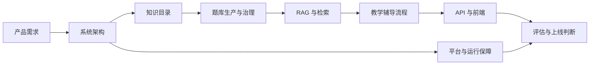

# 数学引导 Agent 文档中心

这里是 `math-tutor-agent` 的文档总入口。文档按“为什么做、系统如何组成、内容如何生产、产品如何运行、质量如何判断”的顺序组织。

## 文档之间的关系

这张图表示主要依赖关系，并非开发时间线：知识目录定义“教什么”，题库定义“有哪些可信题目”，RAG 负责找到合适内容，教学 Agent 决定“怎样逐步引导”，评估文档判断整条链路是否达到上线标准。

## 目录说明

| 目录 | 负责回答的问题 | 主要内容 |
| --- | --- | --- |
| [`00-overview`](./00-overview/TODO.md) | 当前项目做到哪里，下一步做什么？ | 待办、首版验收、Figma 实现清单、参考项目映射 |
| [`agent`](./agent/README.md) | 系统有哪些 Agent，各自负责什么，怎样协作？ | 12 个 Agent 的专项文档和协作架构图 |
| [`module`](./module/README.md) | 系统由哪些功能模块组成，模块怎样衔接？ | 架构、平台、教学、题库、RAG、知识内容、API、多模态、隐私和评估 |

项目级产品需求位于 [`../../docs/REQUIREMENTS_ANALYSIS.md`](../../docs/REQUIREMENTS_ANALYSIS.md)，前端技术方案位于 [`../../docs/TECHNICAL_DESIGN.md`](../../docs/TECHNICAL_DESIGN.md)。它们覆盖整个产品，所以继续保留在仓库根目录的 `docs` 中。

## 推荐阅读顺序

### 第一次了解项目

1. [大学高等数学 MVP 范围](./00-overview/UNIVERSITY_CALCULUS_MVP_SCOPE.md)
2. [项目技术栈与学习指南](./00-overview/TECH_STACK_LEARNING_GUIDE.md)
3. [需求分析](../../docs/REQUIREMENTS_ANALYSIS.md)
4. [系统设计](./module/系统架构模块/SYSTEM_DESIGN.md)
5. [Agent 协作架构图](./agent/agent协作架构.md)
6. [业务流程图](./module/系统架构模块/业务流程图.md)
7. [运行架构](./module/系统架构模块/architecture.md)
8. [数据模型](./module/系统架构模块/DATA_MODEL.md)
9. [当前待办](./00-overview/TODO.md)

### 理解题库策略

1. [大学高数第一章题库建设方案](./module/题库生产与治理模块/UNIVERSITY_CALCULUS_CHAPTER1_QUESTION_BANK.md)
2. [可信母题导入](./module/题库生产与治理模块/TRUSTED_SEED_IMPORT.md)
3. [可信母题批量变式生成](./module/题库生产与治理模块/可信母题批量变式生成/README.md)
4. [自动准入门](./module/题库生产与治理模块/AUTOMATIC_ADMISSION_GATE.md)
5. [题目生命周期](./module/题库生产与治理模块/PROBLEM_LIFECYCLE.md)
6. [生成质量指标](./module/题库生产与治理模块/GENERATION_QUALITY_METRICS.md)

### 理解教学流程

1. [题意理解](./agent/题目理解Agent/PROBLEM_UNDERSTANDING.md)
2. [解法分析](./agent/解题分析Agent/SOLUTION_ANALYSIS.md)
3. [解答校验](./agent/解答校验Agent/SOLUTION_VERIFICATION.md)
4. [自适应数学引导与教学状态机](./module/教学辅导模块/ADAPTIVE_GUIDANCE.md)
5. [分级提示](./agent/提示教学Agent/HINT_STRATEGY.md)
6. [学习者状态](./agent/学情诊断Agent/LEARNER_STATE.md)

### 本地启动与排查

1. [本地服务](./module/运行基础设施模块/LOCAL_SERVICES.md)
2. [数据库迁移](./module/运行基础设施模块/MIGRATIONS.md)
3. [就绪检查](./module/运行基础设施模块/HEALTH_CHECKS.md)
4. [日志系统](./module/运行基础设施模块/LOGGING.md)
5. [统一 API 错误](./module/API与客户端模块/TUTORING_API_ERRORS.md)

### 理解 RAG

1. [RAG 设计](./module/RAG与检索模块/RAG_DESIGN.md)
2. [RAG 数据模型](./module/RAG与检索模块/RAG_DATA_MODEL.md)
3. [文档摄取流程](./module/RAG与检索模块/DOCUMENT_INGESTION.md)
4. [生产索引](./module/RAG与检索模块/PRODUCTION_INDEXING.md)
5. [索引生命周期](./module/RAG与检索模块/INDEX_LIFECYCLE.md)
6. [RAG 质量指标](./module/RAG与检索模块/RAG_QUALITY_METRICS.md)

## 全部文档

下面每一项都直接链接到具体 Markdown 文件。

### 00 总览与计划

- [大学高等数学 MVP 范围收敛](./00-overview/UNIVERSITY_CALCULUS_MVP_SCOPE.md)
- [项目技术栈与学习指南](./00-overview/TECH_STACK_LEARNING_GUIDE.md)
- [功能模块与 Agent 文档编写规范](./00-overview/功能模块与%20Agent%20文档编写规范.md)
- [最新 Figma 网页端实现清单](./00-overview/FIGMA_WEB_IMPLEMENTATION_TODO.md)
- [首版文字题人工验收清单](./00-overview/FIRST_RELEASE_ACCEPTANCE.md)
- [Homework Companion 参考映射](./00-overview/REFERENCE_MAPPING.md)
- [数学辅导 Agent 待办清单](./00-overview/TODO.md)

### Agent 专项文档

- [Agent 文档目录](./agent/README.md)
- [Agent 协作架构图](./agent/agent协作架构.md)
- [题目理解 Agent](./agent/题目理解Agent/PROBLEM_UNDERSTANDING.md)
- [解题分析 Agent](./agent/解题分析Agent/SOLUTION_ANALYSIS.md)
- [解答校验 Agent](./agent/解答校验Agent/SOLUTION_VERIFICATION.md)
- [学情诊断 Agent](./agent/学情诊断Agent/LEARNER_STATE.md)
- [提示教学 Agent](./agent/提示教学Agent/HINT_STRATEGY.md)
- [学习记录 Agent](./agent/学习记录Agent/LEARNING_RECORD.md)
- [受约束相似题 Agent](./agent/受约束相似题Agent/CONSTRAINED_SIMILAR_PRACTICE.md)
- [相似题生成 API](./agent/受约束相似题Agent/API.md)
- [相似题 MPR 数据模型](./agent/受约束相似题Agent/MPR_DATA_MODEL.md)
- [相似题生成性能优化方案](./agent/受约束相似题Agent/SIMILAR_PRACTICE_PERFORMANCE_OPTIMIZATION.md)
- [变式生成 Agent](./agent/变式生成Agent/QUESTION_VARIATION_AGENT.md)
- [题意与条件检查 Agent](./agent/题意与条件检查Agent/PROBLEM_CONDITION_CHECK.md)
- [隔离上下文独立解题 Agent](./agent/隔离上下文独立解题Agent/INDEPENDENT_SOLVING.md)
- [独立 AI 复核 Agent](./agent/独立AI复核Agent/INDEPENDENT_AI_REVIEW.md)
- [候选题修订 Agent](./agent/候选题修订Agent/CANDIDATE_REVISION.md)

### 功能模块文档

- [功能模块文档目录](./module/README.md)

### 系统架构模块

- [数学引导产品业务流程图](./module/系统架构模块/业务流程图.md)
- [数学辅导 Agent 数据对象与 MySQL 模型设计](./module/系统架构模块/DATA_MODEL.md)
- [Math Tutor Agent Harness](./module/系统架构模块/HARNESS.md)
- [数学教育多 Agent 系统设计](./module/系统架构模块/SYSTEM_DESIGN.md)
- [数学辅导 Agent 系统架构](./module/系统架构模块/architecture.md)

### 身份、平台与运行模块

- [身份认证与数据归属设计](./module/身份认证与权限模块/AUTHORIZATION.md)
- [存活与就绪检查](./module/运行基础设施模块/HEALTH_CHECKS.md)
- [多 LLM Provider 与用户模型选择](./module/模型服务模块/LLM_PROVIDERS.md)
- [本地开发服务与统一启动](./module/运行基础设施模块/LOCAL_SERVICES.md)
- [后端日志系统](./module/运行基础设施模块/LOGGING.md)
- [MySQL 数据库迁移流程](./module/运行基础设施模块/MIGRATIONS.md)
- [认证接口限流设计](./module/身份认证与权限模块/RATE_LIMITING.md)
- [Redis 运行协同设计](./module/运行基础设施模块/REDIS_DESIGN.md)
- [Redis 生产故障策略](./module/运行基础设施模块/REDIS_FAILURE_POLICY.md)

### 教学辅导与学习记录模块

- [自适应数学引导与教学状态机](./module/教学辅导模块/ADAPTIVE_GUIDANCE.md)
- [家长报告证据与样本范围](./module/学习记录与复习模块/PARENT_REPORT_EVIDENCE.md)
- [非程序化证明题的验证规则](./module/教学辅导模块/PROOF_VERIFICATION.md)
- [解答校验失败后的有限修订流程](./module/教学辅导模块/SOLUTION_REVISION.md)
- [间隔复习与复习任务](./module/学习记录与复习模块/SPACED_REVIEW.md)

### 题库生产与治理模块

- [规则化自动准入门](./module/题库生产与治理模块/AUTOMATIC_ADMISSION_GATE.md)
- [可信母题批量变式生成](./module/题库生产与治理模块/可信母题批量变式生成/README.md)
- [题目错误反馈与自动重新验证](./module/题库生产与治理模块/CONTENT_ISSUE_REVALIDATION.md)
- [教育内容标签设计](./module/题库生产与治理模块/CONTENT_TAGGING.md)
- [四层重复检测](./module/题库生产与治理模块/DUPLICATE_DETECTION.md)
- [隔离评估集泄漏检测](./module/题库生产与治理模块/EVALUATION_LEAKAGE_DETECTION.md)
- [AI 题库生成版本与准入证据设计](./module/题库生产与治理模块/GENERATION_AUDIT.md)
- [生成批次管理](./module/题库生产与治理模块/可信母题批量变式生成/GENERATION_BATCH_MANAGEMENT.md)
- [题库生成质量指标](./module/题库生产与治理模块/GENERATION_QUALITY_METRICS.md)
- [教师人工抽检工作台](./module/题库生产与治理模块/HUMAN_REVIEW_WORKBENCH.md)
- [题库管理查询与状态持久化](./module/题库生产与治理模块/KNOWLEDGE_ADMIN.md)
- [数值抽样与穷举验证](./module/题库生产与治理模块/NUMERIC_VERIFICATION.md)
- [已批准题目的定期交叉复核与批量重验](./module/题库生产与治理模块/PERIODIC_REVALIDATION.md)
- [题库内容状态机](./module/题库生产与治理模块/PROBLEM_LIFECYCLE.md)
- [通用 SymPy 数学验证器](./module/题库生产与治理模块/SYMPY_VERIFICATION.md)
- [QuestionGenerationJob 合约](./module/题库生产与治理模块/可信母题批量变式生成/QUESTION_GENERATION_JOB.md)
- [题目、解法步骤、错误模式与四级提示关联设计](./module/题库生产与治理模块/TEACHING_CONTENT_LINKS.md)
- [首批可信母题导入](./module/题库生产与治理模块/TRUSTED_SEED_IMPORT.md)
- [大学高数第一章题库建设与 AI 生成准入方案](./module/题库生产与治理模块/UNIVERSITY_CALCULUS_CHAPTER1_QUESTION_BANK.md)
- [证明题与开放题验证覆盖限制](./module/题库生产与治理模块/VERIFICATION_SCOPE_POLICY.md)

### RAG 与检索模块

- [RAG 文档摄取流程](./module/RAG与检索模块/DOCUMENT_INGESTION.md)
- [生产索引删除与重建流程](./module/RAG与检索模块/INDEX_LIFECYCLE.md)
- [MySQL 关键词索引与 Qdrant 生产同步](./module/RAG与检索模块/PRODUCTION_INDEXING.md)
- [Qdrant 向量存储接入](./module/RAG与检索模块/QDRANT_VECTOR_STORE.md)
- [RAG 知识数据对象与 MySQL 映射](./module/RAG与检索模块/RAG_DATA_MODEL.md)
- [RAG 知识检索设计](./module/RAG与检索模块/RAG_DESIGN.md)
- [RAG 检索与回答质量指标](./module/RAG与检索模块/RAG_QUALITY_METRICS.md)
- [RAG 首批知识来源与许可策略](./module/RAG与检索模块/RAG_SOURCES.md)
- [教材知识与学生历史检索边界](./module/RAG与检索模块/RETRIEVAL_DATA_BOUNDARIES.md)
- [RetrievedTeachingContext 结构化教学上下文](./module/RAG与检索模块/RETRIEVED_TEACHING_CONTEXT.md)

### 知识目录与内容模块

- [数学知识与能力目录](./module/知识目录与内容模块/CURRICULUM_CATALOG.md)
- [知识星图与知识内容管理](./module/知识目录与内容模块/KNOWLEDGE_CONTENT_ADMINISTRATION.md)
- [数学思想与方法数据管理](./module/知识目录与内容模块/THINKING_METHOD_ADMINISTRATION.md)
- [知识目录与知识点命名规范](./module/知识目录与内容模块/KNOWLEDGE_POINT_NAMING.md)
- [大学高等数学第一版目录](./module/知识目录与内容模块/UNIVERSITY_CALCULUS_CATALOG.md)

### API、客户端、多模态与隐私模块

- [题目图片上传与处理状态](./module/多模态模块/PROBLEM_IMAGE_UPLOAD.md)
- [ASR / TTS Provider 设计](./module/多模态模块/SPEECH_PROVIDERS.md)
- [辅导 SSE 流式回复](./module/API与客户端模块/SSE_STREAMING.md)
- [学生数据导出、删除与家长授权撤销](./module/学生数据与隐私模块/STUDENT_DATA_PRIVACY.md)
- [辅导 API 错误响应](./module/API与客户端模块/TUTORING_API_ERRORS.md)

### 评估与质量模块

- [高难数学题评估集](./module/评估与质量模块/EVALUATION.md)
- [固定题目生成、RAG 检索与教学端到端评估集](./module/评估与质量模块/FIXED_EVALUATION_SUITES.md)
- [多 Agent 关键流程端到端评估](./module/评估与质量模块/MULTI_AGENT_E2E_EVALUATION.md)

## 新文档放置规则

1. 先判断文档属于单一 Agent、功能模块还是项目总览，再放入 `agent`、`module` 或 `00-overview`。
2. 一个文档只保留一个主位置，其他主题通过链接引用，避免复制多份后内容不一致。
3. 跨主题的新能力先更新架构或需求，再补充实现、运行和评估文档。
4. 新增或移动重要文档后，同时更新本页的目录说明或推荐阅读顺序。
5. 文件名继续使用大写英文和下划线；已有的 `architecture.md` 暂时保留原名，避免无意义改名。

## 内容维护约定

- 文档描述当前真实实现；尚未实现的内容明确写入待办，不把计划写成现状。
- 涉及数据表、接口、状态机或配置项时，写明对应代码位置或迁移版本。
- 涉及题库自动准入时，必须说明确定性校验、验证覆盖和失败去向。
- 涉及学生数据时，必须说明数据归属、访问边界、导出和删除方式。
- 过时文档先更新引用，再删除或归档，避免留下无法追踪的链接。
