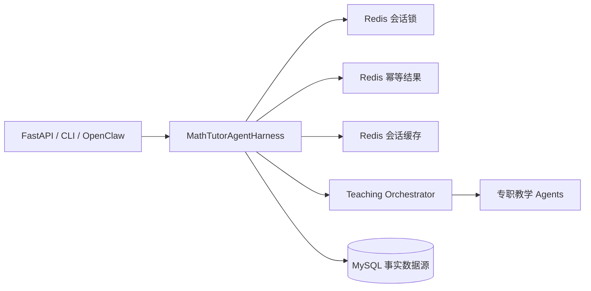

# Redis 运行协同设计

## 1. 为什么采用 Redis

MySQL 继续保存会话、消息、Agent 运行轨迹和学习记录，是系统的事实数据源。Redis 用于那些具有短生命周期、需要原子操作、且会被多个 API 实例同时访问的运行数据。

本项目采用 Redis 主要解决五个问题：

1. **同一会话的并发控制**：学生重复点击、浏览器重试或两个服务实例同时收到请求时，分布式锁保证同一会话同一时刻只执行一轮 Agent 编排，避免提示等级、消息和学习记录互相覆盖。
2. **提交幂等**：客户端为每一轮生成 `client_turn_id`。服务端在短期内保存这一轮的完整 `HarnessRunResult`，相同请求再次到达时直接返回第一次结果，避免重复调用模型和重复写入消息。
3. **热点会话缓存**：辅导对话会在短时间内连续读取同一个会话。缓存完整会话快照可减少 MySQL 读取次数，并降低每轮开始前的等待时间。
4. **认证入口限流**：登录、注册和家长关联写操作按 IP、账号及二者组合计数，在多个 API 实例之间共享限制，降低撞库、批量注册和关联滥用风险。
5. **热点知识检索缓存**：相同的结构化 RAG 查询直接复用经过边界校验的 `RetrievedTeachingContext`，减少重复 Embedding、Qdrant 查询和 MySQL 全文检索。

关系数据库也能实现上述能力，但需要频繁更新幂等记录、维护过期数据，并在长耗时模型调用期间持有数据库锁。Redis 提供带过期时间的键、原子加锁和共享内存访问，更适合这类运行协同数据。Redis 不保存唯一副本，因此不能替代 MySQL。

## 2. 接入位置

Redis 只在 `MathTutorAgentHarness` 边界使用：



具体 Agent 不读写 Redis，也不感知缓存键。这样可以在不修改教学逻辑的情况下调整 Redis、MySQL 或部署方式。

## 3. 一轮请求的处理顺序

1. 客户端生成 `client_turn_id`，并与消息一同提交。
2. Harness 取得 `session_id` 对应的分布式锁；等待超时返回 HTTP 409，客户端可以稍后重试同一个 `client_turn_id`。
3. Harness 查询幂等结果；命中时返回第一次运行的相同结果。
4. Harness 从 Redis 读取会话；未命中或缓存内容无效时从 Repository 读取，并回填缓存。
5. Orchestrator 执行本轮教学流程。
6. Harness 先把更新后的会话写入 MySQL，再更新 Redis 会话快照。
7. Harness 缓存本轮 `HarnessRunResult`，随后释放会话锁。

“先数据库、后缓存”的顺序确保即使 Redis 写入失败，正式学习数据仍然存在。缓存未命中时始终可以从 MySQL 重建。

## 4. 键与生命周期

默认前缀为 `math-tutor:v1`。版本号用于未来修改序列化格式时安全切换键空间。

| 键模式 | 值 | 默认 TTL | 用途 |
| --- | --- | ---: | --- |
| `math-tutor:v1:session:{session_id}` | `TutoringSession` JSON | 1 小时 | 热点会话快照 |
| `math-tutor:v1:turn-result:{session_id}:{client_turn_id}` | `HarnessRunResult` JSON | 24 小时 | 重复提交去重 |
| `math-tutor:v1:lock:session:{session_id}` | Redis Lock token | 120 秒 | 同一会话串行执行 |
| `math-tutor:v1:rate-limit:auth:{action}:{scope}:{digest}` | 整数计数 | 15 分钟或 1 小时 | 认证入口 IP/账号组合限流 |
| `math-tutor:v1:rag:index-generation:{collection}:{index_version}` | MySQL generation 的 Redis 镜像 | 不过期 | 运维观察，不作为事实版本 |
| `math-tutor:v1:rag:query:{provider}:{schema}:{knowledge_version}:{digest}` | `RetrievedTeachingContext` JSON | 成功 15 分钟，无结果 1 分钟 | 热点结构化检索结果 |

TTL 均通过环境变量配置。锁 TTL 应大于正常单轮 Harness 耗时；如果后续允许更长的模型调用，应同步增加锁 TTL，或增加受控的锁续期机制。

### 4.1 RAG 缓存失效

`knowledge_index_states` 是知识索引 generation 的事实来源，Redis 中的 generation 只是镜像。缓存键同时包含 `PRODUCTION_INDEX_VERSION` 和 MySQL generation：

1. 发布新索引投影时，在激活 MySQL 关键词投影的同一事务内递增 generation；
2. 题目退役、重新验证或版本替换删除索引时，在完成删除状态变更的同一事务内递增 generation；
3. 新查询读取 MySQL generation，并只访问当前 generation 的 Redis 命名空间；
4. 旧 generation 的键不做全库扫描删除，由短 TTL 自动回收；
5. 修改缓存 JSON 契约时提升 `RAG_CACHE_SCHEMA_VERSION`，无需清理旧键。

因此索引更新期间 Redis 即使不可用，generation 仍会在 MySQL 持久化；Redis 恢复后不会重新命中旧版本缓存。

## 5. 故障与降级

生产环境采用分级策略：认证限流、会话锁获取和幂等结果读取不可用时快速失败并返回 HTTP 503；普通会话缓存失败时继续运行并回源 MySQL。锁等待超时和 MySQL 乐观锁冲突返回 HTTP 409。

数据库已经提交后的缓存或幂等结果写入失败不会把成功事务改报失败，服务端记录日志并返回已完成结果。完整决策矩阵、配置约束、重试要求和监控项见 `docs/REDIS_FAILURE_POLICY.md`。

## 6. 不放入 Redis 的数据

以下数据必须持久化到 MySQL，不能只存在 Redis：

- 用户、学生、家长及授权关系；
- 完整会话和消息历史；
- Agent run、step、artifact 和审计信息；
- 学习记录、知识点、复习尝试和家长报告；
- 计费、权限、安全事件等正式业务记录。

图片与音频原文件进入对象存储，MySQL 只保存元数据和对象地址。

## 7. 配置

```dotenv
REDIS_ENABLED=true
REDIS_COORDINATION_FAIL_CLOSED=true
REDIS_URL=redis://localhost:6379/0
REDIS_KEY_PREFIX=math-tutor:v1
REDIS_SESSION_TTL_SECONDS=3600
REDIS_IDEMPOTENCY_TTL_SECONDS=86400
REDIS_LOCK_TTL_SECONDS=120
REDIS_LOCK_WAIT_SECONDS=3
REDIS_SOCKET_TIMEOUT_SECONDS=0.5
REDIS_MAX_CONNECTIONS=20
RAG_CACHE_ENABLED=true
RAG_CACHE_TTL_SECONDS=900
RAG_CACHE_NO_RESULTS_TTL_SECONDS=60
RAG_CACHE_SCHEMA_VERSION=v1
```

本地不运行 Redis 时可同时设置 `REDIS_ENABLED=false` 和 `AUTH_RATE_LIMIT_ENABLED=false`。所有非开发环境必须启用 Redis、认证限流快速失败和会话协调快速失败，并通过密钥管理服务注入带认证和 TLS 的 Redis URL，不把密码写入仓库。
