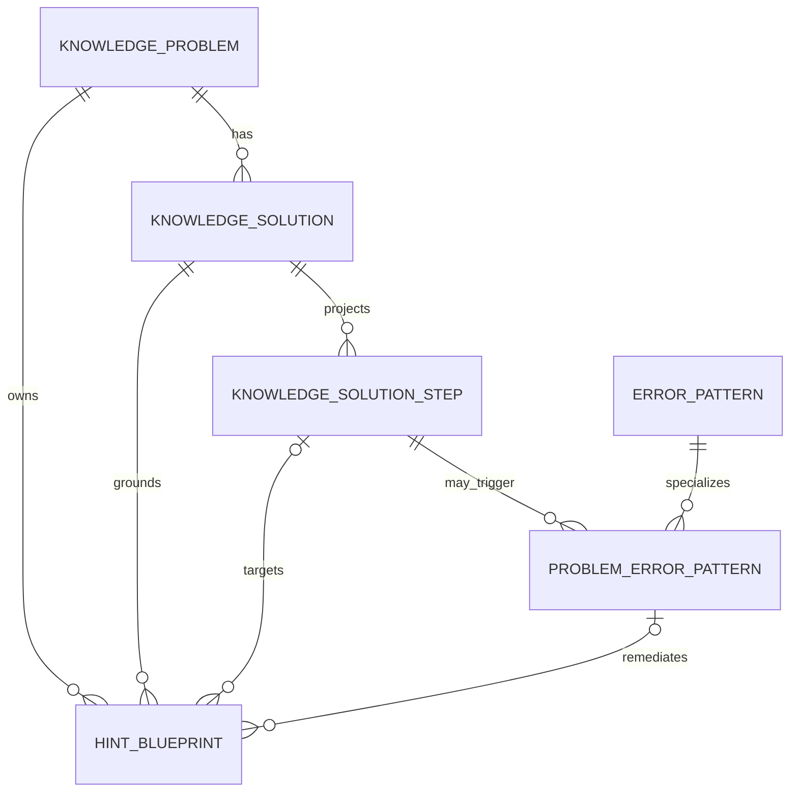

# 题目、解法步骤、错误模式与四级提示关联设计

## 1. 目标

这组数据用于回答三个问题：学生卡在题目的哪一步、当前证据更符合哪种错误模式、系统在当前提示等级可以展示什么。它是教学内容目录，不直接给学生贴能力或错误标签。

错误模式只有在本轮学生作答与 `detection_rule`、`trigger_evidence` 相符时，才可以成为本轮诊断候选。`LearnerState` 仍只保存本轮证据和带置信度的假设。

## 2. 关系

### `knowledge_solution_steps`

`KnowledgeSolution.steps_json` 仍是题解快照；该表把其中的稳定 `step_id` 投影成可被外键引用的记录。

- `(solution_id, step_key)` 唯一；
- 同步时使用 `StructuredSolutionStep` 校验顺序、依赖和字段；
- 步骤被题解移除时标记 `active=false`，保留历史关联；
- 母题导入和隔离解题写入题解时，在同一事务同步步骤索引。

### `error_patterns` 与 `problem_error_patterns`

`error_patterns` 是可复用的错误定义，例如“移项时只改变一项的符号”。`problem_error_patterns` 把它限定到一道题、一种解法和一个具体步骤，并补充本题的可观察证据、诊断追问和修复目标。

错误定义描述行为证据，不能保存“这个学生粗心”“学生代数能力差”等固定标签。

### `hint_blueprints`

每条提示同时引用题目和解法，可按需引用具体步骤和错误关联。`binding_key + hint_level` 保证同一教学目标在每个等级只有一条当前蓝图。

| 等级 | `hint_stage` | `reveal_scope` | 约束 |
| --- | --- | --- | --- |
| 1 | `direction` | `direction_only` | 只给关注方向 |
| 2 | `key_relation` | `relation_only` | 只给一个关键关系 |
| 3 | `local_step` | `single_step` | 必须引用具体解法步骤 |
| 4 | `full_explanation` | `verified_solution` | 批准前必须引用完整验证的题解 |

AI 生成的提示默认 `review_status=candidate`、`source_type=ai_candidate`。生产选择只能读取 `active=true`、`review_status=approved` 的提示，同时还要确认题目状态为 `approved` 或 `indexed`。原有运行时答案泄漏检查继续作为第二道保护。

## 3. 一致性规则

Repository 在写入时执行以下检查：

1. 题解必须属于目标题目；
2. 步骤必须属于目标题解且仍有效；
3. 错误关联、提示、步骤和题解必须处于同一道题的范围；
4. 第三级提示必须指向步骤；
5. 已批准的第四级提示只允许绑定 `verification_status=verified`、覆盖等级为 `full` 且没有未覆盖步骤的题解；
6. 同题完全相同的提示内容不能重复写入；
7. 更新题解步骤时不删除历史步骤，只将已移除步骤停用。

## 4. 管理接口

接口均需要管理员身份：

| 方法 | 路径 | 用途 |
| --- | --- | --- |
| `POST` | `/v1/admin/knowledge/problems/{problem_id}/solutions/{solution_id}/steps/sync` | 从题解 JSON 同步步骤索引 |
| `POST` | `/v1/admin/knowledge/problems/{problem_id}/error-pattern-links` | 新建或更新步骤错误关联 |
| `POST` | `/v1/admin/knowledge/problems/{problem_id}/hints` | 新建或更新分级提示蓝图 |
| `GET` | `/v1/admin/knowledge/problems/{problem_id}/teaching-map` | 查看题目完整教学关联图 |

步骤同步在新的可信母题导入和独立解题写入时自动执行。迁移前已有题解需要调用同步接口，或重新执行对应的幂等导入流程完成回填。

## 5. 教学运行时选择顺序

1. 根据学生本轮作答提取可引用证据；
2. 在当前题目的有效错误关联中匹配证据；
3. 置信度不足时继续追问，不确定错误模式；
4. 根据服务端确定的提示等级，选择同一解法或错误关联下的已批准提示；
5. 重新执行等级披露和最终答案泄漏检查；
6. 记录采用的 `solution_step_id`、`problem_error_pattern_id` 和 `hint_blueprint_id`，供后续评估。

## 6. 数据库升级

迁移版本为 `20261003_0014`，新增四张表：

- `knowledge_solution_steps`
- `error_patterns`
- `problem_error_patterns`
- `hint_blueprints`

迁移只建结构，不在升级事务中解析历史 JSON。历史回填显式执行，避免迁移过程把格式异常的旧题解部分写入关联表。
