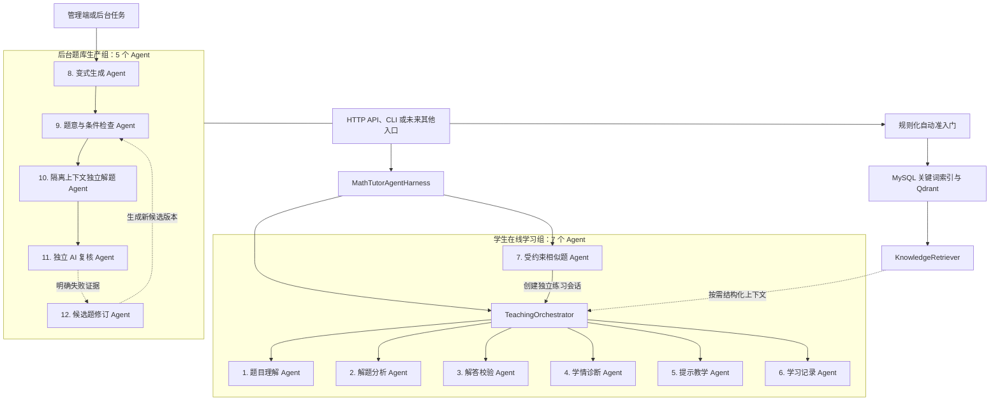
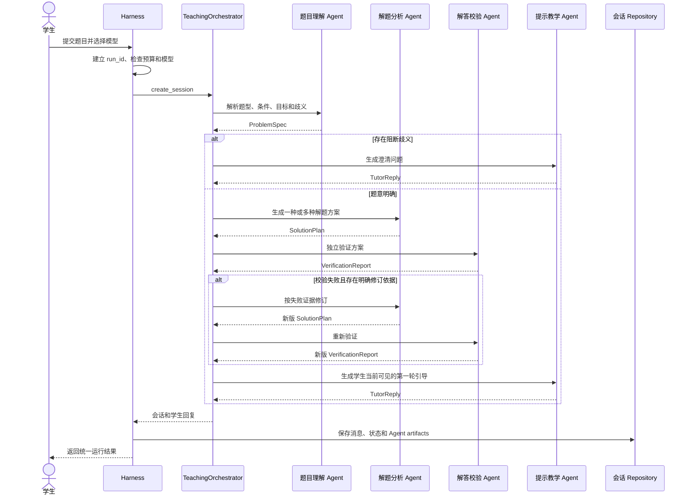
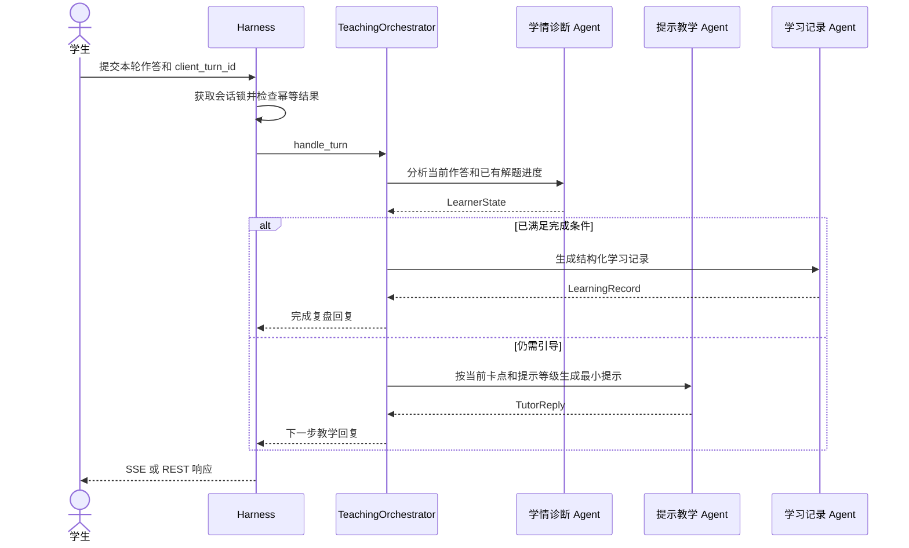
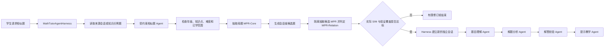
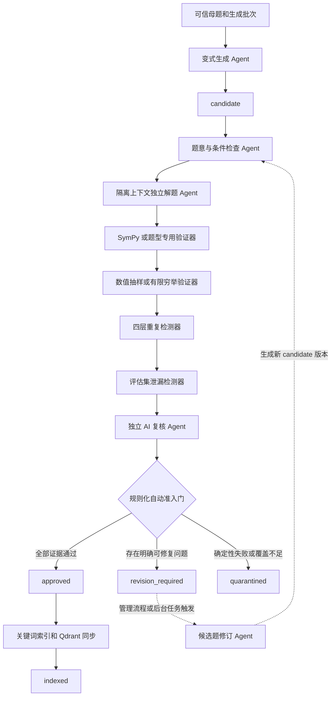
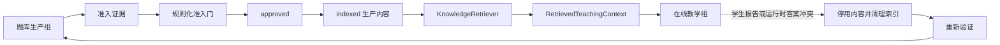
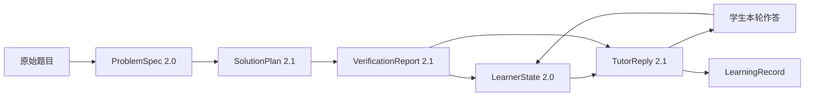

# Agent 协作架构图

本文说明项目当前有多少个 Agent、每个 Agent 的职责、它们在什么情况下协作，以及 Harness、Orchestrator、工具和数据对象在协作中承担什么角色。

## 1. 当前一共有多少个 Agent

按 `app/agents` 中已经实现的具体 Agent 类统计，当前共有 **12 个 Agent**：

- **学生在线学习组：7 个**；
- **后台题库生产组：5 个**。

此外还有两个控制组件：

- `TeachingOrchestrator`：决定在线辅导的一轮应该调用哪些 Agent、调用顺序和状态迁移；
- `MathTutorAgentHarness`：管理一次运行的入口、预算、会话锁、幂等、持久化、trace 和错误转换。

它们负责组织 Agent，但自身不算专职 Agent。因此可以把当前系统概括为：

> **12 个专职 Agent + 1 个教学编排器 + 1 个统一运行 Harness。**

12 个 Agent 不会在一次学生请求中全部运行。在线学习组服务学生会话，题库生产组服务后台内容治理，两组通过经过批准的生产索引间接协作。

## 2. Agent 全景架构

这张图中的 `KnowledgeRetriever`、规则化准入门、SymPy 验证器、数值验证器、重复检测器和评估集泄漏检测器都是 Provider、服务或确定性工具，不按 Agent 计数。它们没有开放式教学决策权，而是为 Agent 提供受控数据或硬性证据。

## 3. 学生在线学习组

| 序号 | Agent | 代码类 | 输入 | 核心输出 | 什么时候调用 |
| --- | --- | --- | --- | --- | --- |
| 1 | 题目理解 Agent | `ProblemUnderstandingAgent` | 原始题目、学科、学段、可选检索上下文 | `ProblemSpec 2.0` | 新建题目或学生补充澄清信息时 |
| 2 | 解题分析 Agent | `SolutionAnalysisAgent` | 规范题目、题目结构、可选教学上下文 | `SolutionPlan 2.1` | 题意明确后；校验给出可修订失败时再次调用 |
| 3 | 解答校验 Agent | `SolutionVerificationAgent` | 题目结构和解题方案 | `VerificationReport 2.1` | 每个新解法和修订解法产生后 |
| 4 | 学情诊断 Agent | `LearnerDiagnosisAgent` | 学生本轮作答、已校验解法和此前进度 | `LearnerState 2.0` | 普通辅导轮次收到学生作答后 |
| 5 | 提示教学 Agent | `HintTeachingAgent` | 学情状态、已校验解法、提示等级、可选检索上下文 | `TutorReply 2.1` | 创建会话的首轮回复及后续每轮教学回复 |
| 6 | 学习记录 Agent | `LearningRecordAgent` | 已完成会话、解题方案、真实作答证据 | `LearningRecord` | 会话达到完成条件后 |
| 7 | 受约束相似题 Agent | `ConstrainedSimilarPracticeAgent` | 已发布例题、大学高数范围、知识点、难度和目标 S/M/T | 候选题、母题/候选 `MPR-Core`、`MPR-Relation` | 学生从知识点例题请求相似题时 |

### 3.1 新建辅导会话时怎样协作

解题分析和解答校验形成有限反馈环。默认最多修订两次，每次修订后都必须重新校验，不能因为重试次数用尽而降低通过标准。

### 3.2 学生继续作答时怎样协作

学情诊断只使用本轮可定位的作答证据，并以此前已经确认的最远解题步骤作为进度下限。这样学生已经完成后半段步骤时，系统不会因为一句简短回复重新回到开头。

### 3.3 相似题请求怎样协作

相似题 Agent 不直接把题目写入正式题库。它生成的题目只在独立练习会话中使用，随后仍需经过在线教学组的理解、分析和校验。S/M 是母题与候选题之间的关系，只接受隔离关系复核器的结论；生成器自报等级不参与选择。会话级 MPR 复核不能替代正式题库的条件检查、独立解题、确定性工具证据、去重、泄漏检查和规则准入。

## 4. 后台题库生产组

| 序号 | Agent | 代码类 | 输入 | 核心输出 | 边界 |
| --- | --- | --- | --- | --- | --- |
| 8 | 变式生成 Agent | `QuestionVariationAgent` | 可信母题、知识范围、难度、批次预算和版本化提示 | 候选题草稿 | 只能创建 `candidate`，不能批准 |
| 9 | 题意与条件检查 Agent | `ProblemConditionCheckAgent` | 候选题及结构化条件 | 歧义、完整性、定义域、解数和学段检查证据 | 检查题目是否成立，不负责放行 |
| 10 | 隔离上下文独立解题 Agent | `IndependentSolvingAgent` | 不含生成答案和推理的候选题 | 独立答案、解法和置信证据 | 不能读取生成 Agent 的参考答案 |
| 11 | 独立 AI 复核 Agent | `IndependentReviewAgent` | 候选答案、独立答案、工具证据和教学标签 | 一致性复核证据 | 意见不能覆盖确定性失败 |
| 12 | 候选题修订 Agent | `CandidateRevisionAgent` | `revision_required` 题目和明确失败证据 | 新的候选题版本 | 最多两次，不能原地覆盖或自行批准 |

### 4.1 题库生产协作流程

其中真正由模型承担开放式任务的是 5 个 Agent。SymPy、数值验证、重复检测、泄漏检测和准入门采用确定性程序或规则服务，因此不会让某个模型同时担任“出题者、解题者和批准者”。

当前代码中的 `CandidateValidationService` 已直接编排条件检查、独立解题和独立复核，并串联确定性验证器及准入门。候选题修订 Agent 与 Repository 已实现为受约束能力，但 `CandidateValidationService` 目前不会自动触发它；仍需由管理流程或后台任务在 `revision_required` 后调用。它不属于学生在线请求链。

## 5. 两组 Agent 怎样产生联系

两组 Agent 不直接互相发送自由文本消息，也不会共享未审核的模型推理。它们通过生产索引和结构化对象衔接：

协作边界：

1. 在线教学组只能检索有效的 `indexed` 内容。
2. `candidate`、`validating`、`revision_required` 和 `quarantined` 不能进入学生上下文。
3. 检索结果先转换为 `RetrievedTeachingContext`，原始长文和内部证据不会直接交给教学 Agent。
4. 学生报告错误或运行时出现答案冲突时，系统先停用索引，再让题库生产组重新验证。
5. 会话临时相似题不会自动变成正式题库内容。

## 6. Agent 之间传递什么

Agent 不依赖一段不可检查的自由对话来协作，而是交接带版本的结构化 artifact。

| Artifact | 主要生产者 | 主要消费者 | 主要内容 |
| --- | --- | --- | --- |
| `ProblemSpec 2.0` | 题目理解 Agent | 解题分析、提示教学 | 规范题干、条件、目标、题型、歧义和置信度 |
| `SolutionPlan 2.1` | 解题分析 Agent | 解答校验、学情诊断、提示教学 | 多解法、推荐路线、关键突破口、步骤和易错点 |
| `VerificationReport 2.1` | 解答校验 Agent | Orchestrator、学情诊断、提示教学 | 通过状态、覆盖范围、工具证据和修订依据 |
| `LearnerState 2.0` | 学情诊断 Agent | 提示教学 Agent | 本轮有效尝试、正确点、误区假设和当前进度 |
| `TutorReply 2.1` | 提示教学 Agent | 前端和下一轮会话 | 本轮动作、提示等级、学生可见文本和下一步建议 |
| `LearningRecord` | 学习记录 Agent | 学习历史、复习和报告服务 | 真实错因、提示使用、完成情况和知识点证据 |

每个 artifact 都保存 `run_id`、Agent 名称、schema 版本、结构化 payload 和置信度。Harness 将它们随会话持久化，因此可以定位问题发生在读题、解法、校验、诊断还是教学表达阶段。

## 7. 协作控制规则

### 7.1 谁能决定调用顺序

- API、CLI 和前端不能直接实例化某个 Agent；它们统一调用 Harness。
- Harness 管理一次运行是否可以开始以及是否可以安全保存。
- TeachingOrchestrator 决定在线辅导调用哪些 Agent。
- 后台服务决定题库生产 Agent 和确定性工具的顺序。
- 专职 Agent 不能绕过编排器自行调用任意其他 Agent。

### 7.2 失败和重试

- 题意存在阻断歧义：暂停解题，先让学生澄清。
- 解答校验失败：只有存在明确修订依据才回到解题分析，最多两次。
- 候选题确定性检查失败：模型复核不能覆盖，进入修订或隔离。
- 候选题自动修订：每次生成新版本并执行全套重新验证，最多两次。
- 模型或 RAG 暂时不可用：保留会话和输入，按可用能力降级。
- 同一 `client_turn_id` 重试：返回已有运行结果，避免重复执行同一轮。

### 7.3 数据和权限

- 在线会话始终绑定学生身份，Repository 校验会话归属。
- 教材知识检索与学生个人历史检索使用不同 Provider 和数据边界。
- Agent 只能看到完成当前职责所需的最小上下文。
- 内部隐藏推理不作为协作接口，也不返回前端；系统保存结构化结论和可审计证据。

## 8. 代码位置

| 内容 | 位置 |
| --- | --- |
| 12 个 Agent 的实现 | `app/agents/` |
| 在线教学编排 | `app/agents/tutoring_team.py` 中的 `TeachingOrchestrator` |
| Harness | `app/harness/math_tutor.py` |
| Harness 依赖装配 | `app/harness/factory.py` |
| 候选题生成编排 | `app/services/question_generation.py` |
| 候选题验证编排 | `app/services/candidate_validation.py` |
| Agent artifact 数据结构 | `app/domain/schemas.py` |
| Agent 运行和步骤持久化模型 | `app/models/agent.py` |

## 9. 相关文档

- [数学引导产品业务流程图](../module/系统架构模块/业务流程图.md)
- [数学教育多 Agent 系统设计](../module/系统架构模块/SYSTEM_DESIGN.md)
- [Math Tutor Agent Harness](../module/系统架构模块/HARNESS.md)
- [数学辅导 Agent 系统架构](../module/系统架构模块/architecture.md)
- [解答校验失败后的有限修订流程](../module/教学辅导模块/SOLUTION_REVISION.md)
- [候选题有限自动修订](./候选题修订Agent/CANDIDATE_REVISION.md)
- [规则化自动准入门](../module/题库生产与治理模块/AUTOMATIC_ADMISSION_GATE.md)

