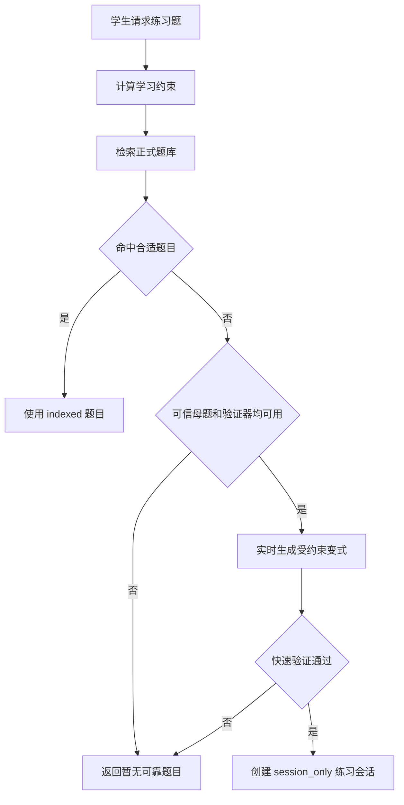

# 受约束的相似题生成

## 目标

相似题用于巩固当前会话正在学习的知识，不用于引入未学内容。每一道即时练习题都必须同时满足年级、知识点、难度和学生已学范围约束。

系统采用“正式题库优先检索，批准母题支持受约束实时变式，优质临时题异步沉淀”的策略。实时生成是正式题库暂时没有合适结果时的有限补充，不是绕过题库准入的入口。

## 题目供给决策

下面是目标供给顺序。当前知识星球“做一道相似题”已经实现第 5—7 步的 MPR 实时生成链路；正式题库优先检索尚未接入该按钮，已记录在 TODO 和性能优化计划中。

学生请求“再来一道”“生成类似题”或“给我某知识点的题目”时，按以下顺序执行：

1. 解析目标知识点、学段、年级、期望难度和已学范围；
2. 通过 `KnowledgeRetriever` 检索 `indexed` 正式题目；
3. 使用题目条件、求解目标和解法结构重排候选题；
4. 有合适结果时直接创建练习会话；
5. 没有合适结果时，查找适用的 `approved` 或 `indexed` 可信母题；
6. 只有可信母题和当前题型的确定性验证器都存在时，才实时生成变式；
7. 实时题快速验证失败、覆盖不足或超出已学范围时停止，不返回未验证的兜底题。



## 范围计算

系统从 MySQL 读取学生档案中的学段、具体年级，以及结构化学习记录里的知识点证据。允许范围由两部分组成：

1. 历史学习记录中已经接触过的知识点；
2. 当前教学会话正在讲解的目标知识点。

当前目标会被加入允许范围，使学生完成本题后可以立即巩固；其他新知识点不会因此被放行。知识点使用目录中的稳定 code，尚未落库的当前会话标签使用 `session:` 命名空间，避免与目录 code 混淆。

## 实时生成与快速校验

知识星球中的“做一道相似题”使用同一个 Agent 内的四阶段流程：

1. **母题 MPR 抽取**：把知识点、数学对象、变量、显式/隐含条件、目标、规范结构、证明义务、策略步骤、关键突破口和验证状态统一写入 `MPR-Core`；
2. **受控生成**：根据目标 S/M/T、难度及固定变式计划，并行生成 1–3 道紧凑的结构化候选题；
3. **候选 MPR 与关系复核**：在隔离的模型调用中重新抽取候选题 `MPR-Core`，独立检查数学正确性和验证覆盖，并建立母题到候选题的 `MPR-Relation`；
4. **硬规则准入**：以独立关系复核判定的实际 S/M 为准，排除数学错误、条件不完整、关系不确定、S/M/T 不达标、验证覆盖不足及评分低于门槛的候选，再选择质量最高者。

候选题分成 1–3 个短 JSON 并行生成，避免模型在单个过长响应中因 token 上限返回半截 JSON。候选编号由服务端指定，各候选独立复核，最后由服务端使用同一组确定性规则和质量分选择结果。

学生在生成前选择“简单 / 中等 / 困难”。后端将选择解析为固定规则，前端不能自由组合 S/M/T：

| 用户难度 | S/M/T | 出题规则 | 候选数 | 质量均分门槛 |
| --- | --- | --- | ---: | ---: |
| 简单 | `S1 + M1 + T2` | 只改参数、初值或局部条件；原主要方法可直接复用，用于巩固步骤 | 1 | 72 |
| 中等 | `S2 + M2 + T1` | 改变函数族或运算结构；保留主思想，但重建至少一个关键环节 | 2 | 78 |
| 困难 | `S3 + M3 + T4` | 改变显式、隐式、等式或不等式关系；切换关键策略并进行方法迁移 | 3 | 82 |

默认为“中等”。难度同时决定数值难度 1/2/3，不再以母题难度为基准做模糊的“更容易 / 同难度 / 更难”偏移。

母题 MPR 使用“母题完整内容 + LLM 模型 + 分析提示版本”生成缓存键。重复从同一例题出题时可以跳过母题 MPR 抽取；修改母题、模型或提示版本后缓存会自动失效。

## MPR 表示与题间关系

`MPR-Core` 只描述一道题自身，包含四部分：

1. **符号结构**：数学对象、变量、定义域、显式/隐含条件、目标和规范结构；
2. **思维策略**：主方法、辅助方法、有序策略步骤和关键突破口；
3. **教学信息**：知识点、先修、难度、常见错误和方向提示；
4. **验证信息**：答案状态、证明覆盖和证据类型。

`MPR-Relation` 只描述母题和候选题之间的关系，保存：

- `source_problem_id` 与 `target_problem_id`；
- 实际 `structure_level` 和 `reasoning_level`；
- 发生的变换、保留的方法和改变的方法；
- 结构判定证据、思维判定证据、置信度和复核状态。

因此 S/M 不再作为单道题的固有标签。生成器只接收目标 S/M 用于设计候选，不得给自己的输出定级；独立复核器比较两份 MPR 后才能给出实际 S/M。证据不足时必须返回 `UNKNOWN + review_required`，服务端会拒绝该候选，不能为了满足目标等级而强行分类。

### 结构变化 S

| 等级 | 要求 |
| --- | --- |
| `S1` | 改变参数、初值或局部条件 |
| `S2` | 改变函数族或运算结构，不得只换参数 |
| `S3` | 改变显式、隐式、等式或不等式等关系形式 |
| `S4` | 改变数学对象或任务载体，例如耦合对象、积分迭代或复合任务 |

### 思维变化 M

| 等级 | 要求 |
| --- | --- |
| `M1` | 原主要论证可以直接复用，用于同法巩固 |
| `M2` | 保留主思想，但必须重新建立至少一个关键证明环节 |
| `M3` | 切换关键策略，使母题关键一步无法照搬 |
| `M4` | 综合多种策略，或迁移到收敛速度、误差等更深结论 |

### 教学目标 T

- `T1`：在不同题面中识别方法；
- `T2`：巩固易错步骤；
- `T3`：克服机械套用；
- `T4`：迁移或综合方法。

难度由结构变化、思维变化和教学目标共同定义。数值计算更繁琐不能单独作为提高难度的依据。

代码硬规则还会检查：独立判定的实际 S/M 必须与请求目标一致；关系置信度至少为 `0.65`；答案验证和证明覆盖必须完整；S2 及以上不能只改参数；M3/M4 不能直接复用母题证明；题面不能携带答案；方向提示不能泄露最终答案；候选不能与母题文本过度相似。生成器自报的结构名、策略名或等级都不能覆盖独立复核结论。选择阶段使用独立复核的教学质量评分。全部候选失败时，系统把复核问题作为明确失败证据重新设计一次；最多执行两轮，第二轮仍无合格题时结束，不返回未通过的兜底题。

快速验证的结论只回答“这道题是否可以在当前会话中使用”，不等于完整题库准入。当前确定性验证器无法完整覆盖的证明题，可以在独立 AI 复核通过后作为 `session_only` 临时题使用，但其验证覆盖仍属于有限，不得因此进入正式题库或生产索引。

## 临时题的数据边界

实时生成题保存为会话练习对象，并至少记录：

```text
origin = runtime_generated
visibility = session_only
source_knowledge_point_code + source_content_key = 数据库母题定位键
generator_version = 生成器版本
constraint_snapshot = 本轮年级、知识点、难度与已学范围
verification_summary = 快速验证范围和结果
```

`session_only` 题目：

- 可以供当前学生作答、获得提示并形成学习记录；
- 不进入 MySQL 生产关键词索引或 Qdrant；
- 不进入其他学生的推荐池；
- 不作为新的可信母题；
- 不具有 `approved` 或 `indexed` 身份；
- 后续发现冲突时，只影响对应练习会话和学习记录修正。

## 异步沉淀为正式题目

临时题具有复用价值时，后台可以把它复制为新的 `candidate`。复制动作必须创建新的题库对象和版本关系，不能直接修改会话题目的可见范围或把快速验证结果当作正式准入证据。

新候选题重新执行：

1. 条件与题意检查；
2. 隔离上下文独立解题；
3. 题型要求的两类数学证据；
4. 文本、公式、条件和解法结构去重；
5. 固定评估集泄漏检查；
6. 独立 AI 教学复核；
7. 规则化自动准入；
8. 生产关键词索引和 Qdrant 同步。

只有最终达到 `indexed` 的新题库版本，才能被其他学生通过 RAG 检索。

## 会话与幂等

相似题会创建独立学习会话，并继承原会话的学生、学科、年级和 LLM 模型。后续提示、判题和学习记录都围绕新题运行，不会错误复用原题答案。

客户端重试时继续使用原来的 `client_turn_id`。系统以“来源会话 + client_turn_id”缓存生成结果，避免网络重试重复创建题目。

新会话保存 `practice_constraints` artifact，记录来源会话、学段、难度、知识点 code、生成器版本和约束校验结果；标准答案不进入该公开追踪 artifact。

从知识点例题生成时，该 artifact 还会保存：

- 母题 `MPR-Core`、候选题 `MPR-Core` 和 `MPR-Relation`；
- 请求的 S/M/T 目标以及独立复核得到的实际 S/M；
- 必须保留、必须改变和禁止采用的变式计划；
- 实际结构类型、关系形式、函数族和关键策略；
- 新增推理步骤、变式差异说明和独立复核摘要；
- `source_type=ai_original_variation`，避免把 AI 变式误标为真题。

## 当前实现范围

当前大学高数 MVP 只有一条学生可用的实时生成路径：知识星球的已发布例题经过母题 MPR 抽取、S/M/T 受控生成、候选 MPR 抽取和独立关系复核，然后创建独立辅导会话。候选数由难度决定，为 1、2 或 3 道。旧的会话内线性和一元二次模板入口已停止对学生开放。

这条路径的独立 AI 复核属于会话级快速质量门。`candidate_mpr.verification=passed/full` 只表示本次隔离复核完整覆盖了它列出的数学义务，不等于已经取得 SymPy、数值抽样或其他确定性工具证据。生成题保持 `session_only`，不得进入生产索引。后续应为不同高数题型逐步增加确定性验证器和反例搜索，再把工具证据和覆盖范围写入 MPR。

MPR 抽取、受控生成和关系复核提示词集中在 `app/prompts/similar_practice.py`，流程编排和硬规则在 `app/agents/similar_practice.py`，MPR、关系及 S/M/T 请求对象在 `app/domain/practice.py`。

整体系统位置见[数学辅导 Agent 系统架构](../../module/系统架构模块/architecture.md#44-正式题库与实时练习生成)，正式题库准入见[题库内容状态机](../../module/题库生产与治理模块/PROBLEM_LIFECYCLE.md)。

当前同步生成链路的耗时分析、目标架构和分阶段实施顺序见[相似题生成性能优化方案](./SIMILAR_PRACTICE_PERFORMANCE_OPTIMIZATION.md)。

## 相关代码与目录

- [受约束相似题 Agent 实现](../../../app/agents/similar_practice.py)
- [相似题分析、生成与复核提示词](../../../app/prompts/similar_practice.py)
- [MPR、S/M/T 约束与生成结果数据对象](../../../app/domain/practice.py)
- [相似题生成 API](./API.md)
- [MPR 数据模型](./MPR_DATA_MODEL.md)
- [学生已学范围与练习约束 Repository](../../../app/repositories/practice_scope.py)
- [Harness 会话与幂等编排](../../../app/harness/math_tutor.py)
- [辅导应用服务](../../../app/services/tutoring.py)
- [相似题 Agent 自动化测试](../../../tests/test_similar_practice_agent.py)
- [Harness 代码目录](../../../app/harness/)
