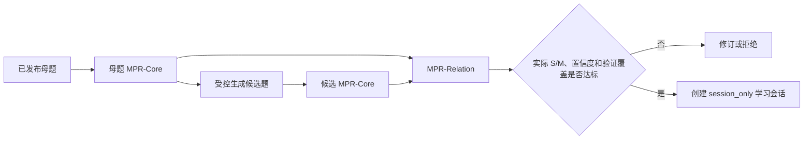

# 相似题 MPR 数据模型

## 1. 文档目的

本文定义知识星球“做一道相似题”使用的数学问题表示（Mathematical Problem Representation，MPR），并说明母题、候选题和 S/M 关系怎样进入生成、复核与会话数据。

MPR 的目标是让系统比较数学结构和思维路径，避免只根据文字相似度判断“相似”，也避免让生成 Agent 自己宣称已经达到指定的 S/M 等级。

## 2. 核心原则

1. `MPR-Core` 描述一道题本身。
2. `MPR-Relation` 描述两道题之间的关系。
3. S1—S4 和 M1—M4 只属于 `MPR-Relation`，不是单道题的固有属性。
4. 请求中的目标 S/M 只约束生成方向，不能作为复核答案。
5. 候选题必须由隔离复核器重新抽取 MPR，不能直接采用生成器自报的结构或方法。
6. 证据不足时允许输出 `UNKNOWN + review_required`，系统必须拒绝该候选。

## 3. `MPR-Core`

### 3.1 身份与范围

| 字段 | 含义 |
| --- | --- |
| `schema_version` | 当前固定为 `1.0` |
| `problem_id` | 稳定母题 ID 或当前候选编号 |
| `statement` | 题面与必要条件，不包含参考解法 |
| `subject` | 当前固定为 `math` |
| `grade_band` | 当前固定为 `university` |
| `problem_type` | 规范题型名称 |
| `knowledge_points` | 直接考查的知识点 |
| `prerequisite_knowledge` | 必要先修知识 |

数据库母题 ID 使用 `knowledge_point_code:content_key`。运行时候选使用当前生成轮次中的 `c1`、`c2`、`c3`，只在本次关系判断和会话证据内生效。

### 3.2 符号结构

| 字段 | 含义 |
| --- | --- |
| `mathematical_objects` | 函数、数列、积分、方程等对象 |
| `variables` | 变量符号、作用和定义域 |
| `conditions` | 显式或隐含条件及其解题作用 |
| `goal` | 求解、证明或判定目标及结果类型 |
| `canonical_structure` | 题型结构、关系形式、函数族和规范结构模式 |
| `proof_obligations` | 必须覆盖的定义域、存在性、唯一性、边界、候选解筛选等事项 |

`canonical_pattern` 应在去掉具体数字后仍能区分题型。它不能只写“极限题”“函数题”等宽泛标签。

### 3.3 思维策略

| 字段 | 含义 |
| --- | --- |
| `primary_method` | 解决本题的主要方法 |
| `secondary_methods` | 必要的辅助方法 |
| `strategy_steps` | 有序的“方法 + 目的”步骤 |
| `key_breakthrough` | 决定解法的关键关系、构造或观察 |

策略步骤记录每一步要解决的问题。例如“计算左右极限”还不够，应说明它用于判断极限是否存在以及属于哪类间断点。

### 3.4 教学与验证

| 字段 | 含义 |
| --- | --- |
| `difficulty` | 当前大学高数 MVP 的 1—3 级粗粒度难度 |
| `common_errors` | 常见错误模式 |
| `hint_directions` | 不泄露答案的方向提示 |
| `verification.status` | `pending`、`passed`、`failed` 或 `partial` |
| `verification.answer_status` | 答案检查状态 |
| `verification.proof_coverage` | `none`、`partial` 或 `full` |
| `verification.evidence_types` | 本次使用的证据类型 |
| `verification.summary` | 验证范围和结论摘要 |

当前候选题的 `independent_llm_review` 是会话级 AI 证据。即使它给出 `passed/full`，也不能冒充 SymPy、数值抽样或其他确定性工具证据，不能据此把题目批准进正式题库。

## 4. `MPR-Relation`

| 字段 | 含义 |
| --- | --- |
| `relation_type` | 当前固定为 `variant_of` |
| `source_problem_id` | 母题 ID |
| `target_problem_id` | 候选题 ID |
| `structure_level` | 实际 S1—S4，无法判断时为 `UNKNOWN` |
| `reasoning_level` | 实际 M1—M4，无法判断时为 `UNKNOWN` |
| `transformations` | 实际发生的结构、条件和任务变化 |
| `preserved_methods` | 两题之间保留的方法 |
| `changed_methods` | 候选题新增或改变的方法 |
| `structure_evidence` | S 等级判断依据 |
| `reasoning_evidence` | M 等级判断依据 |
| `confidence` | 0—1 的关系判断置信度 |
| `review_status` | `accepted`、`review_required`、`rejected` 或 `unknown` |

### 4.1 S：结构变化

| 等级 | 关系含义 |
| --- | --- |
| `S1` | 主要结构不变，只改变参数、初值或局部条件 |
| `S2` | 函数族或运算结构发生实质变化 |
| `S3` | 显式、隐式、等式或不等式等关系表达发生变化 |
| `S4` | 数学对象或任务载体发生变化 |

### 4.2 M：思维变化

| 等级 | 关系含义 |
| --- | --- |
| `M1` | 母题主要论证可以直接复用 |
| `M2` | 保留主思想，但必须重新建立至少一个关键局部 |
| `M3` | 关键策略改变，母题关键一步不能直接照搬 |
| `M4` | 多策略综合，或迁移到误差、速度等更深目标 |

## 5. 准入不变量

运行时选择候选题时同时执行以下规则：

1. `accepted=true`；
2. 数学正确性和条件完整性都通过；
3. `relation.review_status=accepted`；
4. 实际 S/M 与本次请求目标完全一致；
5. `confidence >= 0.65`；
6. 候选答案通过检查，证明覆盖为 `full`；
7. S2 及以上不能只是参数变化；
8. M3/M4 不能直接复用母题关键证明；
9. 题面不携带答案，方向提示不泄露最终结论；
10. 候选题与母题不能只是高文本重复。

任一条件失败都会进入一次基于明确失败证据的重新设计。最多两轮，仍不合格时结束请求，不返回兜底题。

## 6. 当前会话存储

通过 `POST /v1/tutoring/knowledge-example-practice` 生成成功后，`constrained_similar_practice` artifact 保存：

- `mother_mpr`；
- `candidate_mpr`；
- `mpr_relation`；
- 目标及实际 S/M/T；
- 变式计划、变化摘要和验证摘要；
- `origin=runtime_generated`；
- `visibility=session_only`；
- 母题知识点 code 和内容 key；
- 模型、生成器和客户端幂等标识。

标准答案不放入公开的 `practice_context`。生成过程内部答案只供隔离复核和会话初始化使用。

## 7. 一次实际结果

母题为有理函数连续性和间断点讨论，系统生成：

\[
f(x)=\frac{e^x-1}{x(e^x-2)}
\]

要求讨论连续区间并判断间断点类型。独立关系复核结果为：

- 实际关系：`S2 + M2`；
- 置信度：`0.90`；
- S2 依据：函数族从有理函数变为指数与有理式复合，局部极限工具发生实质变化；
- M2 依据：仍保留“定义域 → 候选点 → 左右极限 → 分类”的主框架，但需要重新建立局部极限计算；
- 验证：答案、定义域和间断点分类通过隔离 AI 复核。

该题只能用于对应学生的临时学习会话，不能进入 MySQL 正式题库或 Qdrant 生产索引。

## 8. 当前边界与后续演进

当前已经实现：

- 运行时母题与候选题 MPR；
- 独立 MPR 关系判断；
- 不确定关系拒绝；
- 会话 artifact 保存；
- 前端现有 REST DTO 兼容。

当前尚未实现：

- 可复用的 MySQL `problem_mpr_versions` 和 `problem_relations` 表；
- 管理端 MPR 查看与人工修正；
- MPR 的语义、结构和策略多表示向量索引；
- 各类大学高数题的确定性验证器；
- 由 MPR 直接构造已验证会话启动包；
- 固定 MPR 抽取与关系分类评估集。

正式题库若采用 MPR，应保存版本、内容哈希、模型和提示版本，且必须重新执行完整准入流程，不能直接复制会话级复核结论。

## 9. 相关代码与文档

- [MPR 数据对象](../../../app/domain/practice.py)
- [相似题 Agent](../../../app/agents/similar_practice.py)
- [MPR 抽取、生成与关系复核提示词](../../../app/prompts/similar_practice.py)
- [辅导应用服务](../../../app/services/tutoring.py)
- [受约束相似题生成](./CONSTRAINED_SIMILAR_PRACTICE.md)
- [相似题性能优化](./SIMILAR_PRACTICE_PERFORMANCE_OPTIMIZATION.md)
