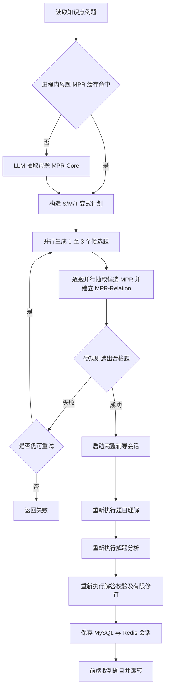
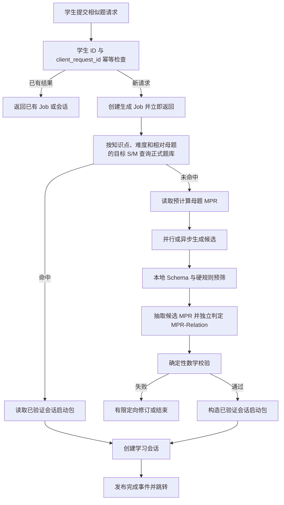

# 相似题生成性能优化方案

## 1. 文档目标

本文说明知识星球“做一道相似题”为什么慢，以及怎样在不降低数学正确性、条件完整性和教学质量门槛的前提下缩短等待时间。

优化对象是以下入口：

- `POST /tutoring/knowledge-example-practice`；
- `TutoringService.create_knowledge_example_practice`；
- `ConstrainedSimilarPracticeAgent.run_from_knowledge_example`；
- 相似题生成完成后的辅导会话初始化。

本文是实施方案。凡标记为“计划”的内容尚未实现，不能当作当前系统能力。

## 2. 当前链路

当前知识点例题生成相似题时，服务端同步执行整条链路，前端必须等待全部步骤结束后才能跳转：



### 2.1 当前模型调用

一次冷启动请求至少可能包含：

1. 一次母题 `MPR-Core` 抽取；
2. 一轮候选生成，其中简单题 1 次、中等题 2 次、困难题 3 次，候选之间已并行；
3. 每道候选一次隔离 MPR 抽取、关系分类和数学复核，候选之间已并行；
4. 会话初始化阶段的题目理解；
5. 会话初始化阶段的解题分析；
6. 解答校验需要模型参与时的校验调用；
7. 校验失败后最多两轮解法修订和重新校验。

候选并行只能减少同一生成阶段的墙钟时间，不能消除“母题 MPR → 候选生成 → 候选 MPR 与关系复核 → 完整辅导初始化”之间的串行等待。第一次生成失败时，候选生成和复核还会再执行一轮。

### 2.2 当前实现中已经存在的优化

- 简单、中等、困难分别只生成 1、2、3 个候选；
- 多个候选通过 `ThreadPoolExecutor` 并行生成；
- 母题 MPR 具有最多 256 条的进程内 LRU 缓存；
- 提示词限制候选输出长度；
- S/M 由独立 `MPR-Relation` 判定，生成器自报标签不参与准入；
- 相同学习会话的普通辅导轮次具有 Redis 幂等结果缓存。

这些措施有效，但仍不足以解决当前端到端等待时间。

## 3. 已确认的主要瓶颈

### 3.1 生成完成后重复理解和求解

相似题生成阶段已经产出题面、答案、证明步骤、母题与候选题 MPR、关系证据和独立复核结果。随后 `Harness.start_session` 仍按普通新题执行题目理解、解题分析和解答校验。

重新校验仍然有必要，但“再次从零提取题意”和“再次从零生成完整解法”造成了重复模型调用。后续应把两份 MPR 和关系证据转换为可复核的会话初始化对象，只保留独立校验，不直接信任生成 Agent 的答案或隔离 AI 复核中的非确定性结论。

### 3.2 母题 MPR 缓存只存在于单个进程

当前 `_analysis_cache` 是 Python 进程内存中的 LRU：

- API 重启后全部失效；
- 多 worker 之间不能共享；
- 同一母题在多个 worker 中可能同时重复分析；
- 无法在管理员发布内容时预计算。

母题是已发布的公共教学内容，其 MPR 适合按内容哈希、MPR Schema、模型版本和提示版本持久化。

### 3.3 知识点例题入口没有先使用正式题库

架构文档定义的是“正式题库优先，实时生成补充”。当前知识点例题接口读取母题后直接进入在线生成，没有先查询满足知识点、大学范围和难度要求，并且与当前母题存在目标 S/M 关系的 `approved/indexed` 题目。S/M 是两题之间的关系，不能作为单题的固有筛选字段。

这会把本可通过数据库或 RAG 在毫秒到秒级完成的请求变成多次 LLM 调用。

### 3.4 `client_request_id` 尚未形成真正的幂等保护

前端会提交 `client_request_id`，当前代码只把它保存进 `practice_context`。网络超时后重复点击，仍可能重新执行整条生成链路并创建重复会话。

### 3.5 LLM HTTP 请求没有复用连接

当前 Provider 使用同步 `httpx.post` 发起请求。每次调用都缺少显式的长期 `httpx.Client` 或 `AsyncClient`，难以稳定复用连接池；候选并行依赖线程池，也不便统一取消、设置阶段截止时间和收集调用指标。

### 3.6 全局输出预算大于单阶段实际需要

Provider 默认使用全局 `LLM_MAX_OUTPUT_TOKENS`。相似题提示词已经限制候选长度，但调用层无法为母题 MPR、单题生成和“候选 MPR + Relation + 数学复核”分别设置输出预算。复核输出比旧版长，预算过小会截断 JSON，预算过大又会增加长输出和异常响应风险。

### 3.7 当前耗时指标没有覆盖完整请求

`Harness.start_session` 的计时在相似题已经生成后才开始。因此响应中的 `duration_ms` 主要反映辅导会话初始化，不包含母题 MPR、候选生成和关系复核。没有分阶段指标时，很难判断优化是否真的生效。

## 4. 优化原则

1. **数学质量门槛不降级**：生成 Agent 的答案不能直接成为正确性证据。
2. **确定性失败不可被模型覆盖**：公式、定义域、回代、边界和重复检测失败时必须拒绝。
3. **先复用可信内容，再在线生成**：正式题库或预验证题命中时不调用在线生成模型。
4. **复用结构化产物**：同一请求中已经完成的分析不重复计算。
5. **区分真实耗时和感知耗时**：后台异步化能改善交互，但仍要继续减少实际计算时间。
6. **所有加速策略都经过固定评估集**：不能只比较速度，不比较错误准入率和答案正确率。

## 5. 目标架构



目标链路有三个关键变化：

1. 优先从正式题库获得已有验证证据的题目；
2. 母题 `MPR-Core` 在内容发布或更新时预计算；
3. 在线生成结果通过独立校验后直接形成会话启动包，避免再次从零分析和求解。

## 6. 分阶段实施计划

### P0：先补全性能观测

在修改算法前先记录真实基线，否则无法判断瓶颈是否转移。

每个请求至少记录：

| 指标 | 含义 |
| --- | --- |
| `practice_total_ms` | 从 API 收到请求到会话保存完成的总耗时 |
| `source_load_ms` | MySQL 读取母题耗时 |
| `analysis_ms` | 母题 MPR 抽取耗时 |
| `analysis_cache_hit` | 母题 MPR 缓存是否命中 |
| `candidate_generation_ms` | 每轮候选生成墙钟耗时 |
| `candidate_count_requested/completed` | 请求数和实际完成数 |
| `review_ms` | 候选 MPR、关系分类和独立复核耗时 |
| `relation_unknown_count` | 因关系证据不足返回 `UNKNOWN` 的候选数 |
| `relation_confidence` | 被采用候选的关系置信度 |
| `generation_rounds` | 实际生成轮数 |
| `session_bootstrap_ms` | 会话初始化耗时 |
| `llm_call_count` | 本次请求实际模型调用次数 |
| `llm_input_tokens/output_tokens` | 各阶段 token 用量 |
| `provider/model` | 实际模型与 Provider |
| `result` | 题库命中、在线生成成功或失败原因 |

实现要求：

- 总计时从 `TutoringService.create_knowledge_example_practice` 入口开始；
- 每个阶段写入统一 `request_id/job_id`；
- 日志保存 ID、哈希、阶段和耗时，不记录学生私有对话或完整提示词；
- Provider 返回统一调用元数据，包含状态码、`finish_reason`、token 和耗时。

### P1：实现真正的请求幂等

Redis 键建议：

```text
practice:request:v1:{student_id}:{client_request_id}
```

值保存 `job_id`、状态和最终 `session_id`，TTL 建议 24 小时。处理规则：

1. 首次请求使用原子 `SET NX` 建立占位；
2. 同一学生重复请求返回同一 Job；
3. 已完成请求直接返回原会话；
4. 已失败请求明确返回可重试状态，不能静默启动第二条链路；
5. 不同学生即使 `client_request_id` 相同也必须隔离。

该步骤不能缩短单次正常请求，但能立即消除网络重试造成的重复等待和重复费用。

### P1：把母题 MPR 抽取移出实时链路

新增可审计的母题 MPR 版本记录，建议字段：

```text
knowledge_point_code
content_key
source_content_hash
provider_id
model_name
prompt_version
mpr_schema_version
mpr_core_json
status
created_at
updated_at
```

计算和失效规则：

- 管理员发布或更新 `problem_type` 内容时异步抽取 MPR；
- 缓存键包含内容哈希、模型、提示版本和 Schema 版本；
- 任一版本变化都会生成新记录，旧记录保留审计但不再使用；
- Redis 只保存热点副本，MySQL 保存可追溯结果；
- 使用短时分布式锁避免多个 worker 同时分析同一版本；
- 请求时若预计算缺失，可以回退在线抽取，但需要记录 `analysis_fallback=true`。

完成后，绝大多数已发布例题的实时链路可以减少一次串行 LLM 调用。

### P1：正式题库优先

在实时生成前增加题库查询：

```text
knowledge_point_code
grade_band = university
difficulty
problem_type
teaching_goal
relation_source_problem_id = 当前母题
relation_structure_level = 目标 S
relation_reasoning_level = 目标 M
relation_review_status = accepted
content_status in (approved, indexed)
index_status = active
```

候选结果继续按题目条件、求解目标和解法结构重排，并排除：

- 学生近期已经做过的题；
- 当前母题本身；
- 已退役、重新验证中或验证覆盖不足的题；
- 超出学生已学范围的知识点。

命中时直接读取题目、结构化题解和验证报告，不再调用相似题生成模型。这是降低平均耗时最有效的方案。

### P1：复用 LLM 连接和单阶段预算

将 Provider 扩展为支持请求级选项：

```text
timeout_seconds
max_output_tokens
temperature
operation_name
request_id
```

并使用进程级 `httpx.Client` 或 `AsyncClient` 复用连接池。建议初始输出预算：

| 阶段 | 建议上限 | 说明 |
| --- | ---: | --- |
| 母题 MPR | 2,500 tokens | 输出结构、策略、教学信息和待验证状态 |
| 单候选生成 | 2,000 tokens | 当前 Prompt 已限制为紧凑 JSON |
| 单候选 MPR 与关系复核 | 3,500 tokens | 每道候选独立输出 MPR、Relation 和验证摘要 |

具体值应根据真实 token 指标调整，不能只靠字符数估计。

### P1：允许部分候选成功

当前任一候选线程异常时，整轮生成可能失败，并进入第二轮完整生成。建议调整为：

1. 并发调用使用 `asyncio.gather(..., return_exceptions=True)` 或等价机制；
2. 一个候选失败时保留其他成功候选；
3. 达到当前难度要求的最小候选数后即可进入复核；
4. 设置候选阶段统一截止时间，取消尚未开始的任务；
5. 只有没有任何可复核候选时才重跑整轮；
6. 第二轮优先根据失败证据定向修订，不重复生成已经明确合格的候选。

这能减少单个 Provider 超时对整轮请求的放大效应。

### P2：建立 `PracticeBootstrapBundle`

在线生成和正式题库命中都输出统一的会话启动包：

```text
question
mother_mpr
candidate_mpr
mpr_relation
problem_spec
solution_plan
verification_report
first_step_prompt
knowledge_point_codes
source_or_generation_provenance
model_and_prompt_versions
content_hashes
```

启动包的信任规则：

1. `problem_spec` 可以从候选 `MPR-Core` 投影，但必须通过 Schema 和条件完整性检查；
2. `solution_plan` 可以复用候选的结构化步骤，但不能直接视为正确；
3. `MPR-Relation` 只证明两题之间的结构和思维关系，不能代替答案正确性证据；
4. `verification_report` 必须来自独立验证器，不能复制生成 Agent 的自评或把 `independent_llm_review` 冒充确定性工具证据；
5. 确定性验证覆盖不足时，不允许走快速启动路径；
6. 证明题或当前工具不能覆盖的题型，继续使用完整辅导初始化流程或返回暂不可用；
7. 启动包内容哈希或 MPR 版本变化后，旧验证报告立即失效。

Harness 增加 `start_session_from_verified_practice`，直接保存已经验证的三个 artifact 并进入提示教学阶段。这样可以省去重复的题目理解和解题分析调用，同时保留独立校验边界。

### P2：异步 Job 与 SSE 进度

现有同步 API 保留兼容，新增异步接口：

```text
POST /tutoring/knowledge-example-practice-jobs
GET  /tutoring/knowledge-example-practice-jobs/{job_id}
GET  /tutoring/knowledge-example-practice-jobs/{job_id}/events
POST /tutoring/knowledge-example-practice-jobs/{job_id}/cancel
```

状态建议为：

```text
queued
loading_source
searching_bank
analyzing
generating
extracting_candidate_mpr
classifying_relation
reviewing
verifying
creating_session
completed
failed
cancelled
```

前端在 500 毫秒内得到 `job_id`，随后通过 SSE 展示真实阶段。刷新页面后用同一 `client_request_id` 恢复 Job，不丢失已输入内容，也不重复生成。

异步化主要改善感知速度和可靠性；真实总耗时仍由前述缓存、复用和减少调用方案优化。

### P2：建立预验证练习池

对访问频率高的“知识点 × 难度”组合，在后台从可信母题生成一批候选，并执行完整题库准入。只有达到 `approved/indexed` 的内容才能跨学生复用。

运行时顺序调整为：

1. 查询学生未做过的正式题；
2. 查询同知识点预验证练习池；
3. 两者都未命中时才在线生成 `session_only` 题目。

练习池需要记录曝光次数、最近使用时间和学生去重信息，避免所有学生反复看到同一道题。

### P3：模型路由和 Prompt 压缩

模型路由必须以固定评估集为前提：

- 母题 MPR 可使用通过结构与策略抽取评估的快速模型；
- 简单题生成可优先使用快速模型；
- 困难题生成和独立复核保留更强模型；
- 同一个候选的生成与复核不能因为缓存或路由而失去隔离；
- 快速模型导致答案正确率、验证覆盖率或错误准入率恶化时立即回滚。

Prompt 优化方向：

1. 不在每个候选请求中重复发送与该候选无关的长母题正文；
2. 使用预计算的紧凑 `MPR-Core` 和内容哈希；
3. 仅在分析缺少必要证据时附带母题片段；
4. Review 只接收通过本地 Schema 和硬规则预筛的候选；
5. MPR-Relation 必须保留证据、置信度和 `UNKNOWN` 出口；
6. 保留目标 S/M/T、定义域、条件完整性和来源标记等硬约束。

## 7. 推荐实施顺序

| 顺序 | 工作项 | 预期收益 | 风险 |
| ---: | --- | --- | --- |
| 1 | 完整链路计时与 LLM 调用指标 | 找到真实 P50/P95 瓶颈 | 低 |
| 2 | `client_request_id` Redis 幂等 | 消除重复生成 | 低 |
| 3 | 母题 MPR MySQL/Redis 预计算 | 减少一次串行 LLM 调用 | 低 |
| 4 | LLM 连接池与请求级 token 上限 | 降低网络和长输出耗时 | 低至中 |
| 5 | 部分候选成功和阶段截止时间 | 减少慢候选拖累与整轮重试 | 中 |
| 6 | 正式题库优先和预验证练习池 | 大幅降低平均在线生成比例 | 中 |
| 7 | `PracticeBootstrapBundle` | 消除重复理解和求解 | 中至高 |
| 8 | 异步 Job、SSE 和恢复能力 | 改善等待体验与可靠性 | 中 |
| 9 | 基于评估集的模型路由 | 进一步降低时延与成本 | 中至高 |

建议先完成 1–5，再实现会改变信任边界的启动包。不能为了追求速度直接把生成 Agent 的答案写成已验证解法。

## 8. 验收指标

上线前先记录当前基线，再以同一批固定母题和模型比较。下面是第一阶段暂定目标，获得真实基线后可调整：

| 指标 | 暂定目标 |
| --- | ---: |
| API 接收请求到返回 Job | P95 ≤ 500 ms |
| 正式题库或预验证池命中 | P95 ≤ 2 s 完成会话创建 |
| 母题 MPR 缓存命中率 | 已发布热点例题 ≥ 90% |
| 在线简单题生成 | P50 ≤ 6 s，P95 ≤ 12 s |
| 在线中等题生成 | P50 ≤ 9 s，P95 ≤ 18 s |
| 在线困难题生成 | P50 ≤ 15 s，P95 ≤ 30 s |
| 网络重试导致的重复 Job | 0 |
| 在线生成完整重跑率 | ≤ 10% |

质量指标必须同时满足：

- 错误内容自动准入率不高于当前基线，并继续作为上线阻断指标；
- 答案正确率不下降；
- 确定性验证覆盖率不下降；
- 评估集近似命中仍然阻止生产索引；
- 困难题的 S/M/T 达标率不下降；
- MPR 关系分类的人工复核一致率不下降，低证据样本必须进入 `UNKNOWN`；
- 任何缓存结果都能追溯到内容哈希、模型版本和提示版本。

## 9. 降级与失败策略

| 场景 | 处理方式 |
| --- | --- |
| Redis 不可用 | 生产严格模式下停止创建新 Job；已有会话读取按既定 Redis 故障策略处理 |
| 母题 MPR 缓存缺失 | 在线抽取并记录 fallback，后台补写持久化 MPR |
| 正式题库无命中 | 进入在线生成 |
| 部分候选超时 | 使用已完成候选继续复核，满足最小数量后不等待慢候选 |
| 所有候选失败 | 最多一次基于明确证据的定向修订，仍失败则结束 |
| MPR 关系为 `UNKNOWN` 或 `review_required` | 拒绝候选；不能用请求中的目标等级补写实际等级 |
| 确定性校验失败 | 不创建可作答会话，不允许模型意见覆盖 |
| 验证覆盖不足 | 使用完整慢路径；仍不足时返回暂时无法生成可靠题目 |
| SSE 断开 | Job 继续运行，客户端重连并从当前状态恢复 |

## 10. 涉及代码位置

- [相似题 Agent](../../../app/agents/similar_practice.py)
- [MPR、S/M/T 和请求数据对象](../../../app/domain/practice.py)
- [MPR 数据模型](./MPR_DATA_MODEL.md)
- [相似题提示词](../../../app/prompts/similar_practice.py)
- [辅导应用服务](../../../app/services/tutoring.py)
- [数学辅导 Harness](../../../app/harness/math_tutor.py)
- [教学多 Agent 编排](../../../app/agents/tutoring_team.py)
- [LLM Provider](../../../app/providers/llm.py)
- [Redis 运行缓存](../../../app/cache/redis_runtime.py)
- [知识检索缓存](../../../app/cache/knowledge_retrieval.py)
- [知识目录 Repository](../../../app/repositories/curriculum.py)
- [相似题自动化测试](../../../tests/test_similar_practice_agent.py)
- [前端知识点详情页](../../../../src/features/knowledge/KnowledgePointDetailPage.tsx)
- [前端相似题预览页](../../../../src/features/learning/SimilarPracticePreviewPage.tsx)

## 11. 完成定义

本优化任务只有同时满足以下条件才算完成：

1. 能从日志和指标中看到完整请求及每个阶段的 P50、P95；
2. 同一 `client_request_id` 不会重复调用模型或创建会话；
3. 已发布母题的分析可以跨进程、跨重启复用；
4. 正式题库命中时不再在线生成；
5. 快速启动路径只接受独立验证通过的结构化启动包；
6. 前端能展示真实进度，并在刷新或断线后恢复；
7. 固定评估集证明速度改善没有换来质量下降；
8. 错误准入率仍满足上线阻断标准。
