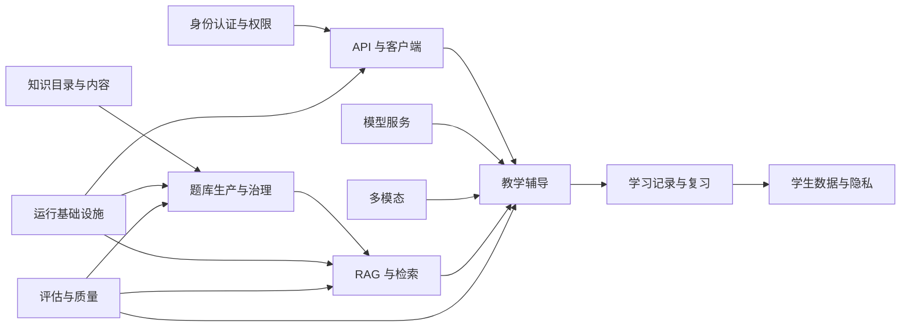

# 功能模块文档目录

本目录按照系统提供的业务与技术能力组织文档。`module/` 回答“系统具有什么功能、数据怎样流转”，`agent/` 回答“由哪个 Agent 负责、Agent 怎样协作”。

## 模块一览

| 模块目录 | 负责的功能 | 主要文档入口 |
| --- | --- | --- |
| [`系统架构模块`](./系统架构模块/) | 系统边界、业务流程、Harness、数据模型和部署结构 | [系统设计](./系统架构模块/SYSTEM_DESIGN.md) |
| [`身份认证与权限模块`](./身份认证与权限模块/) | 注册登录、JWT、角色、会话归属、家长授权和接口限流 | [身份认证与数据归属](./身份认证与权限模块/AUTHORIZATION.md) |
| [`运行基础设施模块`](./运行基础设施模块/) | MySQL、Redis、迁移、日志、健康检查和本地启动 | [本地服务](./运行基础设施模块/LOCAL_SERVICES.md) |
| [`模型服务模块`](./模型服务模块/) | DeepSeek、Gemini、模型选择和 Provider 扩展 | [多 LLM Provider](./模型服务模块/LLM_PROVIDERS.md) |
| [`教学辅导模块`](./教学辅导模块/) | 自适应引导、解答修订和非程序化证明题验证规则 | [自适应数学引导](./教学辅导模块/ADAPTIVE_GUIDANCE.md) |
| [`学习记录与复习模块`](./学习记录与复习模块/) | 间隔复习、学习证据和家长报告 | [间隔复习](./学习记录与复习模块/SPACED_REVIEW.md) |
| [`题库生产与治理模块`](./题库生产与治理模块/) | 母题、生成批次、验证、准入、索引前状态和退役治理 | [题库建设方案](./题库生产与治理模块/UNIVERSITY_CALCULUS_CHAPTER1_QUESTION_BANK.md) |
| [`RAG与检索模块`](./RAG与检索模块/) | 文档摄取、关键词与向量检索、重排、索引生命周期 | [RAG 设计](./RAG与检索模块/RAG_DESIGN.md) |
| [`知识目录与内容模块`](./知识目录与内容模块/) | 课程目录、知识点编码、知识星图、数学思想与方法和内容管理 | [知识内容管理](./知识目录与内容模块/KNOWLEDGE_CONTENT_ADMINISTRATION.md) |
| [`API与客户端模块`](./API与客户端模块/) | REST 错误合约、SSE 流式响应和客户端重试 | [API 错误响应](./API与客户端模块/TUTORING_API_ERRORS.md) |
| [`多模态模块`](./多模态模块/) | 图片题目、OCR、ASR 和 TTS Provider | [图片题目上传](./多模态模块/PROBLEM_IMAGE_UPLOAD.md) |
| [`学生数据与隐私模块`](./学生数据与隐私模块/) | 学生数据导出、删除和家长授权撤销 | [学生数据隐私](./学生数据与隐私模块/STUDENT_DATA_PRIVACY.md) |
| [`评估与质量模块`](./评估与质量模块/) | 固定评估集、生成质量、RAG 质量和多 Agent 端到端评估 | [评估集](./评估与质量模块/EVALUATION.md) |

## 模块协作关系

## 放置规则

1. 描述一个完整系统能力、跨 Agent 流程、数据模型、Provider 或平台设施的文档放入对应模块目录。
2. 只描述某个 Agent 职责和输入输出的文档放入 [`../agent`](../agent/README.md)。
3. 项目待办、验收清单和设计实现清单继续放在 [`../00-overview`](../00-overview/TODO.md)。
4. 新模块目录使用中文功能名并保留“模块”后缀，同时更新本页和文档中心。

## 文档状态与清理规则

当前产品范围固定为大学高等数学。早期初中一元二次方程和高中目录文档仅在对应数据加载器、冻结评估集或回归验证代码仍然存在时保留，并在文档开头标明“历史基线”；它们不代表当前学生端开放范围。

满足以下全部条件时，旧文档才可以删除：

1. 文档描述的代码、数据文件、迁移或运行入口已经移除；
2. 当前业务流程不再读取其数据或执行其规则；
3. 不再承担历史回归、迁移说明或审计依据；
4. 文档索引和其他文档中不存在仍需保留的引用。

每份模块文档末尾的“相关代码”是当前实现入口。功能重构或文件移动时，应同步更新链接；链接目标不存在时不能把文档继续视为已实现说明。

## 相关代码

- [FastAPI 应用入口](../../app/main.py)
- [学生端路由入口](../../../src/app/App.tsx)
- [知识管理端入口](../../../knowledge-admin/src/App.tsx)
