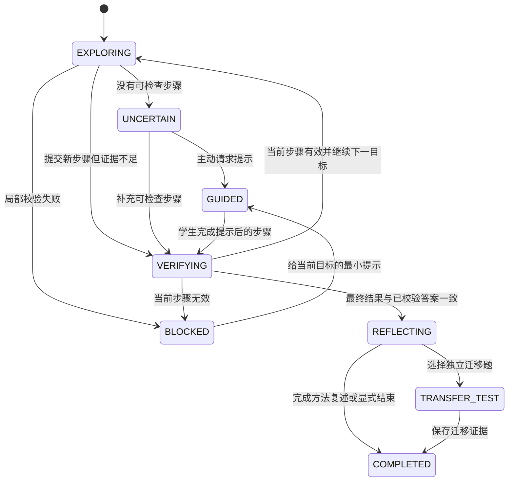

# 自适应数学引导与教学状态机

## 1. 要解决的问题

“一起思考”不能只是把标准解法切成几段后按顺序播放。学生可能已经写到后面的步骤、采用另一条成立路径、只在局部变形处出错，或者虽然得到答案却还说不清关键方法。系统必须先判断学生当前完成了哪个**数学目标**，再决定本轮是观察、追问、校验、给提示、补前置知识还是进入复盘。

本模块把教学决策从提示词中移到确定性策略层。LLM 可以提出诊断假设和生成自然语言，但不能自行回退进度、提高提示等级、跳过数学验证或宣布会话结束。

## 2. 第一版实现范围

当前实现形成一条可运行的最小闭环：

1. 将已经生成并校验的 `SolutionPlan` 投影为 `SolutionGraph`；
2. 将学生每轮输入保存为独立 `StudentAttempt`；
3. 使用 `LearnerState` 的本轮证据生成三态校验结果和障碍分类；
4. `GuidancePolicy` 产生唯一的 `GuidanceDecision`；
5. 提示教学 Agent 只能执行决策中允许的动作；
6. 前端持续展示当前数学目标、引导状态、本轮障碍、目标进度和下一步动作；
7. 每次状态变化保存为会话 artifact，MySQL 通过现有 Agent artifact 结构持久化，不新增会话表字段。

第一版不会把符号工具无法证明的步骤强行判错。证据不足时使用 `unverified`，进入校验或诊断状态。

## 3. 三层解题表示

### 3.1 Mathematical Goal

数学目标是系统追踪进度的基本单位，例如：

- 建立函数连续所需的左右极限；
- 证明递推数列有界；
- 确定极限候选值；
- 检查候选值满足原约束。

每个目标包含：

| 字段 | 含义 |
| --- | --- |
| `id` | 会话内稳定目标 ID |
| `ordinal` | 推荐路线中的顺序 |
| `title` | 学生当前需要完成的数学任务 |
| `prerequisite_goal_ids` | 必须先成立的目标 |
| `step_ids` | 可以完成该目标的步骤 |
| `completion_contract` | 判断目标完成需要的证据 |

### 3.2 Pedagogical Step

教学步骤不是标准答案中的任意一行公式。它表示一次需要学生作出判断、选择方法、完成关键变形或检查条件的认知任务。步骤包含所属方法、对应目标、数学陈述、依据、结果和前置步骤。

### 3.3 Solution Graph

`SolutionGraph` 保存：

- 目标之间的前置依赖；
- 推荐解法路径；
- 多种允许的替代路径；
- 每条路径中的教学步骤；
- 最终数学目标。

当前 `SolutionPlan` 主要提供线性步骤，所以第一版将推荐路线投影为顺序目标链，并保留其他方法为替代路径。后续题库中的结构化题解可以直接提供 AND/OR 目标依赖，替代当前投影逻辑。

## 4. 学生行为与诊断

`StudentAttempt` 独立于聊天消息保存，保留：

- `raw_input`：学生原文，任何解析都不能覆盖；
- `input_type`：数学式、自然语言、混合输入或纯求助；
- `intent`：作答、请求提示、请求完整讲解或完成；
- `candidate_goal_id`、`candidate_step_index`：本轮可能对应的位置；
- `attempt_kind`：局部步骤、最终答案、证明、问题等；
- `verification_status`：`valid`、`invalid`、`unverified`；
- `evidence_ids`：指向本轮 `LearnerState` 证据。

当前障碍只描述本轮，不形成固定能力标签：

| 障碍 | 含义 | 首选动作 |
| --- | --- | --- |
| `knowledge_gap` | 缺少完成当前目标所需的前置定义或公式 | 补知识、类比、微练习 |
| `strategy_selection` | 知道知识但想不到使用什么方法 | 方向提示或诊断问题 |
| `expression_transformation` | 已选方法但不会完成关键变形 | 局部步骤提示 |
| `execution_error` | 计算、符号、代入或局部操作错误 | 定位错误，不重讲整题 |
| `alternative_valid_path` | 学生采用另一条成立路径 | 接住该路径并继续验证 |
| `uncertain` | 本轮证据不足 | 只问一个有区分力的问题 |

## 5. 引导状态机

状态含义：

| 状态 | 允许的主要行为 |
| --- | --- |
| `exploring` | 邀请独立尝试，确认已成立进展 |
| `uncertain` | 提出一个诊断问题 |
| `blocked` | 定位局部错误并选择最小帮助 |
| `remediating` | 补充当前目标必需的前置知识 |
| `guided` | 按一个提示等级等待学生完成目标 |
| `verifying` | 检查条件、公式、等价变形和推理依据 |
| `reflecting` | 提炼关键突破口，不再返回早期步骤 |
| `transfer_test` | 使用新题评估独立迁移 |
| `completed` | 保存学习记录并结束当前会话 |

当前代码已实现除迁移题自动选择以外的状态及转换。`transfer_test` 已保留为领域状态，后续与受约束相似题 Agent 对接。

## 6. 关键业务规则

### 6.1 进度只能单调前进

系统同时使用上一轮 `GuidanceDecision.current_goal_ordinal` 和历史 `LearnerState.next_solution_step_index` 作为进度下限。新一轮可以保持或前进，不能仅因学生当前一句话较短而回到第一步。

### 6.2 普通作答不会自动升级提示

- 普通作答有数学内容：先进入 `verifying`；
- 本轮有有效校验证据：继续当前目标或下一目标；
- 没有可检查内容：进入 `uncertain`，只问一个问题；
- 学生使用 `ask_hint`：才逐级增加到 1、2、3 级；
- 学生请求完整讲解：仍需满足原有第四级门槛。

### 6.3 三态验证

| 结果 | 处理 |
| --- | --- |
| `valid` | 可以确认该局部结果或最终结果 |
| `invalid` | 只定位失败的局部目标，不能由模型意见覆盖 |
| `unverified` | 请求依据或保守引导，不能当成错误 |

本状态机使用现有学情证据形成第一层三态结果。表达式等价、定义域、边界条件和证明链的更强校验继续由独立数学验证工具提供。

### 6.4 明确结束事件

会话可由以下事件结束：

1. 学生点击“完成本题并复盘”；
2. 学生明确说“我会了”“做完了”等，并且已有进度与校验基础；
3. 最终结果已确认，系统进入 `reflecting`，学生完成一次有数学内容的方法复述。

最终结果确认后，系统进入复盘状态，提示 Agent 不得再返回开头步骤。

## 7. 会话工件

| `kind` | 生产者 | 用途 |
| --- | --- | --- |
| `solution_graph` | `solution_graph_builder` | 保存目标、步骤和多解法路径 |
| `student_attempt` | `guidance_policy` | 保存本轮原始输入的结构化解释 |
| `guidance_decision` | `guidance_policy` | 保存状态、事件、目标、障碍、允许动作和原因 |
| `learner_state` | `learner_diagnosis` | 保存本轮证据、误区假设和追问 |
| `tutor_reply` | `hint_teaching` | 保存实际面向学生的回复 |

这些工件都通过 `AgentArtifact` 进入 MySQL。这样可以回放“学生说了什么、系统如何诊断、为何采取该动作、最后展示了什么”。

## 8. 前端展示

`TutorReply` 在保持既有字段不变的基础上增加可选状态字段：

- `guidance_state`；
- `current_goal_id`、`current_goal_title`、`current_goal_ordinal`；
- `completed_goal_count`、`total_goal_count`；
- `obstacle_type`；
- `attempt_verification`；
- `next_action`。

辅导页使用这些字段展示当前数学目标、已完成目标数、引导状态、本轮障碍和下一步。思路地图从 `solution_graph` 和 `guidance_decision` 读取已完成目标，不再只依赖静态页面文案。

## 9. 代码位置

- [引导领域对象、解题图和状态机](../../../app/domain/guidance.py)
- [学情诊断、编排与提示教学](../../../app/agents/tutoring_team.py)
- [提示教学约束](../../../app/prompts/policies.py)
- [辅导回复 DTO](../../../app/domain/tutoring.py)
- [前端辅导服务类型](../../../../src/services/tutoring.ts)
- [一起思考页面](../../../../src/features/learning/CoachPage.tsx)
- [思路地图页面](../../../../src/features/learning/ThoughtMapPage.tsx)

## 10. 后续增强

- 题库题解直接维护 AND/OR Solution Graph，减少运行时投影误差；
- 将表达式、约束、推理和目标校验结果逐项绑定到 `StudentAttempt`；
- 对替代正确路径建立更可靠的路径对齐；
- 将 `transfer_test` 接入受约束相似题 Agent，并把迁移结果写入学习证据；
- 为各状态转换建立固定端到端评估场景，重点统计错误回退、错误判错和答案泄露。

## 相关代码

- [引导领域对象与状态机](../../../app/domain/guidance.py)
- [学情诊断与提示编排](../../../app/agents/tutoring_team.py)
- [提示教学约束](../../../app/prompts/policies.py)
- [辅导回复 DTO](../../../app/domain/tutoring.py)
- [学生端按需提示页](../../../../src/features/learning/HintPage.tsx)
