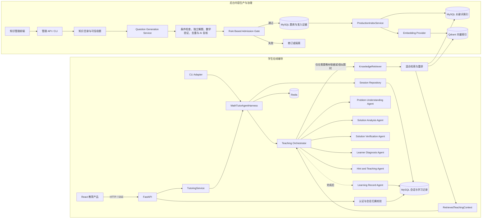
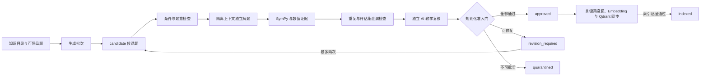
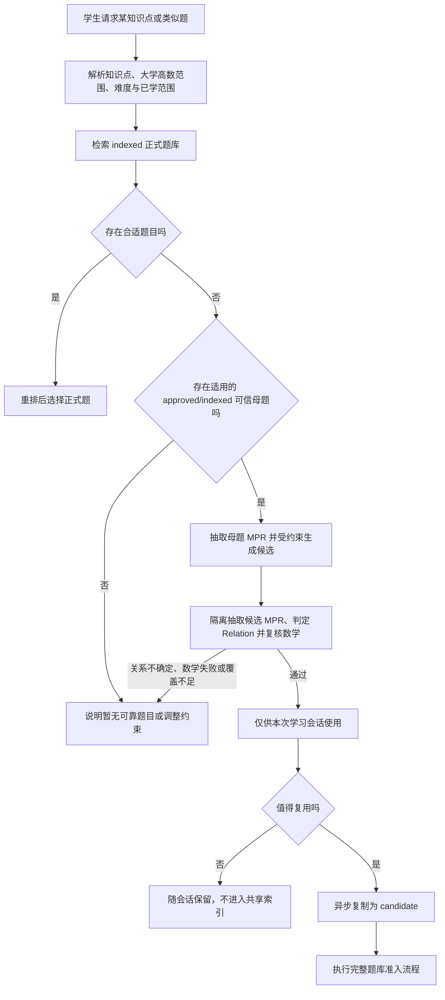
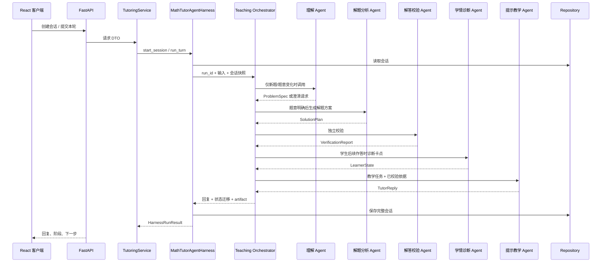

# 数学辅导 Agent 系统架构

本文描述 `math-tutor-agent` 的当前运行架构。项目采用 Harness 驱动的模块化单体：FastAPI 和 CLI 是入口适配器，`MathTutorAgentHarness` 统一管理会话生命周期、预算、编排、trace、降级与持久化。

## 1. 系统边界与技术栈

| 层次 | 设计 |
| --- | --- |
| 用户界面 | 仓库外的 React + TypeScript 教育产品前端 |
| Web/API | FastAPI、Uvicorn/ASGI、REST；首版同步 HTTP，确认流式需求后增加 SSE |
| 应用服务 | 薄服务层 + `MathTutorAgentHarness` |
| Agent 协作 | 一个受控的教学编排器调用职责单一的专职 Agent，通过结构化 artifact 交接 |
| 持久化 | SQLAlchemy Repository + MySQL 8.0；会话聚合写入规范化业务表 |
| 运行协同 | Redis：分布式会话锁、请求幂等、热点会话缓存和认证限流；MySQL 仍是事实数据源 |
| 账号通知 | 可替换 SMTP Email Provider：邮箱验证与密码重置链接 |
| 模型接入 | `LLMProvider` + Registry + 请求级 Router；首批支持 DeepSeek、Gemini，并允许继续注册其他适配器 |
| 数学工具 | 可选 MathVerifier 适配器（CAS/数值计算）；工具受服务端白名单和超时控制 |
| 多模态 | 可选 OCR、ASR、TTS Provider；文字辅导不依赖特定云厂商 |
| 部署 | 首版单体 API 服务；数据库可独立部署，不拆微服务 |

## 2. 容器与组件视图



目标是一个可独立部署的模块化单体。图中的“后台内容生产”和“学生在线辅导”是同一后端中的两个应用边界：它们可以共用 MySQL、Provider 和基础设施，但使用不同的服务、权限与状态机。题库生产通常由管理端或后台任务触发；学生请求只走在线辅导链，不会现场生成并批准生产题目。

## 3. 代码模块职责

目标目录结构：

```text
app/
  api/                 # HTTP 路由、请求/响应 DTO、鉴权依赖
  core/                # 配置、日志、错误类型、生命周期
  domain/              # 会话状态、题目/解答/学习记录等领域模型
  services/            # 将 HTTP 请求映射为 Harness 调用
  harness/             # 统一运行入口、结果合约、预算、trace、依赖装配
  agents/              # understanding / solver / verifier / diagnosis / tutor / record
  providers/           # LLM、数学工具、OCR/ASR/TTS 的可替换适配器
  mcp_tools/           # 数学验证、相似题和复习计划 MCP Server
  repositories/        # 会话、消息、Agent artifact、学习记录存储接口与实现
  prompts/             # 按 Agent 管理的指令模板与输出 schema
```

HTTP、CLI 或未来的 OpenClaw 入口都不得直接调用具体 Agent。它们通过 Harness 获得统一的 `HarnessRunResult`；具体 Agent 也不直接依赖彼此实现。

## 4. 题库生产怎样接入系统

题库不是在线教学 Agent 内部的一段提示词，也不是一个可以被学生请求直接写入的普通数据表。它是一条独立的**内容生产与治理链**，通过生产索引向在线辅导提供可信内容。

### 4.1 两个运行平面

| 运行平面 | 入口 | 允许操作 | 输出 |
| --- | --- | --- | --- |
| 内容生产平面 | 知识管理前端、管理 API、管理 CLI、后台任务 | 维护知识目录和母题；生成候选题；执行验证、修订、隔离、批准、索引和退役 | 经过证据约束的题目、题解、提示及生产索引 |
| 在线教学平面 | 学生前端、辅导 API、Harness | 理解学生题目；按需检索；分析和校验当前解法；诊断作答；逐级提示；保存学习记录 | 单次辅导回复、会话状态和学习记录 |

二者通过生产索引衔接，而不是让教学 Agent 直接查询题库业务表。这样可以保证候选题、验证中的题目和隔离题永远不会因为一次普通检索而暴露给学生。

### 4.2 从母题到生产题库



核心约束如下：

1. 变式生成 Agent 只能创建 `candidate`，不能自行批准题目。
2. 条件检查、独立解题、确定性数学证据、去重、评估集防泄漏和独立 AI 复核依次形成准入证据。
3. `RuleBasedAdmissionGate` 只接受全部必需证据都通过的内容；任何确定性失败都不能被模型意见覆盖。
4. `approved` 表示内容已经通过准入，但尚不可被学生检索。
5. `ProductionIndexService` 成功写入 MySQL 关键词索引和 Qdrant，并保存 `index_sync` 证据后，状态才变成 `indexed`。
6. 退役、答案冲突或重新验证会先抑制关键词结果、删除 Qdrant point，并提升知识库版本使 Redis 检索缓存失效。

完整规则分别见[题目生命周期](../题库生产与治理模块/PROBLEM_LIFECYCLE.md)、[自动准入门](../题库生产与治理模块/AUTOMATIC_ADMISSION_GATE.md)和[生产索引](../RAG与检索模块/PRODUCTION_INDEXING.md)。

### 4.3 在线辅导怎样使用题库

`Teaching Orchestrator` 每轮先判断是否需要外部知识。普通寒暄、澄清问题、学生仅表达“没看懂”或已有上下文足够时，可以不调用 RAG。以下情况才适合检索：

- 需要教材定义、定理、公式或来源版本；
- 需要与当前题目条件和求解目标相近的批准例题；
- 需要受年级、知识点、难度和已学范围约束的相似练习；
- 需要当前提示等级允许暴露的解法步骤或错误模式。

检索链路为：

```text
Teaching Orchestrator
  → KnowledgeRetriever Provider
  → MySQL 关键词召回 + Qdrant 向量召回
  → 元数据过滤
  → 按条件、求解目标和解法结构重排
  → RetrievedTeachingContext
  → 题意理解、解法分析或提示教学 Agent
```

`KnowledgeRetriever` 只返回 `index_status=active` 的生产内容，并将结果压缩成结构化 `RetrievedTeachingContext`。这个对象保留知识点、题目条件、求解目标、允许公开的提示或解法片段、验证覆盖、来源版本和引用；原始长文及 Qdrant payload 不直接塞给 Agent。

提示等级继续控制内容暴露：一级只允许方向，二级允许关键关系，三级允许一个局部步骤，四级在满足产品门槛后才允许完整讲解。检索到完整题解不代表当前轮次可以展示完整题解。

### 4.4 正式题库与实时练习生成

系统采用“正式题库优先检索，批准母题支持受约束实时变式，优质临时题异步沉淀”的混合策略。



实时生成题使用运行时来源与可见范围标记，例如 `origin=runtime_generated`、`visibility=session_only`。这两个字段表达“从哪里来”和“谁可以使用”，不替代正式题库状态。临时题通过会话级质量门后可以服务当前学生，但不能直接写成 `approved` 或 `indexed`，也不能进入共享 RAG、推荐池或作为其他题目的可信母题。

当前大学高数入口的会话级质量门由母题 `MPR-Core`、候选 `MPR-Core`、独立 `MPR-Relation`、条件完整性和隔离 AI 数学复核组成。S/M 是题间关系；实际关系与目标不一致、关系为 `UNKNOWN/review_required`、置信度不足或验证覆盖不足时，候选会被拒绝。该复核尚不等同于题型专用的确定性验证器。

实时题若需要复用，必须另行创建 `candidate`，并重新经过独立解题、两类数学证据、去重、防评估集泄漏、独立 AI 复核和规则化准入；本轮 MPR 与会话级 AI 复核不能替代完整准入证据。证明题、开放题和工具无法覆盖的内容即使可以用于受限教学会话，也不能由此获得正式题库身份。

具体决策和失败处理见[受约束的相似题生成](../../agent/受约束相似题Agent/CONSTRAINED_SIMILAR_PRACTICE.md)。

### 4.5 数据和权限边界

- 管理员与后台任务通过管理服务写题库；学生辅导接口没有题库批准和索引权限。
- 题库事实数据、准入证据和状态保存在 MySQL；Qdrant 只是可重建的向量索引。
- 关键词索引和 Qdrant 使用同一个稳定教学实体投影，避免两套索引含义不一致。
- 教材与共享题库检索走 `KnowledgeRetriever`；学生个人历史走 `StudentHistoryRetriever`，两类数据不混合进同一索引或共享缓存。
- RAG 不可用时，Orchestrator 可以在无需外部依据的轮次降级继续；需要教材引用或相似题的动作必须明确返回能力降级，不能伪造来源。

### 4.6 当前接入入口

| 能力 | 入口 |
| --- | --- |
| 批量生成候选变式 | `POST /v1/admin/generation/jobs` 或 `math-tutor-generate` |
| 查看生成批次 | `GET /v1/admin/generation/jobs/{job_id}` |
| 查看质量与上线门禁 | `GET /v1/admin/generation/quality-report`、`GET /v1/admin/generation/release-gate` |
| 同步批准内容到生产索引 | `math-tutor-index sync` |
| 退役并清理生产索引 | `POST /v1/admin/knowledge/problems/{problem_id}/retire` 或 `math-tutor-index retire` |
| 在线按需检索 | Harness 内部的 `KnowledgeRetriever` Provider，不直接暴露为学生写接口 |
| 受约束实时变式 | 从已发布母题抽取 `MPR-Core`，生成候选后隔离抽取候选 MPR 并判定 `MPR-Relation`；仅通过会话级质量门的内容可以创建 `session_only` 学习会话 |
| 临时题沉淀 | 异步复制为新的 `candidate`，再执行完整准入；不得原地提升为 `approved` |

运行时 MPR 复核当前包含隔离 AI 数学检查，不代表已经取得题型专用的确定性验证证据。临时题不能写入关键词索引或 Qdrant，也不能成为新的可信母题。正式题库准入仍要求题型适用的工具证据、去重、评估集泄漏检查和规则化准入门。

## 5. 在线辅导数据流

1. 客户端携带 Bearer Token 创建会话或提交一轮消息；API 校验账号状态、角色、字段和会话归属。
2. `TutoringService` 将请求交给 `MathTutorAgentHarness`。
3. Harness 创建 `run_id`、检查调用预算、读取会话并调用 Teaching Orchestrator。
4. 新题路径：题目理解 Agent 产出 `ProblemSpec 2.0`，记录题型证据、条件来源、求解目标和分级歧义；存在阻断歧义时立即返回澄清问题并暂停解题，补充后重新理解题目。
5. 题意明确后，解题分析 Agent 生成 `SolutionPlan 2.1`，比较可靠解法并提取关键突破口；解答校验 Agent 优先用安全 SymPy 工具独立求解、比较步骤、代回答案并检查解集完整性。证明题走六维结构化复核并固定为部分覆盖，最终产出 `VerificationReport 2.1`。可修订失败默认最多退回两次，每版必须重新校验，达到上限后停止并禁止使用未通过解法。
6. 提示教学 Agent 根据经校验方案、当前阶段和学生历史，生成单轮 `TutorReply`。学生回答后进入诊断和下一轮提示。
   提示按方向、关键关系、局部步骤、完整讲解四级递进；前三个等级只接收裁剪后的教学上下文，第四级还要求明确请求及有效尝试或既有三级提示。
7. 每次 Agent 输出先做 schema、权限和状态校验；Harness 收集 artifact、置信度与耗时形成 trace。
8. 会话完成时按产品策略调用学习记录 Agent，持久化错因、知识点和复习建议。
9. Harness 保存会话并返回统一运行结果；API 返回回复、`run_id`、trace、耗时和降级状态。



## 6. Agent 协作模型

Agent 通过共享的、单轮运行上下文交换类型化 artifact。它们不直接自由调用其他 Agent；调用顺序、预算、重试和终止由 Orchestrator 控制。

| Agent | 输入 | 输出 | 调用条件 |
| --- | --- | --- | --- |
| TeachingOrchestrator | 用户输入、会话状态 | 有序任务计划、最终采纳结果 | 每轮必经；作为控制面 |
| ProblemUnderstandingAgent | 新题文字/附件解析结果 | `ProblemSpec` 或澄清问题 | 新题或题意变化 |
| SolutionAnalysisAgent | 已确认的 `ProblemSpec` | `SolutionPlan` | 首轮分析或校验要求修订 |
| SolutionVerificationAgent | `ProblemSpec` + `SolutionPlan` | `VerificationReport` | 给提示前；修订后再次校验 |
| LearnerDiagnosisAgent | 学生本轮回答 + 已校验解法上下文 | `LearnerState 2.0` | 学生提交尝试或表达卡点 |
| HintTeachingAgent | 校验结果 + 学情 + 提示等级策略 | `TutorReply` | 每个需要面向学生回复的辅导轮次 |
| LearningRecordAgent | 完成的会话摘要和学情结果 | `LearningRecord` | 完成、收藏或复习触发时 |

推荐的 artifact 合约：`ProblemSpec`、`SolutionPlan`、`VerificationReport`、`LearnerState`、`TutorReply`、`LearningRecord`。每个 artifact 带 `session_id`、`turn_id`、`schema_version`、来源 Agent 和置信度。完整内部推理不暴露给客户端；对学生只展示经过整理的解释和必要依据。

## 7. 会话状态与数据存储

首版教学状态建议：`collecting`、`clarifying`、`diagnosing`、`hinting`、`checking_attempt`、`explaining`、`completed`。状态迁移由领域服务校验，不由模型任意指定。

| 数据 | 存储 | 用途 |
| --- | --- | --- |
| 用户与授权关系 | MySQL；邮箱验证、Access/Refresh Token、学生所有权与家长显式授权 | 身份认证、令牌轮换、学生与家长授权关系 |
| 会话、消息、artifact 与 run trace | MySQL Repository | 恢复对话、呈现历史、审计和定位 Agent 问题 |
| 学习记录与错题 | MySQL Repository | 个性化复习和学习报告 |
| 热点会话快照 | Redis，默认 TTL 1 小时 | 降低连续辅导过程中的数据库读取延迟 |
| 本轮幂等结果 | Redis，默认 TTL 24 小时 | 使用 `client_turn_id` 防止重复模型调用和重复写入 |
| 会话分布式锁 | Redis，默认 TTL 120 秒 | 多副本下让同一会话的状态更新保持串行 |
| 上传图片/音频 | 对象存储适配器（后续） | 原始附件不直接塞入关系数据库 |

MySQL 是正式数据层目标，Redis 是可降级的运行协同层。采用 Redis 是因为会话锁、短期幂等结果和热点缓存需要跨实例共享、原子操作及自动过期；这些数据不适合在模型调用期间通过长数据库事务维护。Redis 不存唯一副本，读取失败时回源 Repository，写入失败时正式学习数据仍以 MySQL 为准。键设计、TTL 和故障策略见 `docs/module/运行基础设施模块/REDIS_DESIGN.md`。

## 8. API 与客户端集成

- `GET /v1/health/live`：不访问外部依赖的进程存活检查。
- `GET /v1/health/ready`：并行检查 MySQL、Redis 和可配置为必需依赖的 LLM Provider。
- `GET /v1/llm/models`：返回当前用户可选择的模型白名单、可用状态和默认模型。
- `POST /v1/tutoring/sessions`：创建会话并提交初始题目。
- `POST /v1/tutoring/sessions/{session_id}/turns`：提交学生回答、追问或提示请求。
- `GET /v1/tutoring/sessions/{session_id}`：读取会话状态与历史消息。
- `GET /v1/tutoring/sessions/{session_id}/trace`：读取按 `run_id` 标识的 Agent 调用轨迹。
- 后续可加 `POST /v1/tutoring/sessions/{session_id}/complete` 及独立的学习记录查询接口。

客户端只依赖稳定的 REST DTO，不依赖某个 Agent 名称或提示词。`TutorReply` 返回 `action`、`text`、`hint_level`、`hint_stage`、`can_show_full_solution`、可选 `understanding_check` 和 `session_status`。SSE 事件只负责传输过程，不改变领域接口。

提交一轮消息时，客户端应生成并复用 `client_turn_id`。网络超时后的重试必须携带相同值，服务端才能返回第一次运行结果；新的学生表达必须使用新的值。

## 9. 部署与外部依赖

首版采用单体 API 部署：FastAPI 应用内运行 API、应用服务和多 Agent 编排；模型服务及数据库作为外部依赖。MySQL 表结构由 Alembic 版本化管理，发布应用前执行 `alembic upgrade head`。开发时可用 Mock Provider 验证流程，避免必须持有云密钥才能启动。环境变量集中在配置模块，密钥不写入仓库和日志。

外部能力均以 Provider 接口接入：

- LLM Provider：生成结构化 Agent 输出。用户在创建会话时选择模型，`RoutingLLMProvider` 使用请求级上下文隔离并发调用，会话把选择持久化为 `provider/model`。
- MathVerifier：可选代数/数值检查；不可用时将校验局限明确传入回复策略。
- MCP Tools：以 stdio 或 Streamable HTTP 暴露确定性数学验证与复习调度能力。
- OCR/ASR/TTS Provider：图片/语音输入输出；没有这些服务时文字辅导继续工作。
- TextbookKnowledgeRetriever Provider：按需提供带引用的公共教材知识上下文；默认关闭，可替换后端且不阻断原教学链路。
- StudentHistoryRetriever Provider：只按当前会话所有者读取个人结构化学习记录，不进入教材索引或共享检索缓存。
- Repository：可替换存储实现。

具体模型供应商、数据库实例和云部署平台在成本、账号与部署环境明确后再确定，不预设腾讯云。

## 10. 运行边界与扩展注意事项

- 多 Agent 是应用内的职责分工与受控调用，不代表首版就拆成多个微服务或多个长期运行的自治 Agent。
- 解答校验应尽量使用独立方法或工具；同一模型自我复述不能作为强正确性证明。
- Agent 只接收完成任务所需的最小上下文；控制最大轮次、模型调用数、超时和 token 预算。
- `LearnerState` 只引用学生本轮消息中的证据；没有证据时记录不确定性并追问，不把一次表现固化为能力或人格标签。
- 模型输出均视为不可信输入：schema 校验、状态校验、长度限制和工具参数白名单不可省略。
- 高难证明题无法完全程序化判定时，必须按目标对应、条件使用、逻辑连续性、定理适用条件、分类完整性和结论闭合报告证据。单模型复核固定为部分覆盖且通过置信度不高于 0.74，不能把“未发现错误”说成“已证明正确”。
- Redis 已承载会话锁、幂等键、热点会话缓存，以及认证接口的 IP/账号组合限流；异步任务状态可在需要时复用独立键空间接入。
- 图片与语音引入后，需增加上传大小/格式限制、内容生命周期和隐私策略。
- 家长解除关联后不得继续读取学生的新报告。
- 不将孩子真实姓名、学校、住址或电话写入 Agent artifact、trace 或日志。
- 数据库备份和只读副本必须采用与主库相同的访问控制和删除策略。

## 11. 一致性与并发

- `learning_sessions.version` 参与 Repository 的原子条件更新；成功后版本加一，冲突时回滚消息、Agent 轨迹和学习记录的同一事务，并清除旧 Redis 会话快照。
- `client_turn_id` 保证客户端重试不会重复创建消息和 Agent run。
- 创建学习记录时，以 `session_id` 唯一约束保证幂等。
- 周报以学生、周期类型和日期范围唯一，重新生成时更新现有草稿。
- Harness 开始时写入 `agent_runs.running`；成功后在同一事务写入最终状态。超时回收任务可将长期 `running` 标记为 `failed`。

## 12. Repository 边界

建议将当前单一 `SessionRepository` 拆为以下接口：

```text
SessionRepository
MessageRepository
AgentRunRepository
LearningRecordRepository
ReportRepository
MediaAssetRepository
```

Harness 通过 Unit of Work 使用这些接口，保证一次运行的数据原子提交。Agent 不得直接持有数据库连接；模型 Provider 也不得读写业务表。

## 13. 迁移顺序

1. 引入 MySQL 连接配置与 Alembic 初始迁移，建立完整业务表。（已完成）
2. 使用 MySQL Repository 将会话聚合写入 `learning_sessions`、`session_messages`、`agent_runs`、`agent_run_steps` 和 `agent_artifacts`。（已完成）
3. 接入 Redis 会话锁、幂等结果和热点缓存。（已完成）
4. 在 Repository 更新路径启用 `learning_sessions.version` 乐观锁和 HTTP 409 冲突处理。（已完成）

## 相关代码

- [FastAPI 应用装配](../../../app/main.py)
- [Harness 依赖装配](../../../app/harness/factory.py)
- [数学辅导 Harness](../../../app/harness/math_tutor.py)
- [辅导应用服务](../../../app/services/tutoring.py)
- [学生端应用路由](../../../../src/app/App.tsx)
