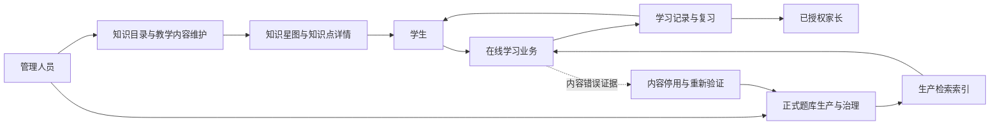
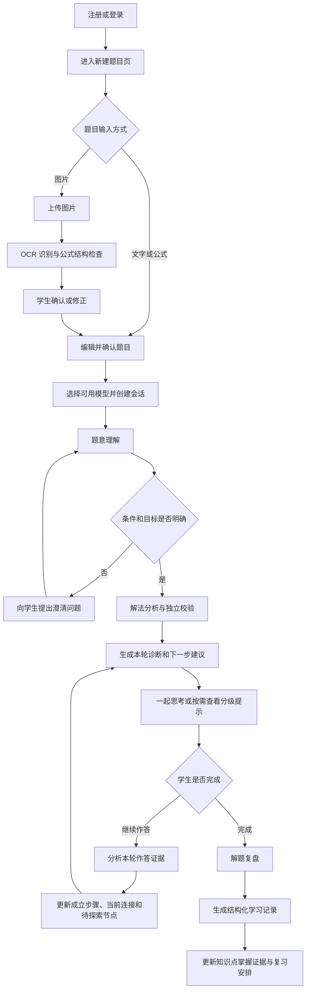
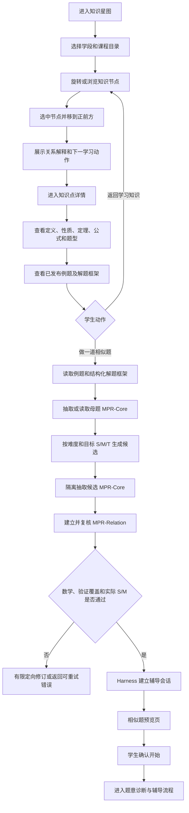
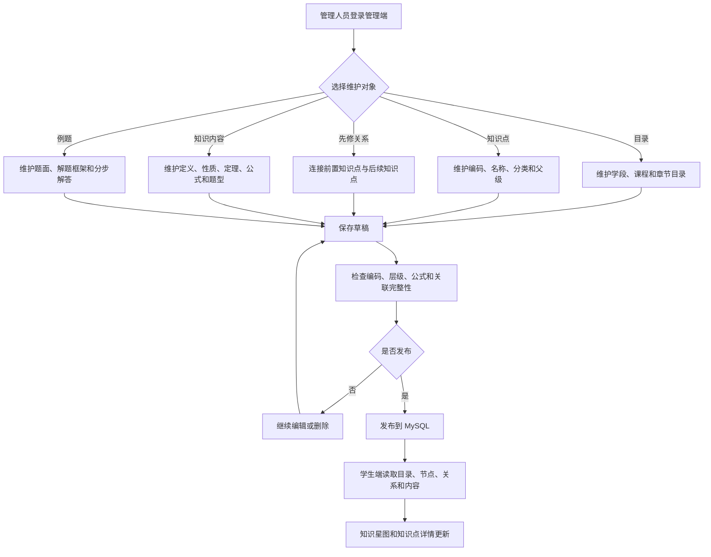
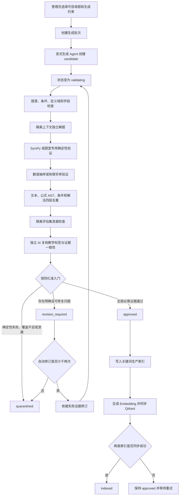
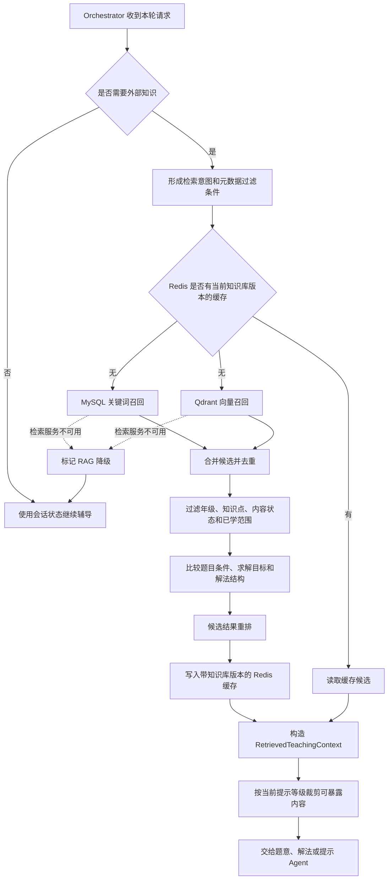
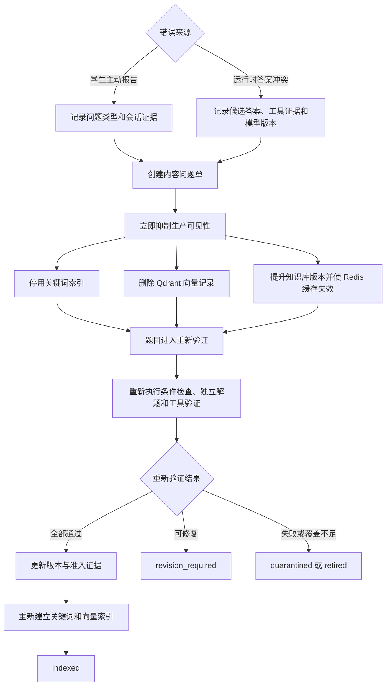
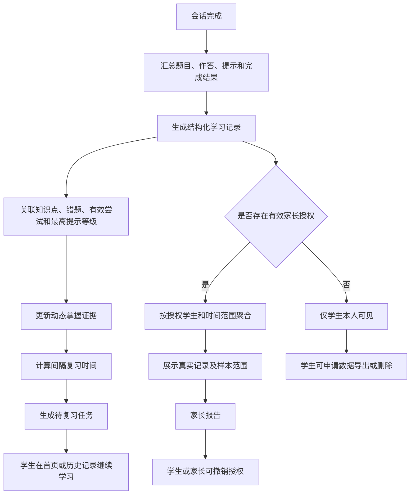

# 数学引导产品业务流程图

本文从业务视角说明学生、家长和管理人员怎样使用系统，以及知识内容、正式题库、RAG 和学习记录怎样衔接。各类业务分别绘图，避免把在线学习、后台内容生产和平台治理混成一条难以维护的大流程。

> 阅读约定：流程图描述当前实现和已经确定的业务规则；后续尚未实现的节点在加入本文时必须明确标为“规划”。代码组件之间的调用关系见[系统架构](./architecture.md)，数据表关系见[数据模型](./DATA_MODEL.md)。

## 1. 业务全景与边界

系统包含三条主要业务链：学生学习、知识内容维护、正式题库生产。它们可以共用 MySQL、Redis、Qdrant 和模型 Provider，但入口、权限和内容状态互不混用。

业务边界如下：

| 业务对象 | 谁可以写入 | 学生是否直接看到 | 主要用途 |
| --- | --- | --- | --- |
| 知识目录与教学内容 | 管理人员 | 发布后可见 | 知识星图、定义、性质、公式、题型与例题 |
| 正式题库 | 后台生产流程和管理人员 | 仅 `indexed` 内容可被检索 | 可信例题、相似练习、教学依据 |
| 会话临时题 | 学生请求触发，Agent 生成 | 仅当前会话可见 | 当场练习，不自动进入正式题库 |
| 学习记录 | 辅导流程根据真实行为生成 | 学生本人及已授权范围内的家长 | 掌握证据、复习任务和学习报告 |

## 2. 学生创建题目并完成辅导

**业务目标**：学生提交一道题，系统理解题意并根据学生的实际作答逐步引导，最后形成可追踪的学习记录。

关键规则：

1. 学生已经给出的正确步骤必须进入本轮证据，后续引导从当前进度继续，不能无故回到第一步。
2. 提示按“方向提示、关键关系、局部步骤、完整讲解”逐级展开，并持续显示当前等级。
3. 会话完成必须有明确状态；完成后进入复盘和学习记录，不再回到未完成教学循环。
4. 网络失败时保留输入和 `client_turn_id`，学生重试同一轮时复用幂等键。
5. RAG 是按需能力，本流程并不要求每一轮都检索题库。

## 3. 知识星图、知识点详情与相似题

**业务目标**：学生从课程目录和知识星图理解知识关系，查看管理端发布的内容，并从某个例题发起一次临时相似练习。

当前“做一道相似题”使用发布的知识点例题作为约束来源。`MPR-Core` 描述单题结构与策略，`MPR-Relation` 描述母题和候选题之间的实际 S/M；生成器不能给自己的候选定级。关系证据不足时返回 `UNKNOWN + review_required` 并拒绝候选。

生成成功后，会话 artifact 保存母题 MPR、候选题 MPR、关系证据和复核摘要，并标记为 `origin=runtime_generated`、`visibility=session_only`。它只服务当前学生会话，不会因为生成成功就进入共享题库或 Qdrant 生产索引。会话级 `independent_llm_review` 也不能替代正式题库要求的确定性工具证据。

后续若要复用某道高质量临时题，应异步复制为 `candidate`，再走第 5 节的完整准入流程。

## 4. 管理人员维护知识目录与教学内容

**业务目标**：管理人员维护知识星图所需的数据，使学生端不再依赖前端写死的节点和正文。

这条流程维护的是“教什么、怎样解释”的知识内容。它与正式题库生产是两个业务：管理端录入一个知识点例题，不等于该题已经通过正式题库的自动准入和生产索引。

## 5. 正式题库生成、验证与准入

**业务目标**：从来源清楚的可信母题生成候选变式，并用相互独立的证据阻止错误内容进入生产检索。

准入原则：

- 生成 Agent 只能创建候选题，不能批准自己的输出。
- 独立解题 Agent 不读取生成 Agent 给出的答案和推理。
- 任一确定性校验失败、验证覆盖不足或评估集近似命中都必须阻断生产索引。
- 模型复核意见不能覆盖程序化失败证据。
- `approved` 只表示准入通过；完成关键词索引和 Qdrant 同步后才成为可检索的 `indexed` 内容。

## 6. 在线辅导按需使用 RAG

**业务目标**：只在教学确实需要教材依据、可信例题或相似题时调用检索，并把检索结果压缩成受提示等级约束的结构化上下文。

检索只允许返回生产状态有效的 `indexed` 内容。候选题、验证中内容、隔离内容和会话临时题不能进入共享检索结果。教材知识检索与学生个人历史检索使用不同的数据边界，不能把其他学生的记录当作教材依据。

## 7. 错误报告、自动停用与重新验证

**业务目标**：学生报告题目或答案错误，或者系统运行时发现答案冲突后，先阻止问题内容继续传播，再调查和重新验证。

这里采用“先停用、后调查”的顺序。已经报告冲突的题目不能在等待复核期间继续被学生检索。

## 8. 学习记录、复习任务与家长报告

**业务目标**：把真实学习过程转化为可解释的掌握证据，并在授权范围内支持学生复习和家长了解学习情况。

掌握状态不是模型一次生成的固定标签。系统根据题目结果、有效尝试、使用的提示等级、错因和后续复习表现持续更新证据。家长报告只能基于真实学习记录，并明确样本数量、时间范围和覆盖知识点。

## 9. 核心状态的衔接关系

以下关系最容易在开发和运营中混淆：

| 前一状态或对象 | 后一状态或对象 | 是否自动发生 | 说明 |
| --- | --- | --- | --- |
| 知识点发布 | 学生端展示 | 是 | 发布后由目录和详情 API 读取 |
| 知识点例题 | 正式题库题目 | 否 | 需要单独进入候选题准入链 |
| 会话临时相似题 | `candidate` | 否 | 只有值得复用时才异步复制 |
| `candidate` | `approved` | 否 | 必须通过全部准入证据 |
| `approved` | `indexed` | 否 | 关键词和 Qdrant 同步成功后才能转换 |
| `indexed` | 学生可检索 | 是 | 仍受元数据过滤、重排和提示等级限制 |
| 浏览知识点 | 掌握证据 | 否 | 必须有真实作答、提示或完成记录 |
| 学习记录 | 家长报告 | 否 | 必须存在有效授权并展示样本范围 |

## 10. 相关文档

- [数学教育多 Agent 系统设计](./SYSTEM_DESIGN.md)
- [Math Tutor Agent Harness](./HARNESS.md)
- [受约束的相似题生成](../../agent/受约束相似题Agent/CONSTRAINED_SIMILAR_PRACTICE.md)
- [题库内容状态机](../题库生产与治理模块/PROBLEM_LIFECYCLE.md)
- [规则化自动准入门](../题库生产与治理模块/AUTOMATIC_ADMISSION_GATE.md)
- [RAG 知识检索设计](../RAG与检索模块/RAG_DESIGN.md)
- [知识星图与知识内容管理](../知识目录与内容模块/KNOWLEDGE_CONTENT_ADMINISTRATION.md)
- [学生数据导出、删除与家长授权撤销](../学生数据与隐私模块/STUDENT_DATA_PRIVACY.md)

## 相关代码

- [认证 API](../../../app/api/routes/auth.py)
- [辅导 API](../../../app/api/routes/tutoring.py)
- [辅导服务](../../../app/services/tutoring.py)
- [题库生成服务](../../../app/services/question_generation.py)
- [学生端学习工作区](../../../../src/features/learning/LearningWorkspace.tsx)
