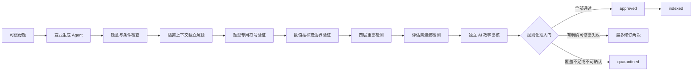

# 大学高数第一章题库建设与 AI 生成准入方案

## 1. 文档目的

本文定义大学高等数学第一章“函数、极限与连续”的题库目标、内容边界、可信母题建设方式、AI 变式生成流程、数学验证范围、自动准入规则、质量指标和首版实施计划。

本文解决的核心问题不是“如何让 AI 一次生成大量题目”，而是：

1. 如何知道 AI 生成的题目是否正确；
2. 哪些题型可以自动验证并进入正式题库；
3. 哪些题型只能作为候选内容；
4. 独立开发阶段如何用较少人工维护一个可持续增长的题库；
5. 如何让题库真正服务诊断、分级提示、相似题和间隔复习。

## 2. 当前项目现状

项目已经具备通用题库基础设施：

- `candidate`、`validating`、`revision_required`、`quarantined`、`approved`、`indexed`、`retired` 内容状态；
- 可信母题约束下的变式生成；
- 题意与条件检查；
- 隔离上下文的独立解题；
- SymPy 符号验证与数值抽样；
- 文本、公式 AST、条件结构和解法结构四层重复检测；
- 评估集泄漏检测；
- 独立 AI 复核；
- 最多两次、基于明确失败证据的自动修订；
- 规则化自动准入门；
- 生产索引、题目退役、重新验证和质量报告。

当前可以直接运行的完整确定性验证配置主要是 `quadratic-v1`，针对初中一元二次方程。大学高数第一章不能直接沿用该配置并自动批准内容。必须先建立本章题型规格、可信母题以及对应的函数、数列极限、函数极限和连续性验证器配置。

因此，第一章知识目录完成不代表第一章生产题库已经完成。

## 3. 知识内容库、题库和评估集的边界

### 3.1 知识内容库

知识内容库保存：

- 定义；
- 性质；
- 定理；
- 公式；
- 题型说明；
- 解题框架；
- 典型例子。

它主要用于教材知识检索、概念解释和教学 Agent 的提示组织。当前管理端在 `knowledge_point_contents` 中维护的内容属于这一层。

### 3.2 正式题库

正式题库保存可以实际分配给学生的题目，以及与教学有关的结构化对象：

- 题干与条件；
- 求解目标；
- 标准答案；
- 结构化解法步骤；
- 步骤依据与关键突破口；
- 知识点和题型标签；
- 难度及难度来源；
- 常见错误模式；
- 四级提示；
- 母题与变式关系；
- 验证证据、内容状态和版本。

知识内容中的“例题”不能因为已经发布就自动成为正式练习题。它必须先转换为题库对象，并经过题库准入流程。

### 3.3 固定评估集

固定评估集用于评价生成器、验证器和检索系统，不进入普通生产索引，也不能成为变式生成母题。评估题原文、答案和题解不能暴露给生成 Agent。

## 4. 第一章题库的产品目标

第一章题库不是用于随机展示题目，而是支持以下教学决策：

1. 根据当前知识点和题型选择题目；
2. 根据学生已学范围限制题目；
3. 根据当前掌握证据调整难度；
4. 根据错误模式选择后续题目；
5. 根据提示等级控制题解暴露；
6. 使用同构题验证学生是否能够独立完成；
7. 把错题和掌握状态关联到具体知识点；
8. 为间隔复习生成合适的复习任务。

题目数量是结果指标，错误准入率、答案正确率和教学覆盖才是上线指标。

## 5. 第一章首批题型范围

第一批题库围绕当前已经建立的知识点和题型建设。

| 主题 | 首批题型 | 首选验证方式 | 自动准入建议 |
| --- | --- | --- | --- |
| 函数 | 分段函数的复合函数 | 分段条件覆盖、定义域检查、符号等价、抽样代入 | 可以 |
| 函数 | 函数有界与无界 | 不等式证据、值域或导数、反例数列、数值抽样 | 限定模板可以 |
| 数列极限 | 含 $n$ 项和或 $n$ 个因式乘积 | SymPy 极限、渐近式、数值序列抽样 | 可以 |
| 数列极限 | 递推数列极限 | 不动点候选、单调有界条件、递推数值抽样 | 条件覆盖完整时可以 |
| 数列极限 | 以极限定义函数 | 符号极限与数值抽样 | 可以 |
| 函数极限 | $\frac00$、$\frac{\infty}{\infty}$、$0\cdot\infty$ | SymPy 极限、变形等价、双精度与高精度抽样 | 可以 |
| 函数极限 | $\infty-\infty$ | 有理化或通分等价、SymPy 极限、数值抽样 | 可以 |
| 函数极限 | $1^\infty$、$0^0$、$\infty^0$ | 对数变换、定义域、SymPy 极限、数值抽样 | 可以 |
| 函数极限 | 已知极限求参数或相关极限 | 参数方程、分母非零检查、符号代回 | 可以 |
| 函数极限 | 含绝对值、$e^{1/x}$、取整函数的方向性极限 | 左右极限、分段覆盖、定义域检查 | 可以 |
| 连续性 | 讨论连续区间和间断点类型 | 候选点枚举、左右极限、函数值比较 | 可以 |
| 连续性 | 连续条件下求参数 | 左右极限、函数值、参数解代回 | 可以 |
| 连续性 | 连续函数零点问题 | 连续区间、端点异号、数值求根 | 只自动批准存在性结论 |
| 连续性 | 零点唯一性证明 | 单调性、导数符号或形式化代数证据 | 覆盖完整时可以，否则隔离 |

首版不自动批准依赖长篇文字论证、验证器无法覆盖关键步骤的开放证明题。此类内容最高为 `partial`，状态保持 `quarantined`。

## 6. 可信母题建设

### 6.1 母题来源

母题只能来自：

- 项目作者自行编写并确认的题目；
- 许可允许使用和改编的开放教育资源；
- 已明确授权的内容；
- 未来由教师审核通过的投稿。

来源不清楚的商业题库截图、搜索结果、论坛题目和教师专用答案不能进入可信母题库。

### 6.2 母题最低要求

一条可信母题必须具有：

- 唯一稳定 ID；
- 明确题干；
- 显式条件和隐含条件；
- 求解目标；
- 答案类型；
- 标准答案；
- 至少一条结构化解法；
- 关键步骤和步骤依据；
- 知识点与单一主题型；
- 难度及难度来源；
- 常见错误模式；
- 四级提示；
- 可执行的验证方案；
- 来源、许可、作者或项目自有声明；
- 作者确认状态与时间。

### 6.3 首版规模

第一章目前约有 14 个优先题型。建议首轮规模为：

- 每个题型先录入 2～3 道可信母题；
- 首轮共 30～45 道可信母题；
- 每道母题生成 5～8 道候选变式；
- 首轮得到约 150～300 道候选题；
- 经过自动验证后，目标保留 100～180 道正式题。

这个规模足以支撑第一版的练习、同构题验证和间隔复习。未达到质量门槛时应减少正式题数量，不能为了数量降低准入标准。

## 7. AI 生成边界

AI 生成 Agent 只能读取母题的结构化题面、条件、目标、题型、知识点、答案类型和允许的变化方式，不能读取母题标准答案、完整题解或隐藏推理。

允许的变化方式包括：

- 参数变化；
- 条件变化；
- 求解目标变化；
- 等价表达式变化；
- 区间或趋近方向变化；
- 在知识范围不变时改变题面叙述。

禁止的变化包括：

- 引入母题之外的新知识点；
- 改变答案类型但没有声明；
- 删除确保答案唯一的关键条件；
- 把计算题改成无法确定性验证的开放证明题；
- 复制或轻微改写隔离评估题；
- 生成 Agent 自己批准答案。

## 8. 候选题验证与准入流程

### 8.1 条件检查

检查：

- 题意是否明确；
- 显式和隐含条件是否完整；
- 定义域是否有效；
- 左右极限方向是否明确；
- 参数范围是否遗漏；
- 解或答案数量是否符合题目要求；
- 是否超出大学高数第一章范围。

### 8.2 隔离独立解题

独立解题 Agent 不读取生成 Agent 给出的答案和推理。独立解题结果成为候选标准答案，再交给确定性工具验证。

### 8.3 两类数学证据

每道可自动准入题至少需要：

1. **符号证据**：SymPy 极限、求解、化简、左右极限、参数代回或条件验证；
2. **数值或边界证据**：高精度抽样、趋近序列、边界点、分段覆盖或有限集合穷举。

两类证据必须绑定同一道独立题解和同一内容哈希，不能拼接不同题解的结果。

## 9. 第一章验证器规划

大学高数第一章至少需要四个验证配置。

### 9.1 `calculus-function-v1`

覆盖：

- 分段复合函数的定义域；
- 分支条件是否穷尽且互斥；
- 分界点归属；
- 每一段的符号等价；
- 有界性题目的候选界与反例数列。

### 9.2 `calculus-sequence-limit-v1`

覆盖：

- 数列通项或递推定义域；
- 符号极限；
- 递推不动点候选；
- 单调有界证据；
- 大规模 $n$ 的高精度数值抽样。

递推题若不能验证收敛性，只验证出候选极限，不得自动准入。

### 9.3 `calculus-function-limit-v1`

覆盖：

- 双侧和单侧极限；
- 未定式类型；
- 变形前后的局部等价；
- 对数、根式和分母的定义域；
- 参数解代回；
- 特殊方向性函数的边界抽样。

### 9.4 `calculus-continuity-v1`

覆盖：

- 候选间断点枚举；
- 左右极限与函数值；
- 间断点类型；
- 连续参数方程及代回；
- 零点定理的连续区间和端点异号条件；
- 唯一性声明所需的单调性或导数符号证据。

## 10. 自动准入规则

候选题只有同时满足以下条件才能进入 `approved`：

1. 母题为可信母题，且来源许可允许使用或属于项目自有内容；
2. 题干、条件、目标、答案类型和知识点通过 Schema 校验；
3. 条件检查无阻断歧义；
4. 独立解题成功；
5. 候选答案与独立答案一致；
6. 对应题型验证器完整覆盖答案和关键约束；
7. 符号证据与数值或边界证据全部通过；
8. 不存在确定性证据冲突；
9. 未与生产题库过度重复；
10. 未命中隔离评估集；
11. 难度、知识点、题型和提示内容通过独立复核；
12. 模型、提示、验证器、内容哈希和证据均已留档。

任何确定性检查失败或返回 `inconclusive`，都必须阻止自动批准。AI 复核的高置信度不能覆盖工具失败。

## 11. 修订、隔离和回滚

- 候选题最多自动修订两次；
- 每次修订必须引用明确失败证据；
- 修订后重新运行全部检查；
- 第二次修订后仍失败，进入 `quarantined`；
- 已批准题目收到有效错误报告或运行时发现答案冲突时，立即停止生产检索；
- 停用题目重新进入完整验证流程；
- 验证器版本升级后，对受影响题目执行批量重新验证；
- 旧题面、旧答案、旧证据和状态变化保留审计记录。

## 12. 质量指标与上线阻断

每个生成批次至少统计：

- 题意有效率；
- 条件完整率；
- 答案正确率；
- 确定性验证覆盖率；
- 重复拦截率；
- 评估集泄漏拦截率；
- 自动准入率；
- 错误内容自动准入率。

### 12.1 核心指标

$$
\text{错误内容自动准入率}
=
\frac{\text{已自动批准但后来被确定性证据确认错误的题目数}}
{\text{全部自动批准题目数}}.
$$

### 12.2 第一章上线门槛

- 错误内容自动准入率必须为 $0$；
- 可程序验证题的确定性验证覆盖率必须为 $100\%$；
- 固定评估集中的答案正确率必须为 $100\%$；
- 任何评估集泄漏命中必须被阻断；
- 任一批准题缺少验证器版本、内容哈希或准入证据时阻断上线；
- 正式上线前至少累计 30 道自动准入样本，避免以极小样本得出质量结论。

这里的 $100\%$ 是发布门槛，不代表系统永远不会出现错误。生产环境仍需保留学生错误报告、自动停用和定期重新验证机制。

## 13. 面向学生的出题策略

教学 Agent 只能从 `approved` 或 `indexed` 题目中选择正式练习。

选题顺序应考虑：

1. 当前学习知识点；
2. 学生已经学习的先修范围；
3. 目标题型；
4. 当前掌握状态；
5. 最近错误模式；
6. 已使用的最高提示等级；
7. 最近练习题的结构相似度；
8. 间隔复习到期时间。

当题库中没有满足条件的批准题时，应明确显示“当前没有经过验证的合适题目”，或者回退到可信母题。不能临时自由生成一道未验证题目直接交给学生。

四级提示按以下顺序暴露：

1. 方向提示；
2. 关键关系；
3. 局部步骤；
4. 完整讲解。

前三个等级不能读取完整答案和完整题解。

## 14. 独立开发阶段的人工角色

没有教研团队时，作者不需要逐题审核全部 AI 变式，但仍需要承担以下最小职责：

- 确认可信母题；
- 确认题型规格；
- 抽查每个新题型的首批候选；
- 检查固定评估集结果；
- 处理 `quarantined` 中高价值或高频失败题；
- 处理学生错误报告；
- 决定验证器升级后的重新上线。

AI 可以减少审核工作量，但不能同时担任生成者、唯一解题者和最终批准者。

## 15. 落地阶段

### 阶段 A：建立题型规格

- [ ] 为本章每个题型登记稳定 `problem_type`；
- [ ] 定义允许的答案类型；
- [ ] 定义显式、隐含条件；
- [ ] 定义允许的变式类型；
- [ ] 定义关键验证点；
- [ ] 定义禁止自动准入的情况。

### 阶段 B：录入可信母题

- [ ] 每个题型录入 2～3 道母题；
- [ ] 保存结构化解法、关键突破口和四级提示；
- [ ] 保存来源许可或项目自有声明；
- [ ] 人工运行一次答案与条件检查；
- [ ] 建立母题导入批次与审计记录。

### 阶段 C：实现第一章验证器

- [ ] 实现 `calculus-function-v1`；
- [ ] 实现 `calculus-sequence-limit-v1`；
- [ ] 实现 `calculus-function-limit-v1`；
- [ ] 实现 `calculus-continuity-v1`；
- [ ] 为每个验证器建立通过、失败和不确定样例；
- [ ] 建立冻结的第一章生成评估集。

### 阶段 D：小批量生成

- [ ] 每个题型先生成 5 道候选题；
- [ ] 检查条件失败、工具失败和重复原因；
- [ ] 调整题型提示和生成约束；
- [ ] 错误准入率达到 $0$ 后再扩大批次；
- [ ] 每个题型达到 10～15 道批准题后接入学生选题。

### 阶段 E：生产运营

- [ ] 按知识点和题型监控题量与覆盖；
- [ ] 定期执行交叉复核和工具重新验证；
- [ ] 学生错误报告自动停用对应题目；
- [ ] 根据真实错误模式补充母题和提示；
- [ ] 教师资源到位后增加人工抽检比例。

## 16. 第一章完成标准

第一章题库达到可用状态，需要同时满足：

1. 每个上线题型至少有 2 道可信母题；
2. 每个上线题型至少有 10 道 `approved` 或 `indexed` 题目；
3. 每道正式题具有结构化答案、步骤、关键突破口和四级提示；
4. 每道正式题具有完整的题型专用确定性验证证据；
5. 固定评估集与生产索引完全隔离；
6. 错误内容自动准入率为 $0$；
7. 学生端能够按知识点、题型、难度和已学范围选择大学高数题目；
8. 题目错误报告能够触发停用、重新验证和索引失效；
9. 质量报告能够按批次和知识点追踪生成表现；
10. 没有合适批准题时，只允许基于已发布母题生成，并通过母题/候选 MPR、独立关系判定和会话级数学复核的 `session_only` 临时题；关系不确定、实际 S/M 不达标或验证覆盖不足的实时题不能交给学生。会话级 AI 复核不能替代正式题库的题型专用确定性证据。

## 17. 相关文档

- [需求分析与题库目标](../../../../docs/REQUIREMENTS_ANALYSIS.md)
- [可信母题批量变式生成](./可信母题批量变式生成/README.md)
- [变式生成 Agent](../../agent/变式生成Agent/QUESTION_VARIATION_AGENT.md)
- [相似题 MPR 数据模型](../../agent/受约束相似题Agent/MPR_DATA_MODEL.md)
- [题目条件检查](../../agent/题意与条件检查Agent/PROBLEM_CONDITION_CHECK.md)
- [隔离上下文独立解题](../../agent/隔离上下文独立解题Agent/INDEPENDENT_SOLVING.md)
- [数值验证](./NUMERIC_VERIFICATION.md)
- [规则化自动准入门](./AUTOMATIC_ADMISSION_GATE.md)
- [题库内容状态机](./PROBLEM_LIFECYCLE.md)
- [候选题有限自动修订](../../agent/候选题修订Agent/CANDIDATE_REVISION.md)
- [题库生成质量指标](./GENERATION_QUALITY_METRICS.md)
- [固定评估集](../评估与质量模块/FIXED_EVALUATION_SUITES.md)
- [大学高等数学第一版目录](../知识目录与内容模块/UNIVERSITY_CALCULUS_CATALOG.md)
- [受约束的相似题生成](../../agent/受约束相似题Agent/CONSTRAINED_SIMILAR_PRACTICE.md)

## 相关代码

- [受约束相似题 Agent](../../../app/agents/similar_practice.py)
- [相似题提示词](../../../app/prompts/similar_practice.py)
- [练习范围 Repository](../../../app/repositories/practice_scope.py)
- [大学高数产品范围](../../../app/core/product_scope.py)
- [大学高数目录数据](../../../app/catalogs/data/university_calculus_managed.v1.json)
