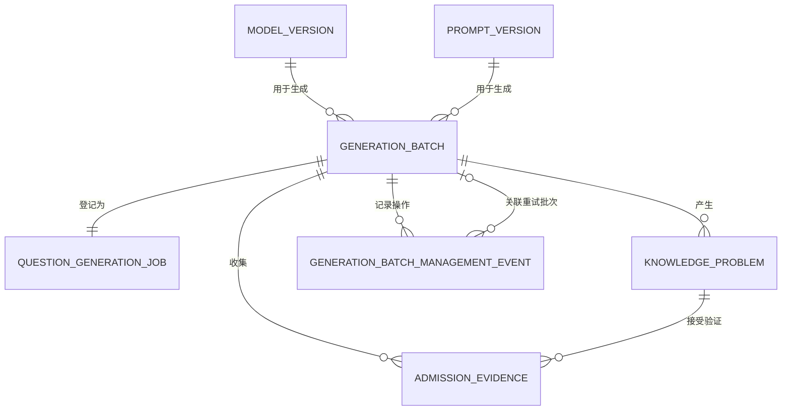

# 可信母题批量变式生成数据模型

## 1. 文档目的

本文档集中定义可信母题批量变式生成业务使用的数据对象、MySQL 持久化结构、对象关系和数据约束。

执行顺序、状态如何迁移以及管理员如何操作批次不在本文档重复定义，分别参见：

- [业务总览](./README.md)；
- [QuestionGenerationJob 合约](./QUESTION_GENERATION_JOB.md)；
- [生成批次管理](./GENERATION_BATCH_MANAGEMENT.md)；
- [HTTP API](./API.md)。

本文中的对象分为三层：

| 层次 | 用途 | 主要实现位置 |
| --- | --- | --- |
| 接口 DTO | 接收生成请求、返回逐题结果 | `app/domain/question_generation.py` |
| 领域对象 | 表达预算、用量、候选草稿和任务状态 | `app/domain/question_generation.py`、`app/domain/generation.py` |
| 持久化对象 | 保存批次、Job、候选题、证据和管理事件 | `app/models/generation.py`、`app/models/knowledge.py` |

## 2. 对象关系



核心关系如下：

- 一个生成批次只有一个 `QuestionGenerationJob`，两者是一对一关系；
- 一个批次可以生成多道 `KnowledgeProblem`；
- 每道候选题可以产生多条 `AdmissionEvidence`；
- 暂停、恢复、取消、重试和撤回操作形成只追加的管理事件；
- 模型版本和提示版本通过外键固定到批次，保证结果可以追溯。

## 3. 生成请求对象

### 3.1 `QuestionGenerationJobInput`

该对象是创建生成任务时的完整语义输入。

| 字段 | 类型 | 约束或含义 |
| --- | --- | --- |
| `schema_version` | string | 当前为 `1.0` |
| `idempotency_scope` | string | 1–100 字符；调用方定义的稳定作用域 |
| `idempotency_key` | string | 8–128 字符；禁止首尾空白和控制字符；不以明文入库 |
| `mother_problem_ids` | string[] | 1–100 个去重的可信母题 ID |
| `requested_count` | integer | 1–1000，且不得超过 `budget.max_candidates` |
| `subject` | literal | MVP 固定为 `math` |
| `grade_band` | literal | MVP 固定为 `university` |
| `topic_code` | string | 主题知识点编码，必须包含在 `knowledge_point_codes` 中 |
| `problem_type` | string | 目标题型 |
| `knowledge_point_codes` | string[] | 必须覆盖的知识点编码，不允许重复 |
| `capability_point_codes` | string[] | 可选能力点编码，不允许重复 |
| `allowed_derivation_types` | enum[] | 允许使用的变式类型，不允许重复 |
| `difficulty` | object | 目标难度区间，见 `DifficultyRange` |
| `language` | string | 内容语言，默认 `zh-CN` |
| `model_version_id` | string | 已登记且启用的模型版本 ID |
| `prompt_version_id` | string | 已登记且启用的提示版本 ID |
| `verifier_profile` | string | 后续验证流水线配置名 |
| `auto_validate` | boolean | 大学高数验证配置完成前必须为 `false` |
| `output_schema_version` | string | 输出结构版本，默认 `1.0` |
| `random_seed` | integer/null | 可选随机种子，范围为 0 至 2³¹−1 |
| `constraints` | object | 生成约束，见 `QuestionGenerationConstraints` |
| `budget` | object | 本任务资源上限，见 `QuestionGenerationBudget` |

任务登记时还需验证：母题存在且为可信母题，状态为 `approved` 或 `indexed`；学科、学段、题型和知识点与请求兼容；模型版本和提示版本处于启用状态；提示版本用途为 `question_generation`，且输出结构版本相符。

### 3.2 `DifficultyRange`

| 字段 | 类型 | 约束 |
| --- | --- | --- |
| `minimum` | integer | 1–5，默认 1 |
| `maximum` | integer | 1–5，默认 3，且不得小于 `minimum` |

### 3.3 `QuestionGenerationConstraints`

| 字段 | 类型 | 默认值或含义 |
| --- | --- | --- |
| `domains` | string[] | `['reals']`，允许的定义域 |
| `preserve_answer_type` | boolean | `true`，保持答案类型 |
| `preserve_solution_count` | boolean | `false`，是否保持解的数量 |
| `require_unique_answer` | boolean | `false`，是否要求唯一答案 |
| `require_programmatic_verification` | boolean | `true`，是否要求程序化验证 |
| `allow_new_knowledge_points` | boolean | `false`，是否允许引入新知识点 |
| `prohibited_terms` | string[] | 禁止出现的词语 |
| `additional_instructions` | string/null | 最长 2000 字符的附加要求 |

## 4. 预算与用量对象

### 4.1 `QuestionGenerationBudget`

| 字段 | 含义 |
| --- | --- |
| `max_execution_attempts` | Job 从待执行或暂停状态进入运行态的累计次数上限 |
| `max_model_calls` | 生成、检查、独立解题、复核及修订使用的模型调用总上限 |
| `max_revision_rounds` | 每条候选版本链允许的修订轮次，范围 0–2 |
| `max_input_tokens` / `max_output_tokens` | 输入和输出 token 上限 |
| `max_total_tokens` | 输入与输出 token 总上限 |
| `max_cost_minor_units` / `currency` | 以货币最小单位表示的费用上限及三位货币代码 |
| `max_duration_seconds` | Job 墙钟时间上限 |
| `max_candidates` | 最多尝试的候选位置数 |

`max_input_tokens` 和 `max_output_tokens` 均不得超过 `max_total_tokens`。

### 4.2 `QuestionGenerationUsage`

| 字段 | 含义 |
| --- | --- |
| `model_calls` | 已发生的模型调用次数 |
| `revision_rounds` | 已使用的修订轮次 |
| `input_tokens` / `output_tokens` | 已使用的输入和输出 token |
| `total_tokens` | token 总数，必须等于输入与输出之和 |
| `cost_minor_units` | 已产生费用，使用预算对象中的币种 |
| `duration_ms` | 累计墙钟耗时，单位毫秒 |
| `candidates_attempted` | 已实际尝试的候选位置数，不含 `skipped` |

## 5. 候选草稿与输出对象

### 5.1 `GeneratedQuestionDraft`

候选草稿保存生成 Agent 的结构化结果，但不包含可信标准答案。

| 字段 | 含义 |
| --- | --- |
| `statement` / `normalized_statement` | 原始题干与可选规范化题干 |
| `explicit_conditions` | 显式条件 |
| `implicit_conditions` | 隐含条件 |
| `target` | 求解目标和预期答案类型 |
| `difficulty` / `difficulty_factors` | 难度等级及难度来源 |
| `answer_type` | 答案类型，必须与求解目标中的预期类型一致 |
| `knowledge_point_codes` | 去重的知识点编码 |
| `derivation_type` | 相对母题采用的变式类型 |
| `derivation_note` | 具体变化说明 |

### 5.2 `QuestionGenerationCandidateResult`

每个请求位置对应一条结果。

| 字段 | 含义 |
| --- | --- |
| `ordinal` | 从 0 开始的候选位置序号，同一输出内唯一 |
| `candidate_key` | 稳定候选键，同一输出内唯一 |
| `mother_problem_id` | 对应的母题 ID |
| `outcome` | `candidate_created`、`generation_failed` 或 `skipped` |
| `draft` | 成功时的候选草稿 |
| `problem_id` | 成功持久化后的题目 ID |
| `content_status` | 成功时只能从 `candidate` 开始 |
| `failure_code` / `failure_message` | 失败或跳过时的稳定错误码和摘要 |

当 `outcome=candidate_created` 时，`draft`、`problem_id` 和 `content_status` 必须存在，且不得携带失败码。失败或跳过时必须有失败码，也不得携带已持久化内容。

### 5.3 `QuestionGenerationJobOutput`

| 字段 | 含义 |
| --- | --- |
| `schema_version` | 当前为 `1.0` |
| `job_id` / `generation_batch_id` | Job 与批次 ID |
| `status` | 批次当前状态 |
| `stop_reason` | 终止原因；非终态为空 |
| `candidates` | 逐位置候选结果 |
| `usage` | 最终或当前资源用量 |
| `started_at` / `finished_at` | 开始和结束时间 |
| `errors` | 最多 100 条的有界错误摘要 |
| `validation` | 可选的自动验证批次结果 |

## 6. MySQL 持久化对象

### 6.1 `generation_batches`

该表保存批次范围、总体进度和执行状态。

| 字段组 | 字段 |
| --- | --- |
| 身份 | `id`、`batch_key`、`purpose` |
| 内容范围 | `subject`、`grade_band`、`topic_code`、`config_json` |
| 计数 | `requested_count`、`generated_count`、`approved_count`、`quarantined_count`、`failed_count` |
| 状态 | `status`、`started_at`、`finished_at` |
| 版本引用 | `model_version_id`、`prompt_version_id` |
| 系统时间 | `created_at`、`updated_at` |

`batch_key` 全局唯一。模型和提示版本必须同时为空或同时存在。计数满足：

```text
generated_count + failed_count <= requested_count
approved_count + quarantined_count <= generated_count
```

终态必须存在 `finished_at`；已经执行过的运行态、暂停态和各执行终态必须存在 `started_at`。

### 6.2 `question_generation_jobs`

该表与 `generation_batches` 一对一，保存可重放任务的规范输入和累计结果。

| 字段组 | 字段 |
| --- | --- |
| 关联 | `id`、`generation_batch_id` |
| 幂等 | `idempotency_scope`、`idempotency_key_hash`、`request_hash` |
| 结构版本 | `input_schema_version`、`output_schema_version` |
| 内容快照 | `input_json`、`budget_json`、`usage_json`、`output_json` |
| 执行状态 | `attempt_count`、`status_reason`、`last_error_code` |
| 系统时间 | `created_at`、`updated_at` |

`generation_batch_id` 和 `idempotency_key_hash` 分别具有唯一约束。`input_json` 不保存原始 `idempotency_key`，预算单独进入 `budget_json`。

### 6.3 `knowledge_problems`

成功生成的候选草稿转换为题目记录，并通过 `generation_batch_id` 关联批次。生成器写入时必须满足：

- 初始内容状态为 `candidate`；
- 保存显式条件、隐含条件、求解目标、难度来源和知识点；
- 保存母题关系及变式类型；
- 不把生成模型给出的答案作为可信标准答案。

题目表的完整定义见题库模块的数据对象文档；本文只定义它与批量变式生成的关系。

### 6.4 `admission_evidence`

该表保存生成、检查、工具验证和复核留下的准入证据。

| 字段组 | 字段 |
| --- | --- |
| 关联 | `generation_batch_id`、`problem_id`、可选 `solution_id` |
| 证据身份 | `evidence_type`、`evidence_hash` |
| 生产者 | `producer_type`、可选模型、提示或验证器版本 ID |
| 结论 | `status`、`is_blocking`、`summary` |
| 详情与时间 | `payload_json`、`created_at` |

同一批次、题目、证据类型和证据哈希不得重复。`producer_type` 决定必须关联哪类版本：模型证据关联模型与提示版本，验证器证据关联验证器版本，混合证据同时关联三者，系统证据不关联这些版本。

### 6.5 `generation_batch_management_events`

该表只追加记录批次管理操作，不用于覆盖批次当前状态。

| 字段 | 含义 |
| --- | --- |
| `generation_batch_id` | 被操作批次 |
| `related_batch_id` | 重试等操作关联的新旧批次，可为空 |
| `action` | `pause`、`resume`、`cancel`、`retry_created`、`retried_from` 或 `withdraw_approved` |
| `previous_status` / `current_status` | 操作前后状态 |
| `reason` | 必填操作原因 |
| `actor_type` / `actor_id` | `admin` 或 `system` 及可选操作者 ID |
| `payload_json` | 操作的结构化补充信息 |
| `created_at` | 操作发生时间 |

题目撤回还必须写入逐题状态迁移记录，使一次批次操作可以追踪到每道题的变化。

## 7. 幂等身份

系统计算并持久化两个 SHA-256 哈希：

1. `idempotency_key_hash`：对规范化后的 `{scope, key}` 计算；
2. `request_hash`：对排除 `idempotency_scope` 和原始 `idempotency_key` 后的完整语义请求计算。

派生键定义如下：

```text
batch_key = "qgen-" + idempotency_key_hash
candidate_key = "qgc-" + sha256(idempotency_key_hash + ":" + ordinal)
```

原始幂等键只存在于请求内，不写入数据库。MySQL 中的哈希记录是审计和最终幂等依据；Redis 只能用于快速查询或分布式锁。

## 8. 跨对象不变量

- `requested_count <= budget.max_candidates`；
- 开启自动验证时，预算必须为每个候选预留生成、条件检查、独立解题和独立复核所需的模型调用；
- 输出中的 `ordinal` 和 `candidate_key` 各自唯一；
- `usage.candidates_attempted` 等于输出中非 `skipped` 的位置数；
- 模型重试会增加模型调用、token、费用和耗时，不会增加候选位置数；
- 生成成功只表示候选题已落库，不代表题目已经 `approved` 或 `indexed`；
- `approved_count` 和 `quarantined_count` 来自后续准入流程，不由生成 Agent 自行决定。

## 9. 代码与迁移映射

| 内容 | 位置 |
| --- | --- |
| 请求、预算、用量、草稿和输出领域对象 | `app/domain/question_generation.py` |
| 批次领域对象和状态 | `app/domain/generation.py` |
| 管理事件与管理端 DTO | `app/domain/generation_admin.py` |
| 批次、Job、版本和证据 ORM | `app/models/generation.py` |
| 候选题 ORM | `app/models/knowledge.py` |
| 当前 MySQL 结构基线 | `migrations/versions/20261031_0035_current_schema_baseline.py` |

## 相关代码

- [生成请求与预算 DTO](../../../../app/domain/question_generation.py)
- [生成批次领域对象](../../../../app/domain/generation.py)
- [生成管理 DTO](../../../../app/domain/generation_admin.py)
- [生成数据库模型](../../../../app/models/generation.py)
- [候选题数据库模型](../../../../app/models/knowledge.py)
