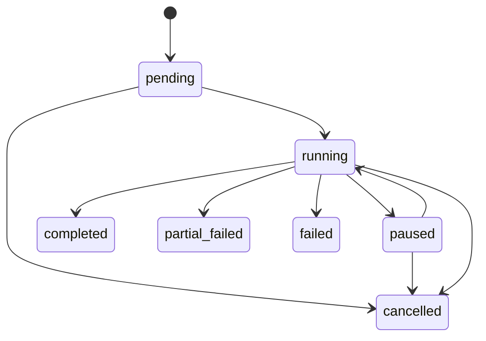

# QuestionGenerationJob 合约

## 1. 职责边界

`QuestionGenerationJob` 表示一次可重放、受预算约束的候选题生成请求。它不负责批准内容，也不能把模型生成的答案当作标准答案。

Job 涉及的输入、批次、输出和候选题对象分工见 [数据模型](./DATA_MODEL.md)。

生成草稿不包含可信标准答案。答案必须由后续隔离上下文的独立解题 Agent 产生，再由数学工具验证。

## 2. 输入

`QuestionGenerationJobInput` 的字段、类型、默认值和基础约束见 [数据模型](./DATA_MODEL.md#3-生成请求对象)。

首版变式类型直接复用 `ProblemDerivationType`。输入列表必须去重。模型版本和提示版本发布后不可原地修改，因此请求哈希可以稳定指向实际生成配置。

任务登记时，Repository 还会确认母题存在、标记为可信母题、状态为 `approved` 或 `indexed`，并且学科、学段和题型与请求一致。知识点和能力点必须存在；当前实现要求请求知识点来自所选母题，并且至少一条母题能够独立覆盖全部请求知识点。

提示版本的 `purpose` 必须是 `question_generation`，其 `output_schema_version` 必须与请求一致。

## 3. 输出

输出对象的完整字段和组合约束见 [数据模型](./DATA_MODEL.md#5-候选草稿与输出对象)。每个请求位置只会产生以下一种结果：

- `candidate_created`：包含结构化草稿和持久化 `problem_id`，题目状态必须为 `candidate`；
- `generation_failed`：包含稳定错误编码和可读摘要；
- `skipped`：因取消、预算或前置条件不满足而未尝试。

候选草稿不包含可直接进入题库的标准答案。同一请求重放时，候选位置身份保持一致。

## 4. 预算

预算和累计用量对象的字段定义见 [数据模型](./DATA_MODEL.md#4-预算与用量对象)。

执行器必须在每次模型调用、修订或候选生成前调用 `usage.can_reserve(...)`，使用该次操作的最大预计消耗做预留判断。操作完成后以 Provider 返回的真实 usage 更新累计值。无法取得 token 或费用信息时不能填零冒充真实值，后续执行器应停止或按明确配置使用保守估算。

达到预算后不再开始新操作：已有候选则批次进入 `partial_failed`，没有候选则进入 `failed`；停止原因使用 `budget_exhausted`。恰好在最后一个成功候选后达到上限，且请求已经完整完成时，可以正常进入 `completed`。

每次执行器成功取得 Job 并把批次从 `pending` 或 `paused` 切换到 `running` 时，原子增加 `attempt_count`。达到 `max_execution_attempts` 后不能再次恢复，应根据已有候选进入 `partial_failed` 或 `failed`。一次运行内部的模型重试仍计入 `max_model_calls`，不能借 Job 重启绕过 token、费用或调用预算。

## 5. 幂等规则

幂等哈希、批次键和候选键的数据定义见 [数据模型](./DATA_MODEL.md#7-幂等身份)。数据库只保存幂等键哈希，不保存原始 key。

- 同一幂等键哈希和相同请求哈希：返回原 Job 与批次，不重复生成；
- 同一幂等键哈希但请求哈希不同：抛出 `QuestionGenerationIdempotencyConflict`；
- 需要重新生成时：调用方必须提供新 key；
- MySQL 记录永久承担审计幂等，Redis 只能作为快速查询或分布式锁，不能成为唯一依据。

## 6. 批次状态机

| 状态 | 含义 | 终态 |
| --- | --- | --- |
| `pending` | 已登记，尚未占用执行资源 | 否 |
| `running` | 正在生成或持久化候选 | 否 |
| `paused` | 主动暂停，可从已保存 usage 和序号恢复 | 否 |
| `completed` | 所有请求位置成功产生候选 | 是 |
| `partial_failed` | 至少有一个候选成功，另有失败或跳过 | 是 |
| `failed` | 没有产生可持久化候选 | 是 |
| `cancelled` | 收到取消请求，不再开始新操作 | 是 |

终态必须写入 `finished_at` 和停止原因。终态不可恢复；重试使用新幂等键和新批次。暂停不会释放审计记录，恢复时继续累计原 usage。

管理员暂停、恢复、取消、失败位置重试和批准内容撤回的接口及事务规则见 [生成批次管理](./GENERATION_BATCH_MANAGEMENT.md)。

## 7. 数量语义

计数字段、数据库约束和跨对象不变量见 [数据模型](./DATA_MODEL.md#8-跨对象不变量)。运行中的批次允许尚未覆盖全部请求位置。

## 8. 持久化

`question_generation_jobs`、`generation_batches`、候选题、准入证据和管理事件的字段及关系见 [数据模型](./DATA_MODEL.md#6-mysql-持久化对象)。

`QuestionGenerationJobRepository.register()` 必须在调用方事务内使用。它先执行幂等检查，再确认模型和提示版本处于启用状态，最后原子创建批次与 Job。

变式生成 Agent、可信母题的二次校验、禁止答案字段和候选持久化边界见 `docs/agent/变式生成Agent/QUESTION_VARIATION_AGENT.md`。

## 9. 批量执行器

`QuestionGenerationService` 已实现批量执行：可信母题按候选序号轮询分配，每个候选成功后立即保存进度，暂停后从未完成序号继续，取消或预算耗尽时为剩余位置写入 `skipped`。HTTP、CLI、调用示例和完整记录范围见 [可信母题批量变式生成](./README.md)。

## 相关代码

- [QuestionGenerationJob 合约](../../../../app/domain/question_generation.py)
- [QuestionGenerationJob Repository](../../../../app/repositories/question_generation.py)
- [题目生成服务](../../../../app/services/question_generation.py)
- [当前 MySQL 结构基线](../../../../migrations/versions/20261031_0035_current_schema_baseline.py)
